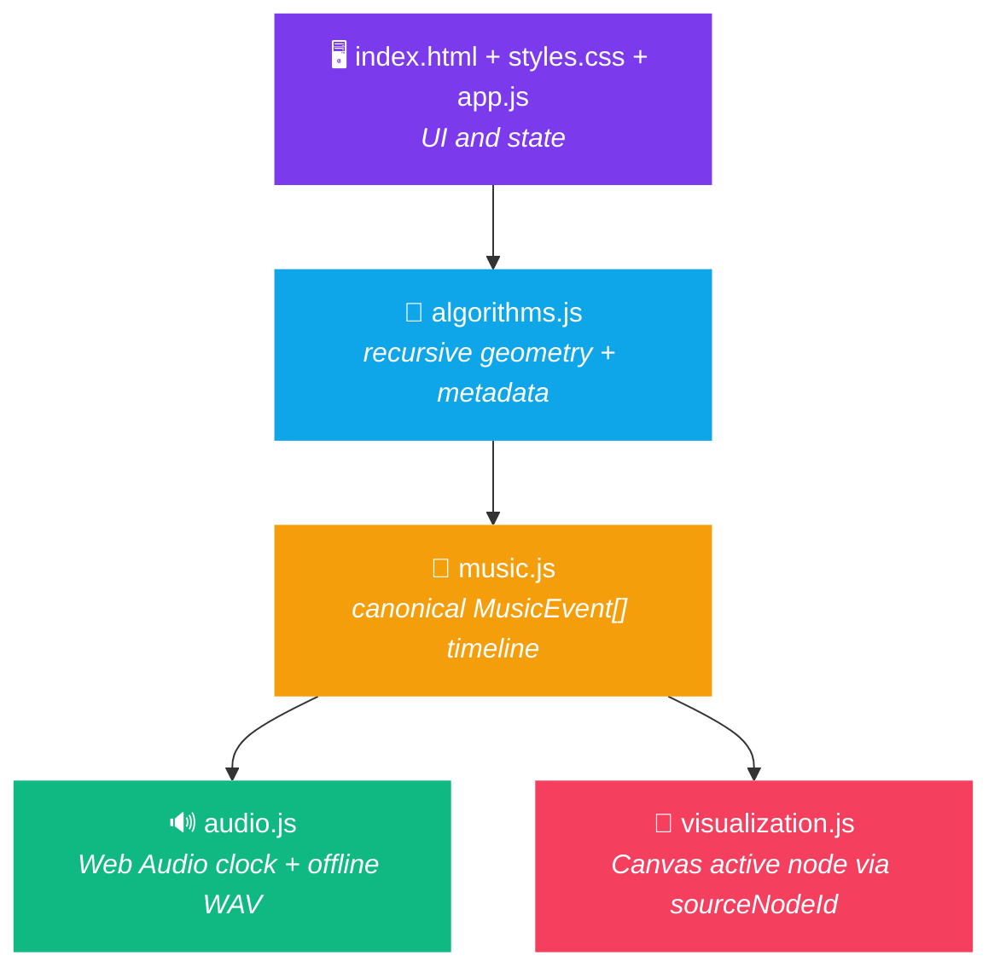

<div align="center">



<br/>


### 🌀 Fibonacci &nbsp;•&nbsp; 🔺 Sierpinski &nbsp;•&nbsp; 🌳 Recursive Tree

*Three recursive algorithms generate the **actual musical events** you hear.<br/>
The same event timeline drives the glowing node animation and the WAV export.*

[🚀 Quick Start](#-quick-start) · [✨ Features](#-features) · [🧠 How It Works](#-how-the-music-is-born) · [🏗️ Architecture](#️-architecture) · [☁️ Deploy](#️-deploy-to-vercel) · [♿ Accessibility](#-keyboard--accessibility)

</div>

---

<!-- 📸 Add a screenshot or GIF of the running app here:
<p align="center"></p>
-->

## 🚀 Quick Start

> **No account · No server · No database · No API key · No build step**

| Step | Action |
|:---:|---|
| **1** 📦 | Unzip the project |
| **2** 🌐 | Open **`index.html`** in a current Chrome, Edge, Firefox, or Safari |
| **3** 🎛️ | Choose Fibonacci, Sierpinski, or Recursive Tree; move the sliders; pick a mood |
| **4** ▶️ | Press **Play** *(the first click authorizes sound in your browser)* |
| **5** 💾 | Press **Export WAV** to download your original audio file |

Prefer a local server?

```bash
python -m http.server 8000
# visit http://localhost:8000
```

---

## ✨ Features

<table>
<tr>
<td width="50%" valign="top">

### 🎼 Sound
- 🌀🔺🌳 Fibonacci, Sierpinski triangle, recursive tree
- 🎭 **4 moods** and **4 synthesizer voices**
- 🎹 **5 tonal scales**
- 🔊 Master volume, stereo panning, reverb and delay
- 💿 Offline-rendered **stereo 16-bit PCM WAV**

</td>
<td width="50%" valign="top">

### 🎨 Visuals & Control
- ✨ Real-time synchronized active-node highlighting
- ▶️ ⏸️ ⏹️ Play, pause, stop, loop, seek, regenerate
- 🌿 Tree angle and branch-length controls
- 📱 Responsive layouts and keyboard input
- 🕊️ Reduced-motion switch

</td>
</tr>
</table>

### 🎚️ Bounded Controls

| Control | Range |
|---|:---:|
| 🔁 Recursion depth | `1 – 8` |
| ⏱️ Tempo | `40 – 160 BPM` |
| 🌫️ Density | `1 – 10` |

<details>
<summary><b>📋 Full feature status</b></summary>

<br/>

| Feature | Status |
|---|:---:|
| Fibonacci, Sierpinski triangle, recursive tree | ✅ |
| Recursion depth 1–8, tempo 40–160 BPM, density 1–10 | ✅ |
| Algorithm-specific tree angle and branch-length controls | ✅ |
| Shared algorithm → music timeline → visualization | ✅ |
| Four distinct moods and four synthesizer voices | ✅ |
| Five tonal scales | ✅ |
| Play, pause, stop, loop, seek, regenerate | ✅ |
| Real-time synchronized active-node highlighting | ✅ |
| Master volume and reduced motion | ✅ |
| Offline rendered, stereo 16-bit PCM WAV with reverb/delay | ✅ |
| Responsive layouts and keyboard input | ✅ |
| Client-only design, no user data collected | ✅ |

</details>

---

## 🧠 How the Music Is Born

Every note is quantized to your chosen scale. Pad and bass voices come from the **same nodes** as the melody, never an unrelated backing track.

| Algorithm | 🎵 Pitch | ⏳ Timing | 🎧 Pan |
|---|---|---|---|
| 🌀 **Fibonacci** | Actual Fibonacci values drive scale degrees | Sequence index sets timing and phrase length | n/a |
| 🔺 **Sierpinski** | Subdivision path, triangle position and depth set pitch and register | Traversal order | Horizontal position |
| 🌳 **Recursive Tree** | Branch depth, position and height set pitch and register | Traversal order | Left / right branch |

> 💡 Fibonacci uses a memoized/linear process, avoiding exponential recursion.
> 🌿 In the tree, higher density produces three-way branching.

---

## 🏗️ Architecture



> Each **MusicEvent** carries: `id` · `time` · `pitch` · `duration` · `velocity` · `depth` · `pan` · `sourceNodeId`

### 🧰 Technology

| | Tech | Role |
|:---:|---|---|
| 🧱 | **Plain HTML + CSS + modular JS** | No dependency installation; open the app directly |
| 🖼️ | **Canvas 2D** | Smooth HiDPI recursive visuals with cached static geometry |
| 🎧 | **Web Audio API** | Sample-accurate scheduling, synthesis, panning, effects, compression |
| 💽 | **OfflineAudioContext** | Exports the same composition, synthesis and effects to WAV |

<sub>The SRS lists React/TypeScript/Vite/Tailwind as *recommended*, not mandatory. This dependency-free build prioritizes zero-setup hackathon demos while keeping the algorithm, music, audio, visualization and UI layers modular.</sub>

### 📁 Project Structure

```text
recursive-soundscapes/
├── index.html
├── public/
│   ├── favicon.svg
│   ├── banner.svg
│   └── footer.svg
├── src/
│   ├── algorithms.js
│   ├── music.js
│   ├── audio.js
│   ├── visualization.js
│   ├── app.js
│   └── styles.css
├── docs/
│   ├── SRS.md
│   ├── AI_PROMPT_LOG.md
│   └── TESTING.md
└── README.md
```

---

## ☁️ Deploy to Vercel

A static site with **no build command and no dependencies**. The root-level `vercel.json` selects Vercel's **Other** preset and publishes the project root (`index.html`, `src/`, `public/`).

1. 📤 Push the project to a Git provider supported by Vercel
2. ➕ In Vercel, choose **Add New → Project** and import the repository
3. 📁 Keep the project root as the **Root Directory**; the checked-in `vercel.json` supplies the settings
4. 🚀 Deploy. No environment variables are required

> 🔒 The app runs entirely in the visitor's browser. Audio playback still needs a user gesture, and WAV export is rendered locally.

---

## ♿ Keyboard & Accessibility

- ⌨️ All controls are buttons, selects, or labelled range sliders
- ␣ Press **Space** (outside form fields) to toggle playback
- 🕊️ The **reduced-motion** switch suppresses visual pulsing
- 🔇 The interface **never autoplays**

---

## ⚠️ Known Limitations

| | Limitation |
|:---:|---|
| 👆 | Browser audio needs a click/tap to satisfy autoplay policies |
| 🧠 | Offline WAV export uses memory proportional to duration (lengths are bounded) |
| 📱 | Mobile backgrounding may suspend Web Audio; return to the page and press Play |
| ☁️ | No cloud saving and no multitrack editing |
| 🌐 | Canvas animations may differ across browsers; use modern versions |

---

## 🏆 Hackathon Evidence

The SRS asks for the **real AI prompt chain and actual agent responses**.

- 🤖 `docs/AI_PROMPT_LOG.md` records the prompt available for this delivered code and clearly marks absent conversations
- ⚠️ It is **not** a substitute for exporting your original Codex/ChatGPT messages. **Add them before submission**
- 🧪 `docs/TESTING.md` lists checks and results
- 📘 `docs/SRS.md` holds the supplied specification

---

## 📜 License

Project source created for the user. The original procedural music is synthesized in the browser and uses **no copyrighted sound samples**.

<br/>

<div align="center">


</div>
