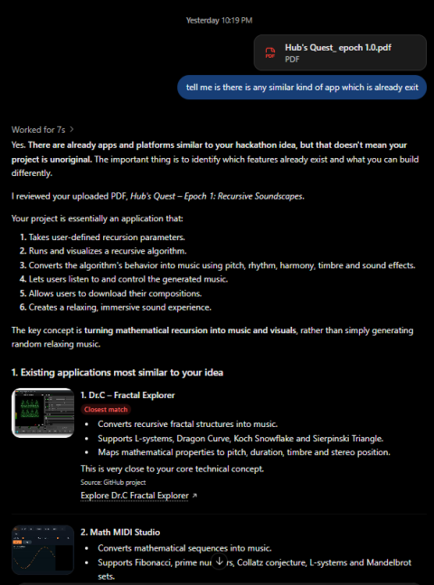
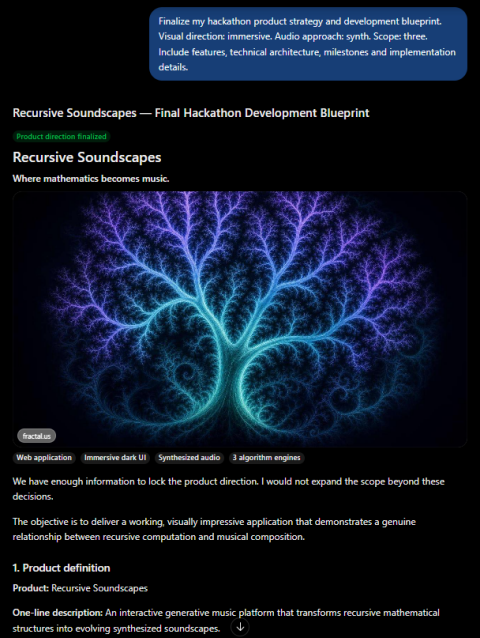
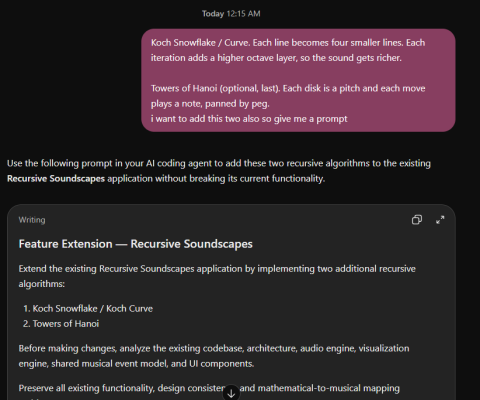

# Recursive Soundscapes — ChatGPT Conversation Log
 
Hub's Quest – Epoch 1: Recursive Soundscapes (hackathon project)
 
*Left column: the AI's responses (ChatGPT, then GitHub Copilot in Turns 7–8, then Codex in Turns 9–11). Right column: your questions and messages, with the original screenshot of each exchange attached as evidence where one was provided. Image caption/source labels from the original chat view are omitted from the transcript text.*
 
# Turn 1 — Searching for similar existing apps
 
<table>
<colgroup>
<col style="width: 64%" />
<col style="width: 35%" />
</colgroup>
<thead>
<tr class="header">
<th><strong>ChatGPT</strong></th>
<th><strong>You</strong></th>
</tr>
</thead>
<tbody>
<tr class="odd">
<td>
Yes. There are already apps and platforms similar to your hackathon idea, but that doesn't mean your project is unoriginal. The important thing is to identify which features already exist and what you can build differently.

I reviewed your uploaded PDF, Hub's Quest – Epoch 1: Recursive Soundscapes.

Your project is essentially an application that:

<blockquote>

1. Takes user-defined recursion parameters.

2. Runs and visualizes a recursive algorithm.

3. Converts the algorithm's behavior into music using pitch, rhythm, harmony, timbre and sound effects.

4. Lets users listen to and control the generated music.

5. Allows users to download their compositions.

6. Creates a relaxing, immersive sound experience.

</blockquote>

The key concept is turning mathematical recursion into music and visuals, rather than simply generating random relaxing music.

<h2>1. Existing applications most similar to your idea</h2>
<h3>1. Dr.C – Fractal Explorer (Closest match)</h3>
<ul>
<li>
Converts recursive fractal structures into music.
</li>
<li>
Supports L-systems, Dragon Curve, Koch Snowflake and Sierpinski Triangle.
</li>
<li>
Maps mathematical properties to pitch, duration, timbre and stereo position.
</li>
</ul>

This is very close to your core technical concept. Source: GitHub project.

<h3>2. Math MIDI Studio</h3>
<ul>
<li>
Converts mathematical sequences into music.
</li>
<li>
Supports Fibonacci, prime numbers, Collatz conjecture, L-systems and Mandelbrot sets.
</li>
<li>
Allows users to configure generators and map values to pitch, velocity and rhythm.
</li>
<li>
Exports MIDI files.
</li>
</ul>

This is also an extremely close competitor in terms of mathematical music generation.

<h3>3. SynScape</h3>
<ul>
<li>
Generates music from visual movement and musical rules.
</li>
<li>
Users control scales, rhythm, instruments and patterns.
</li>
<li>
Supports real-time music generation and recording.
</li>
</ul>

Similar in interactive visual music generation, but not specifically focused on recursive algorithms.

<h3>4. Wotja</h3>
<ul>
<li>
Generates ambient music algorithmically.
</li>
<li>
Creates evolving soundscapes and drones.
</li>
<li>
Supports experimentation, relaxation and musical creativity.
</li>
<li>
Available across multiple platforms.
</li>
</ul>

Similar in the relaxation and procedural music aspects.

<h3>5. Drift – Generative Ambient Music</h3>
<ul>
<li>
Generates ambient music in real time.
</li>
<li>
Uses procedural audio synthesis.
</li>
<li>
Combines music with animated particle visuals.
</li>
<li>
Creates evolving soundscapes.
</li>
</ul>

Similar in the audio-visual relaxation experience, but not specifically recursion-driven.

<h2>2. How similar are these to your project?</h2>

Here is my assessment based on their published feature descriptions.

<table>
<colgroup>
<col style="width: 33%" />
<col style="width: 33%" />
<col style="width: 33%" />
</colgroup>
<thead>
<tr class="header">
<th><strong>Feature</strong></th>
<th><strong>Existing apps</strong></th>
<th><strong>Your proposed app</strong></th>
</tr>
<tr class="odd">
<th>Mathematical algorithms to music</th>
<th>Yes</th>
<th>Yes</th>
</tr>
<tr class="header">
<th>Recursive algorithms</th>
<th>Yes, some</th>
<th>Yes</th>
</tr>
<tr class="odd">
<th>Interactive visualization</th>
<th>Yes, some</th>
<th>Yes</th>
</tr>
<tr class="header">
<th>Configurable recursion parameters</th>
<th>Yes, some</th>
<th>Yes</th>
</tr>
<tr class="odd">
<th>Relaxation-focused experience</th>
<th>Yes, some</th>
<th>Yes</th>
</tr>
<tr class="header">
<th>Real-time audio generation</th>
<th>Yes</th>
<th>Required</th>
</tr>
<tr class="odd">
<th>Audio download/export</th>
<th>Yes, some</th>
<th>Required</th>
</tr>
<tr class="header">
<th>All features in one focused experience</th>
<th>Not established</th>
<th>Your goal</th>
</tr>
</thead>
<tbody>
</tbody>
</table>

Important: Dr.C and Math MIDI Studio already cover substantial parts of your central idea. You cannot honestly claim that converting recursion or mathematical functions into music is completely new.

<h2>3. How can you make your project different?</h2>

I would focus on these five differentiating features:

<h3>1. Live recursion visualization</h3>

Show every recursive call as an animated tree or fractal. Let users watch the algorithm develop while listening.

<h3>2. Every recursion depth creates a musical layer</h3>

Map different recursion depths to different instruments, pitches and ambient textures.

<h3>3. Mood-based sound generation</h3>

Let users choose Calm, Dreamy, Deep Focus or Meditation. The same algorithm should produce different musical experiences.

<h3>4. Multiple recursion engines</h3>

Offer Fibonacci recursion, recursive trees, Sierpinski triangles and the Tower of Hanoi as different sound-generation engines.

<h3>5. Save and share generated soundscapes</h3>

Let users export MP3/WAV, save presets and share their generated compositions.

<h2>4. My honest verdict</h2>

Worth building. Your idea has potential, but its novelty is not in the basic concept. It needs to come from the execution, interaction and user experience.

My recommendation:

<ul>
<li>
Study Dr.C first because it is the closest technical reference.
</li>
<li>
Study Math MIDI Studio to understand mathematical-to-musical mapping.
</li>
<li>
Study Wotja for the ambient music experience.
</li>
<li>
Build a more accessible, visually immersive application that combines these concepts.
</li>
</ul>

One important distinction: your hackathon evaluation gives 35% to relaxation and user experience, 25% to musical quality, and only 15% to creative use of recursion. So don't spend all your time building complicated algorithms while neglecting the actual sound and experience.

<h2>5. One question that will determine your direction</h2>

What is your main goal with this project?

<ul>
<li>
Win the hackathon with a strong project
</li>
<li>
Build something that could become a real startup
</li>
<li>
Build an impressive portfolio project
</li>
<li>
Create something genuinely innovative and technically different
</li>
</ul>

What platform are you planning to build?

<ul>
<li>
Web application
</li>
<li>
Mobile application
</li>
<li>
Desktop application
</li>
</ul>

I can then help you identify a concrete feature set that separates your application from the closest existing competitors.
</td>
<td>
Yesterday, 10:19 PM (as shown in screenshot)

📎 Attachment: Hub's Quest_ epoch 1.0.pdf

<strong>tell me is there is any similar kind of app which is already exist</strong>

<strong>Screenshot evidence — Turn 1</strong>
</td>
</tr>
</tbody>
</table>
# Turn 2 — Competitor analysis and product strategy
 
<table>
<colgroup>
<col style="width: 64%" />
<col style="width: 35%" />
</colgroup>
<thead>
<tr class="header">
<th><strong>ChatGPT</strong></th>
<th><strong>You</strong></th>
</tr>
</thead>
<tbody>
<tr class="odd">
<td><h2>Competitive analysis and product strategy: Recursive Soundscapes</h2>

Recommended direction: Build a focused web experience

My recommendation is to build Recursive Soundscapes as an interactive mathematical music playground, not as another AI music generator or generic meditation application.

There is a real competitive threat: I found an existing browser application that already performs much of your proposed core functionality.

That changes the strategy. You should not compete by adding more algorithms. You should compete through a better experience, stronger educational interaction, and better musical results.

<h2>1. Competitor analysis</h2>

I checked the available project descriptions and official product information. These are the competitors I would actually study.

<h3>A. Dr.C – Fractal Explorer (Direct competitor)</h3>

Browser application · GitHub

<ul>
<li>
Five fractal types.
</li>
<li>
Nine synthesis engines.
</li>
<li>
Live fractal visualization.
</li>
<li>
Maps fractal properties to pitch, duration, timbre and spatial audio.
</li>
<li>
Includes 57 presets.
</li>
</ul>

Threat: Very high. It already implements almost exactly the technical direction described in your challenge.

<h3>B. Math MIDI Studio</h3>

Desktop application · GitHub

<ul>
<li>
Fibonacci, prime numbers, Collatz and L-systems.
</li>
<li>
Multiple mathematical generators.
</li>
<li>
Configurable musical mappings.
</li>
<li>
Piano-roll preview.
</li>
<li>
MIDI export.
</li>
</ul>

Threat: High for mathematical-to-musical conversion, but its desktop workflow leaves room for a more accessible browser experience.

<h3>C. Wotja</h3>

Generative music platform

<ul>
<li>
Procedural ambient music.
</li>
<li>
Customizable music engines.
</li>
<li>
Generative templates and sound presets.
</li>
<li>
Sharing and music creation tools.
</li>
<li>
Relaxation and sleep-oriented use cases.
</li>
</ul>

Threat: High for the soundscape and relaxation experience, but not specifically a recursion-visualization product.

<h3>D. Molecular Music Generator</h3>

Browser-based algorithmic composition

<ul>
<li>
Generates musical patterns through mathematical rules.
</li>
<li>
Allows users to configure composition variables.
</li>
<li>
Produces MIDI compositions.
</li>
</ul>

Threat: Medium. It demonstrates that browser-based algorithmic composition is already established.

<h3>E. MusicFractal</h3>

Browser-based audio visualizer

<ul>
<li>
Converts existing audio into animated fractal visuals.
</li>
<li>
Uses WebGL and Web Audio.
</li>
<li>
Runs locally in the browser.
</li>
</ul>

Threat: Medium for the audiovisual presentation, but its direction is the reverse of yours: it visualizes music rather than generating music from recursion.

<h3>Competitive positioning</h3>
<table>
<colgroup>
<col style="width: 20%" />
<col style="width: 20%" />
<col style="width: 20%" />
<col style="width: 20%" />
<col style="width: 20%" />
</colgroup>
<thead>
<tr class="header">
<th><strong>Product</strong></th>
<th><strong>Math to music</strong></th>
<th><strong>Recursion</strong></th>
<th><strong>Browser</strong></th>
<th><strong>Relaxation</strong></th>
</tr>
<tr class="odd">
<th>Dr.C</th>
<th>Yes</th>
<th>Yes</th>
<th>Yes</th>
<th>Some</th>
</tr>
<tr class="header">
<th>Math MIDI Studio</th>
<th>Yes</th>
<th>Yes, some</th>
<th>No</th>
<th>Not its focus</th>
</tr>
<tr class="odd">
<th>Wotja</th>
<th>Yes, generative</th>
<th>Not its focus</th>
<th>No</th>
<th>Yes</th>
</tr>
<tr class="header">
<th>Molecular Music Generator</th>
<th>Yes</th>
<th>Not its focus</th>
<th>Yes</th>
<th>Not its focus</th>
</tr>
<tr class="odd">
<th>MusicFractal</th>
<th>No, reverse direction</th>
<th>Visuals</th>
<th>Yes</th>
<th>Some</th>
</tr>
<tr class="header">
<th>Your proposed app</th>
<th>Yes</th>
<th>Yes</th>
<th>Yes</th>
<th>Yes</th>
</tr>
</thead>
<tbody>
</tbody>
</table>

This is a qualitative comparison based on documented features, not a benchmark of actual musical quality.

The important discovery: Dr.C is your closest competitor. You should inspect its actual application before finalizing your interface and feature list.

<h2>2. Your differentiation strategy</h2>

I recommend positioning the product around this idea: RECURSIVE Soundscapes — Where mathematics becomes music.

Core product promise: Choose a mathematical process. Watch it grow. Hear its structure become music. Create your own soundscape.

I would build around four differentiating pillars.

<h3>Pillar 1: Make recursion understandable</h3>

Most people don't understand recursion. Instead of simply displaying a fractal, explain what's happening. For example, when someone selects Fibonacci:

<ul>
<li>
Show the recursive call tree.
</li>
<li>
Highlight each function call.
</li>
<li>
Show the current recursion depth.
</li>
<li>
Display the generated Fibonacci sequence.
</li>
<li>
Explain how the current calculation contributes to the music.
</li>
</ul>

This creates an educational experience, not just a music generator.

<h3>Pillar 2: Recursion should control the music</h3>

This is where I would invest most of your engineering effort. Create a mapping system:

<table>
<colgroup>
<col style="width: 50%" />
<col style="width: 50%" />
</colgroup>
<thead>
<tr class="header">
<th><strong>Recursive property</strong></th>
<th><strong>Musical output</strong></th>
</tr>
<tr class="odd">
<th>Recursion depth</th>
<th>Instrument layer</th>
</tr>
<tr class="header">
<th>Returned value</th>
<th>Pitch</th>
</tr>
<tr class="odd">
<th>Number of recursive calls</th>
<th>Rhythm</th>
</tr>
<tr class="header">
<th>Branching factor</th>
<th>Musical density</th>
</tr>
<tr class="odd">
<th>Execution time</th>
<th>Note duration</th>
</tr>
<tr class="header">
<th>Tree structure</th>
<th>Harmony</th>
</tr>
</thead>
<tbody>
</tbody>
</table>

For example:

<ul>
<li>
Depth 1: Soft piano.
</li>
<li>
Depth 2: Ambient bells.
</li>
<li>
Depth 3: Warm strings.
</li>
<li>
Depth 4: Atmospheric pads.
</li>
</ul>

The user should hear the mathematical structure developing rather than hearing an unrelated random melody.

<h3>Pillar 3: Let users control the emotional experience</h3>

Offer four sound profiles:

<table>
<colgroup>
<col style="width: 50%" />
<col style="width: 50%" />
</colgroup>
<thead>
<tr class="header">
<th><strong>Mode</strong></th>
<th><strong>Musical characteristics</strong></th>
</tr>
<tr class="odd">
<th>Calm</th>
<th>Slow piano, soft pads</th>
</tr>
<tr class="header">
<th>Dreamy</th>
<th>Bells, reverb, airy textures</th>
</tr>
<tr class="odd">
<th>Deep Focus</th>
<th>Minimal repetitive ambient patterns</th>
</tr>
<tr class="header">
<th>Meditation</th>
<th>Long drones, gentle transitions</th>
</tr>
</thead>
<tbody>
</tbody>
</table>

The same recursive algorithm should produce noticeably different compositions depending on the selected mood.

<h3>Pillar 4: Make the experience interactive</h3>

Users should be able to:

<ul>
<li>
Change recursion depth while playing.
</li>
<li>
Change the musical scale.
</li>
<li>
Change the instrument.
</li>
<li>
Adjust tempo and sound density.
</li>
<li>
Pause and resume the visualization.
</li>
<li>
Regenerate the composition.
</li>
<li>
Save and download their soundscape.
</li>
</ul>

This gives users a reason to experiment.

<h2>3. What I would actually build for the hackathon</h2>

Do not try to implement 10 recursive algorithms and 20 instruments. That's a poor use of limited hackathon time. Build three polished algorithm engines.

<h3>1. Fibonacci recursion (Must build)</h3>
<ul>
<li>
Easy to understand.
</li>
<li>
Produces recognizable numerical sequences.
</li>
<li>
Great for melodic patterns and arpeggios.
</li>
</ul>
<h3>2. Sierpinski triangle (Must build)</h3>
<ul>
<li>
Visually impressive.
</li>
<li>
Naturally demonstrates recursive branching.
</li>
<li>
Great for layered ambient sounds and spatial audio.
</li>
</ul>
<h3>3. Recursive tree (Must build)</h3>
<ul>
<li>
Visually communicates recursion.
</li>
<li>
Depth and branching can control musical layers.
</li>
<li>
Excellent for interactive demonstrations.
</li>
</ul>
<h2>4. Proposed web application architecture</h2>

Here is the architecture I recommend.

<ul>
<li>
Frontend: React + TypeScript (application interface)
</li>
<li>
Tailwind CSS (visual design)
</li>
<li>
Canvas / Three.js (recursive visualization)
</li>
<li>
Tone.js (music synthesis and scheduling)
</li>
</ul>

Flow: Recursive Algorithm Engine (Fibonacci · Sierpinski · Recursive Tree) → Musical Mapping Engine (Pitch · Rhythm · Harmony · Timbre · Spatial audio) → Audio Output (real-time playback, WAV export)

Suggested architecture. A backend is not necessary for the initial demonstration.

Useful technologies:

<ul>
<li>
Tone.js – browser-based audio synthesis and scheduling.
</li>
<li>
Web Audio API – audio processing.
</li>
<li>
Three.js – 3D visualization.
</li>
<li>
React – frontend.
</li>
<li>
OfflineAudioContext – rendering audio for export.
</li>
</ul>

You can build the first version entirely client-side.

<h2>5. Recommended application interface</h2>

I would use five main screens or sections.

<ul>
<li>
Screen 1 – Landing page: a visually impressive introduction with a prominent Start Creating button.
</li>
<li>
Screen 2 – Algorithm selection: three algorithm cards with interactive previews.
</li>
<li>
Screen 3 – Recursion laboratory: controls on the left, recursion visualization in the center, and live algorithm information.
</li>
<li>
Screen 4 – Sound studio: mood selection, instrument selection, musical mapping and playback.
</li>
<li>
Screen 5 – My soundscapes: saved compositions, playback and downloads.
</li>
</ul>
<h2>6. Prioritize according to the judging criteria</h2>

Your PDF specifies the following evaluation weights (official evaluation weights from your hackathon brief): Relaxation / UX, Musical quality, Recursion creativity, Visual design, Interaction, Technical execution.

This should determine your development priorities.

<table>
<colgroup>
<col style="width: 50%" />
<col style="width: 50%" />
</colgroup>
<thead>
<tr class="header">
<th><strong>Priority</strong></th>
<th><strong>What to deliver</strong></th>
</tr>
<tr class="odd">
<th>1</th>
<th>Beautiful, genuinely relaxing music</th>
</tr>
<tr class="header">
<th>2</th>
<th>Smooth, understandable interactive experience</th>
</tr>
<tr class="odd">
<th>3</th>
<th>Clear connection between recursion and music</th>
</tr>
<tr class="header">
<th>4</th>
<th>Impressive visualization</th>
</tr>
<tr class="odd">
<th>5</th>
<th>Reliable controls and audio export</th>
</tr>
</thead>
<tbody>
</tbody>
</table>

One critical warning: don't assume that a beautiful fractal visualization will compensate for poor music. The judges explicitly assign 25% to musical quality.

<h2>7. A realistic hackathon development schedule</h2>

Assuming you have approximately 3 days:

<table>
<colgroup>
<col style="width: 50%" />
<col style="width: 50%" />
</colgroup>
<thead>
<tr class="header">
<th><strong>Time</strong></th>
<th><strong>Deliverable</strong></th>
</tr>
<tr class="odd">
<th>Day 1 – Morning</th>
<th>UI and application structure</th>
</tr>
<tr class="header">
<th>Day 1 – Afternoon</th>
<th>Fibonacci and recursive tree engines</th>
</tr>
<tr class="odd">
<th>Day 1 – Evening</th>
<th>Sierpinski visualization</th>
</tr>
<tr class="header">
<th>Day 2 – Morning</th>
<th>Musical mapping engine</th>
</tr>
<tr class="odd">
<th>Day 2 – Afternoon</th>
<th>Instruments, moods and sound design</th>
</tr>
<tr class="header">
<th>Day 2 – Evening</th>
<th>Real-time playback and controls</th>
</tr>
<tr class="odd">
<th>Day 3 – Morning</th>
<th>WAV export and saved presets</th>
</tr>
<tr class="header">
<th>Day 3 – Afternoon</th>
<th>Polish, testing and presentation</th>
</tr>
</thead>
<tbody>
</tbody>
</table>

Do not spend the final day adding new algorithms. Stabilize the application.

<h2>8. Your strongest hackathon differentiator</h2>

Signature feature: Hear the Recursion — live algorithm-to-music synchronization.

When a recursive function executes:

<blockquote>

1. A new branch appears in the visualization.

2. The corresponding musical note plays.

3. The branch glows according to its pitch.

4. The recursion depth controls the instrument layer.

5. The completed algorithm becomes a full composition.

</blockquote>

The user can see exactly why a particular sound was generated. This is a much stronger demonstration than pressing a button and hearing randomly generated ambient music.

<h2>9. Final recommendation</h2>

My proposed positioning:

<table>
<colgroup>
<col style="width: 50%" />
<col style="width: 50%" />
</colgroup>
<thead>
<tr class="header">
<th><strong>Element</strong></th>
<th><strong>Decision</strong></th>
</tr>
<tr class="odd">
<th>Product</th>
<th>Recursive Soundscapes</th>
</tr>
<tr class="header">
<th>Category</th>
<th>Interactive generative music</th>
</tr>
<tr class="odd">
<th>Main audience</th>
<th>Students, creative coders, music enthusiasts</th>
</tr>
<tr class="header">
<th>Platform</th>
<th>Web</th>
</tr>
<tr class="odd">
<th>Main differentiator</th>
<th>Synchronized recursion visualization and music</th>
</tr>
<tr class="header">
<th>Core algorithms</th>
<th>Fibonacci, Sierpinski, recursive tree</th>
</tr>
<tr class="odd">
<th>Main experience</th>
<th>Relaxing, interactive mathematical sound creation</th>
</tr>
</thead>
<tbody>
</tbody>
</table>

Don't claim you're the first to generate music from recursion. Dr.C makes that claim impossible to defend. Instead, demonstrate that you've created a more understandable, engaging and relaxation-focused experience.

<h2>10. Three decisions before development</h2>

I want to settle these before recommending a specific implementation plan.

1. Which visual direction do you prefer?

<ul>
<li>
Immersive futuristic dark interface (purple, blue, glowing fractals)
</li>
<li>
Minimal, elegant meditation-style interface
</li>
<li>
Educational scientific laboratory interface
</li>
</ul>

2. What kind of music should it generate?

<ul>
<li>
Entirely synthesized music (piano, bells, pads, ambient)
</li>
<li>
Real instrument samples and ambient sound effects
</li>
<li>
Combination of synthesized music and real sound samples
</li>
</ul>

3. How ambitious should the first version be?

<ul>
<li>
Three polished algorithms with excellent UX
</li>
<li>
Five algorithms with moderate customization
</li>
<li>
Advanced platform with many algorithms and extensive controls
</li>
</ul>

My vote: immersive futuristic interface, hybrid audio, and three polished algorithms. That's the best balance between ambition and actually finishing a working hackathon product.
</td>
<td>
<strong>My goal is: hackathon. My planned platform is: web. Analyze the existing competitors and recommend a differentiated product strategy.</strong>

<strong>Screenshot evidence — Turn 2</strong>
</td>
</tr>
</tbody>
</table>
# Turn 3 — Final product strategy and development blueprint
 
<table>
<colgroup>
<col style="width: 64%" />
<col style="width: 35%" />
</colgroup>
<thead>
<tr class="header">
<th><strong>ChatGPT</strong></th>
<th><strong>You</strong></th>
</tr>
</thead>
<tbody>
<tr class="odd">
<td><h2>Recursive Soundscapes — Final Hackathon Development Blueprint</h2>

Product direction finalized

Recursive Soundscapes — Where mathematics becomes music.

Tags: Web application · Immersive dark UI · Synthesized audio · 3 algorithm engines

We have enough information to lock the product direction. I would not expand the scope beyond these decisions.

The objective is to deliver a working, visually impressive application that demonstrates a genuine relationship between recursive computation and musical composition.

<h2>1. Product definition</h2>

Product: Recursive Soundscapes

One-line description: An interactive generative music platform that transforms recursive mathematical structures into evolving synthesized soundscapes.

Target users:

<ul>
<li>
People looking for relaxing ambient music.
</li>
<li>
Students learning recursion and mathematical patterns.
</li>
<li>
Creative coders and experimental music enthusiasts.
</li>
</ul>

The core user journey:

<blockquote>

1. Choose an algorithm — Fibonacci, Sierpinski triangle or recursive tree.

2. Configure recursion — select depth, tempo, musical scale and sound density.

3. Watch the mathematics unfold — see recursive branches, nodes and patterns animate in real time.

4. Listen to the generated composition — every meaningful recursive event contributes to the music.

5. Customize and export — change instruments, adjust the mood, and save the composition as WAV.

</blockquote>
<h2>2. Final feature scope</h2>

I recommend dividing features into three categories.

<h3>Must-have features</h3>
<table>
<colgroup>
<col style="width: 50%" />
<col style="width: 50%" />
</colgroup>
<thead>
<tr class="header">
<th><strong>Feature</strong></th>
<th><strong>Implementation</strong></th>
</tr>
<tr class="odd">
<th>Three recursion engines</th>
<th>Fibonacci, Sierpinski, recursive tree</th>
</tr>
<tr class="header">
<th>Live visualization</th>
<th>Canvas or Three.js</th>
</tr>
<tr class="odd">
<th>Musical mapping</th>
<th>Recursion properties to musical events</th>
</tr>
<tr class="header">
<th>Four moods</th>
<th>Calm, Dreamy, Focus, Meditation</th>
</tr>
<tr class="odd">
<th>Synthesized instruments</th>
<th>Piano-like, bells, pads, bass</th>
</tr>
<tr class="header">
<th>Playback controls</th>
<th>Play, pause, stop, regenerate</th>
</tr>
<tr class="odd">
<th>Parameter controls</th>
<th>Depth, tempo, density, scale</th>
</tr>
<tr class="header">
<th>WAV export</th>
<th>Browser audio rendering</th>
</tr>
</thead>
<tbody>
</tbody>
</table>
<h3>Differentiating features</h3>

These are the features that make the project memorable:

<ul>
<li>
Hear the Recursion: Animate the exact branch or calculation that triggers each musical event.
</li>
<li>
Depth-based instruments: Different recursion levels produce different musical layers.
</li>
<li>
Live parameter changes: Change the depth or mood and hear the composition evolve.
</li>
<li>
Visual-to-audio connection: Highlight the visual node corresponding to the currently playing note.
</li>
</ul>
<h3>Optional features</h3>

Only implement these if the core experience is stable:

<ul>
<li>
Save favorite compositions in browser storage.
</li>
<li>
Share compositions through downloadable configuration files.
</li>
<li>
Generate randomized presets.
</li>
<li>
Add a guided explanation of each algorithm.
</li>
</ul>

Do not build authentication, payments, a database or an AI chatbot. They do not improve your central demonstration enough to justify the time.

<h2>3. Three algorithm engines — technical design</h2>
<h3>Engine 1: Fibonacci (Priority 1)</h3>
<ul>
<li>
Generates a Fibonacci sequence.
</li>
<li>
Visualizes recursive function calls.
</li>
<li>
Converts sequence values into pitch.
</li>
<li>
Uses repeated patterns to create melodic arpeggios.
</li>
</ul>

Musical identity: Flowing, melodic, predictable.

<h3>Engine 2: Sierpinski Triangle (Priority 2)</h3>
<ul>
<li>
Recursively divides a triangle into smaller triangles.
</li>
<li>
Visualizes branching geometry.
</li>
<li>
Maps recursion depth to instrument layers.
</li>
<li>
Maps triangle positions to stereo panning.
</li>
</ul>

Musical identity: Layered, geometric, spatial.

<h3>Engine 3: Recursive Tree (Priority 3)</h3>
<ul>
<li>
Generates branching structures.
</li>
<li>
Visualizes parent and child relationships.
</li>
<li>
Maps branches to rhythmic events.
</li>
<li>
Uses branch depth to control musical layering.
</li>
</ul>

Musical identity: Organic, atmospheric, evolving.

<h3>The musical mapping engine</h3>

This is the most important technical component. Do not generate random notes and then display random fractals. That would make the mathematical connection superficial.

Use a consistent event representation:

type MusicEvent = {

time: number;

pitch: number;

duration: number;

velocity: number;

depth: number;

pan: number;

sourceNodeId: string;

};

Every algorithm produces these events through a shared mapping function.

<table>
<colgroup>
<col style="width: 50%" />
<col style="width: 50%" />
</colgroup>
<thead>
<tr class="header">
<th><strong>Mathematical input</strong></th>
<th><strong>Audio output</strong></th>
</tr>
<tr class="odd">
<th>Recursion depth</th>
<th>Octave / instrument layer</th>
</tr>
<tr class="header">
<th>Sequence value</th>
<th>Pitch</th>
</tr>
<tr class="odd">
<th>Child count</th>
<th>Rhythmic subdivision</th>
</tr>
<tr class="header">
<th>Node position</th>
<th>Stereo panning</th>
</tr>
<tr class="odd">
<th>Branch traversal</th>
<th>Note ordering</th>
</tr>
<tr class="header">
<th>Event frequency</th>
<th>Sound density</th>
</tr>
</thead>
<tbody>
</tbody>
</table>

For example:

<ul>
<li>
Shallow recursion produces soft, lower-register notes.
</li>
<li>
Deeper recursion introduces higher musical layers.
</li>
<li>
Branching creates rhythmic subdivisions.
</li>
<li>
Spatial positions influence stereo movement.
</li>
</ul>

Important implementation detail: Normalize mathematical values before mapping them to notes. Fibonacci values grow rapidly, so directly converting their raw values into MIDI pitches will produce unusable results.

<h2>4. Sound design specification</h2>

You selected synthesized music, which is a good choice for a hackathon because it avoids large audio libraries and licensing complications. Use synthesized instruments with four distinct sound profiles.

<table>
<colgroup>
<col style="width: 50%" />
<col style="width: 50%" />
</colgroup>
<thead>
<tr class="header">
<th><strong>Mood</strong></th>
<th><strong>Sound design</strong></th>
</tr>
<tr class="odd">
<th>Calm</th>
<th>Soft sine/triangle tones, gentle piano-like attacks</th>
</tr>
<tr class="header">
<th>Dreamy</th>
<th>Bell-like tones, long reverb, airy pads</th>
</tr>
<tr class="odd">
<th>Deep Focus</th>
<th>Repeating pulses, minimal bass and melody</th>
</tr>
<tr class="header">
<th>Meditation</th>
<th>Sustained drones, slow transitions, low-frequency layers</th>
</tr>
</thead>
<tbody>
</tbody>
</table>

Suggested synthesis components:

<ul>
<li>
Oscillators: sine, triangle and filtered sawtooth.
</li>
<li>
ADSR envelopes: attack, decay, sustain and release.
</li>
<li>
Low-pass filters: remove harsh high frequencies.
</li>
<li>
Reverb: create spatial depth.
</li>
<li>
Stereo panning: reflect recursive geometry.
</li>
<li>
Gentle compression: control sudden volume differences.
</li>
</ul>

Use a master gain limiter or compressor. Otherwise, a high recursion depth could create hundreds of overlapping notes and produce unpleasant audio clipping.

<h2>5. Technical architecture</h2>
<h3>Recommended technology stack</h3>
<ul>
<li>
React + TypeScript — application and component architecture (frontend)
</li>
<li>
Tailwind CSS — responsive styling and design system
</li>
<li>
Three.js or HTML Canvas — fractal and recursive visualizations
</li>
<li>
Tone.js + Web Audio API — synthesizers, audio scheduling and effects
</li>
<li>
Vite — development and production build
</li>
</ul>
<h3>Internal application architecture</h3>

src/

├── components/

│ ├── Header.tsx

│ ├── AlgorithmSelector.tsx

│ ├── ParameterControls.tsx

│ ├── Visualization.tsx

│ ├── AudioPlayer.tsx

│ └── SoundStudio.tsx

│

├── algorithms/

│ ├── fibonacci.ts

│ ├── sierpinski.ts

│ └── recursiveTree.ts

│

├── audio/

│ ├── synthesizer.ts

│ ├── musicMapper.ts

│ ├── scheduler.ts

│ ├── effects.ts

│ └── exportWav.ts

│

├── visualization/

│ ├── fibonacciRenderer.ts

│ ├── sierpinskiRenderer.ts

│ └── treeRenderer.ts

│

├── hooks/

│ ├── useAudio.ts

│ └── useComposition.ts

│

├── types/

│ └── music.ts

│

└── App.tsx

<h3>How the components communicate</h3>
<ul>
<li>
User controls (algorithm, depth, mood, tempo)
</li>
<li>
→ Algorithm engine (generates recursive structures and events)
</li>
<li>
→ Visualization (draw and animate nodes)
</li>
<li>
→ Music mapper (convert events into notes)
</li>
<li>
→ Audio scheduler (schedule notes and effects against a shared timeline)
</li>
<li>
→ Live soundscape (playback, synchronization and WAV export)
</li>
</ul>

Use one shared event timeline for both visualization and sound. This is essential: the highlighted visual node must correspond to the note currently playing.

<h3>Performance rules</h3>

There are a few technical mistakes worth avoiding:

<ul>
<li>
Never run an unrestricted recursive tree. Set maximum depth and event limits.
</li>
<li>
Do not use naive exponential Fibonacci recursion. Use memoization or an iterative sequence generator, while separately constructing a limited call-tree visualization.
</li>
<li>
Do not create a new audio context for every note. Reuse the same audio context and instruments.
</li>
<li>
Schedule notes using audio-clock timestamps, not JavaScript animation frames.
</li>
<li>
Keep visualization animation on requestAnimationFrame, separate from audio scheduling.
</li>
<li>
Render WAV through OfflineAudioContext or a dedicated offline synthesis renderer.
</li>
</ul>

These decisions will prevent the most likely performance and synchronization problems.

<h2>6. UI/UX design blueprint</h2>

Your visual direction should feel like a premium futuristic music instrument, not a typical admin dashboard.

<h3>Design system — color palette</h3>
<table>
<colgroup>
<col style="width: 50%" />
<col style="width: 50%" />
</colgroup>
<thead>
<tr class="header">
<th><strong>Role</strong></th>
<th><strong>Hex</strong></th>
</tr>
<tr class="odd">
<th>Background</th>
<th>#090B16</th>
</tr>
<tr class="header">
<th>Panels</th>
<th>#171E34</th>
</tr>
<tr class="odd">
<th>Cyan</th>
<th>#65E7EF</th>
</tr>
<tr class="header">
<th>Violet</th>
<th>#A78BFA</th>
</tr>
<tr class="odd">
<th>Pink</th>
<th>#F0A5E8</th>
</tr>
<tr class="header">
<th>Success</th>
<th>#9EE6C2</th>
</tr>
<tr class="odd">
<th>Text</th>
<th>#EEF2FF</th>
</tr>
<tr class="header">
<th>Muted</th>
<th>#9BA8C7</th>
</tr>
</thead>
<tbody>
</tbody>
</table>

Interface principles:

<ul>
<li>
Dark navy background.
</li>
<li>
Glowing cyan and violet accents.
</li>
<li>
Subtle particle animation.
</li>
<li>
Rounded translucent panels.
</li>
<li>
Smooth transitions.
</li>
<li>
Large central visualization.
</li>
<li>
Minimal distractions during playback.
</li>
</ul>
<h3>Main screen layout</h3>

I recommend a single main workspace rather than forcing users to navigate through five separate pages.

<ul>
<li>
Left: algorithm and configuration.
</li>
<li>
Center: large interactive fractal visualization.
</li>
<li>
Right or lower section: music mapping and sound controls.
</li>
<li>
Bottom: playback timeline and export.
</li>
</ul>

This makes the product easier to demonstrate and reduces development time.

<h2>7. Three-day development roadmap</h2>
<h3>72-hour implementation plan</h3>

Day 1 — Build the foundation (architecture and visualization)

<ul>
<li>
Initialize React, TypeScript and Vite.
</li>
<li>
Implement the dark visual design.
</li>
<li>
Build algorithm selection and configuration.
</li>
<li>
Implement Fibonacci and recursive tree.
</li>
<li>
Implement Sierpinski visualization.
</li>
<li>
Establish the shared event data structure.
</li>
</ul>

End-of-day result: All three algorithms generate visual structures.

Day 2 — Make mathematics audible (audio and synchronization)

<ul>
<li>
Implement musical mapping.
</li>
<li>
Build synthesized instruments.
</li>
<li>
Add four mood profiles.
</li>
<li>
Implement real-time playback.
</li>
<li>
Synchronize visual nodes with musical events.
</li>
<li>
Add tempo, density and scale controls.
</li>
</ul>

End-of-day result: The application produces real music from recursive structures.

Day 3 — Polish and deliver (hackathon-ready product)

<ul>
<li>
Add pause, stop and regenerate.
</li>
<li>
Implement WAV export.
</li>
<li>
Improve visual animations.
</li>
<li>
Add sample presets.
</li>
<li>
Test different recursion depths.
</li>
<li>
Optimize audio levels and performance.
</li>
<li>
Prepare the live demonstration.
</li>
</ul>

End-of-day result: A stable, demonstrable application.

<h2>8. What the judges should experience</h2>

Your demo should tell a story, not just show features. I would use this 90-second presentation sequence:

<table>
<colgroup>
<col style="width: 50%" />
<col style="width: 50%" />
</colgroup>
<thead>
<tr class="header">
<th><strong>Time</strong></th>
<th><strong>Demonstration</strong></th>
</tr>
<tr class="odd">
<th>0–10 sec</th>
<th>Introduce Recursive Soundscapes</th>
</tr>
<tr class="header">
<th>10–25 sec</th>
<th>Select Fibonacci and show recursion</th>
</tr>
<tr class="odd">
<th>25–40 sec</th>
<th>Generate music and play it</th>
</tr>
<tr class="header">
<th>40–55 sec</th>
<th>Highlight nodes as corresponding notes play</th>
</tr>
<tr class="odd">
<th>55–70 sec</th>
<th>Change mood and recursion depth</th>
</tr>
<tr class="header">
<th>70–80 sec</th>
<th>Switch to Sierpinski and demonstrate another sound</th>
</tr>
<tr class="odd">
<th>80–90 sec</th>
<th>Export and explain the core innovation</th>
</tr>
</thead>
<tbody>
</tbody>
</table>

Your strongest sentence during the presentation:

"We don't just generate music using mathematical algorithms. We make the mathematics itself audible. Every recursive structure becomes a musical experience that users can see, hear and control."

<h2>9. Final acceptance checklist</h2>

Use this as your development completion criteria. (11 of 11 completed)

<ul>
<li>
All three recursive algorithms work correctly
</li>
<li>
Recursion depth changes the generated structure
</li>
<li>
Visualization accurately represents the algorithm
</li>
<li>
Musical events derive from actual algorithm properties
</li>
<li>
Four moods produce noticeably different sound
</li>
<li>
Notes and visual events remain synchronized
</li>
<li>
Play, pause, stop and regenerate work reliably
</li>
<li>
No clipping or unpleasant volume spikes
</li>
<li>
WAV export produces a playable audio file
</li>
<li>
Application works on desktop and mobile browsers
</li>
<li>
Demo runs without internet after assets are loaded
</li>
</ul>
<h2>10. My final strategic advice</h2>

There are three things I would protect at all costs:

<ul>
<li>
Musical quality: It must sound intentional, not like a sequence of arbitrary computer-generated beeps.
</li>
<li>
Mathematical authenticity: Each note must have an understandable relationship to the recursive structure.
</li>
<li>
Visual synchronization: Judges should immediately understand why the music changes when the algorithm changes.
</li>
</ul>

Don't add AI music generation. Don't add social networking. Don't add a complicated backend. Those features would dilute your central idea.

The winning product is not the one with the most features. It is the one where the judges can immediately see, hear and understand the innovation.

Your next implementation milestone should be a working end-to-end vertical slice: Fibonacci input → recursive visualization → mapped musical events → synchronized synthesized playback. Once that works reliably, extend the same architecture to the other two algorithms.
</td>
<td>
<strong>Finalize my hackathon product strategy and development blueprint. Visual direction: immersive. Audio approach: synth. Scope: three. Include features, technical architecture, milestones and implementation details.</strong>

<strong>Screenshot evidence — Turn 3</strong>
</td>
</tr>
</tbody>
</table>
# Turn 4 — Software Requirements Specification (SRS)
 
<table>
<colgroup>
<col style="width: 64%" />
<col style="width: 35%" />
</colgroup>
<thead>
<tr class="header">
<th><strong>ChatGPT</strong></th>
<th><strong>You</strong></th>
</tr>
</thead>
<tbody>
<tr class="odd">
<td>
Below is a build-ready Software Requirements Specification (SRS) for Recursive Soundscapes. It is based on the hackathon brief you uploaded, with the technical design and implementation details added to make it usable by a developer or AI coding agent.

One important distinction: the hackathon requires a working recursive algorithm, not three. The three-algorithm scope below is a product decision, not a judging requirement. If time becomes tight, finish one algorithm properly before expanding.

<h2>Software Requirements Specification (SRS) — Recursive Soundscapes</h2>

Version: 1.0 · Project Type: Web Application · Project Category: Creative Coding / Generative Music · Document Status: Development Specification

<h2>1. Introduction</h2>
<h3>1.1 Purpose</h3>

This document defines the functional and non-functional requirements, system architecture, user interactions, technical constraints, and acceptance criteria for Recursive Soundscapes.

The application will transform recursive mathematical processes into original musical compositions and synchronized visual simulations. Users will be able to configure recursion parameters, observe the algorithm's behavior, listen to generated soundscapes, adjust musical characteristics, and export compositions as audio files.

<h3>1.2 Product Vision</h3>

Make recursion audible. Make simulation beautiful. Make the experience relaxing.

Recursive Soundscapes will turn mathematical structures into interactive audiovisual experiences. Rather than simply generating random ambient music, the application will use the actual behavior of recursive algorithms to determine musical events.

<h3>1.3 Problem Statement</h3>

Mathematical recursion is often difficult to understand visually and abstract to experience. At the same time, generative music applications frequently separate their musical output from the underlying mathematical processes.

Recursive Soundscapes addresses this by connecting three elements:

<ul>
<li>
Mathematical recursion.
</li>
<li>
Real-time visual simulation.
</li>
<li>
Procedural music generation.
</li>
</ul>
<h3>1.4 Intended Users</h3>
<blockquote>

1. People looking for relaxing ambient soundscapes.

2. Students and educators interested in recursion and mathematical patterns.

3. Creative coders and generative-art enthusiasts.

4. Music enthusiasts interested in algorithmic composition.

</blockquote>
<h3>1.5 Definitions</h3>
<table>
<colgroup>
<col style="width: 50%" />
<col style="width: 50%" />
</colgroup>
<thead>
<tr class="header">
<th><strong>Term</strong></th>
<th><strong>Definition</strong></th>
</tr>
<tr class="odd">
<th>Recursion</th>
<th>A function calling itself to solve smaller instances of a problem</th>
</tr>
<tr class="header">
<th>Recursion depth</th>
<th>Maximum number of recursive levels</th>
</tr>
<tr class="odd">
<th>Musical event</th>
<th>A generated note or sound event with timing and audio properties</th>
</tr>
<tr class="header">
<th>Soundscape</th>
<th>A composition of musical notes, textures, and ambient layers</th>
</tr>
<tr class="odd">
<th>Timbre</th>
<th>The tonal character or quality of a sound</th>
</tr>
<tr class="header">
<th>Procedural music</th>
<th>Music generated through rules or algorithms</th>
</tr>
<tr class="odd">
<th>Visualization</th>
<th>A graphical representation of the recursive process</th>
</tr>
</thead>
<tbody>
</tbody>
</table>
<h2>2. Project Scope</h2>
<h3>2.1 In Scope</h3>

The application shall provide:

<ul>
<li>
Three selectable recursive visualization engines.
</li>
<li>
User-configurable recursion parameters.
</li>
<li>
Interactive visualization of recursive behavior.
</li>
<li>
Procedural music generation based on algorithm output.
</li>
<li>
Synthesized musical instruments and ambient sounds.
</li>
<li>
Four selectable sound moods.
</li>
<li>
Audio playback controls.
</li>
<li>
Real-time visual synchronization with musical events.
</li>
<li>
Audio export in WAV format.
</li>
<li>
Responsive and accessible user interface.
</li>
</ul>
<h3>2.2 Out of Scope</h3>

The first release will not include:

<ul>
<li>
User registration or authentication.
</li>
<li>
Subscription or payment functionality.
</li>
<li>
Social networking or public sharing feeds.
</li>
<li>
Cloud-based composition storage.
</li>
<li>
AI-generated music.
</li>
<li>
Multiplayer collaboration.
</li>
<li>
A backend database.
</li>
<li>
Professional multitrack audio editing.
</li>
</ul>

These features do not directly satisfy the core hackathon requirements and would consume time better spent improving musical quality and user experience.

<h2>3. System Overview</h2>
<h3>3.1 Product Description</h3>

Recursive Soundscapes is a browser-based interactive music studio.

The user selects an algorithm and configures its parameters. The application executes the recursive process, generates a visual representation, converts meaningful algorithm events into musical events, and plays the resulting composition.

The same event data must drive both the audio scheduler and visual animation.

<h3>3.2 Supported Algorithms</h3>
<h3>RS-ALG-01: Fibonacci Sequence</h3>

The application shall generate Fibonacci values and use their relationships to create melodic patterns.

Visual behavior:

<ul>
<li>
Display the sequence and its recursive relationship.
</li>
<li>
Highlight the currently processed value.
</li>
<li>
Animate the sequence as musical events are played.
</li>
</ul>

Musical mapping:

<ul>
<li>
Normalized Fibonacci values determine pitch.
</li>
<li>
Sequence position influences note timing.
</li>
<li>
Repeating patterns influence melodic phrases.
</li>
<li>
Recursion depth can influence instrument layers.
</li>
</ul>

Musical character: Flowing, melodic, and repetitive.

Implementation note: Avoid naïve exponential recursive Fibonacci computation. Use memoization or iterative generation for the sequence, and generate a bounded recursive call-tree representation separately if needed.

<h3>RS-ALG-02: Sierpinski Triangle</h3>

The application shall recursively divide a triangle into smaller triangular structures.

Visual behavior:

<ul>
<li>
Render the initial triangle.
</li>
<li>
Recursively generate smaller triangles.
</li>
<li>
Highlight individual triangles during playback.
</li>
<li>
Allow the user to change recursion depth.
</li>
</ul>

Musical mapping:

<ul>
<li>
Triangle depth determines instrument layers or octave.
</li>
<li>
Triangle position determines stereo panning.
</li>
<li>
Recursive subdivision determines rhythmic subdivisions.
</li>
<li>
Traversal order determines note order.
</li>
</ul>

Musical character: Geometric, layered, and spatial.

<h3>RS-ALG-03: Recursive Branching Tree</h3>

The application shall generate a tree structure through recursive branching.

Visual behavior:

<ul>
<li>
Render a central trunk and recursive branches.
</li>
<li>
Animate branch growth.
</li>
<li>
Highlight branches as their associated musical events play.
</li>
<li>
Allow the user to control depth and branching density.
</li>
</ul>

Musical mapping:

<ul>
<li>
Branch depth determines musical register.
</li>
<li>
Branch count influences rhythmic subdivisions.
</li>
<li>
Branch position influences stereo panning.
</li>
<li>
Traversal order determines note sequence.
</li>
</ul>

Musical character: Organic, atmospheric, and evolving.

<h3>3.3 Algorithm Configuration</h3>

The user shall be able to configure supported algorithm parameters. Initial recommended limits:

<table>
<colgroup>
<col style="width: 25%" />
<col style="width: 25%" />
<col style="width: 25%" />
<col style="width: 25%" />
</colgroup>
<thead>
<tr class="header">
<th><strong>Parameter</strong></th>
<th><strong>Minimum</strong></th>
<th><strong>Maximum</strong></th>
<th><strong>Default</strong></th>
</tr>
<tr class="odd">
<th>Recursion depth</th>
<th>1</th>
<th>8</th>
<th>4</th>
</tr>
<tr class="header">
<th>Tempo</th>
<th>40 BPM</th>
<th>160 BPM</th>
<th>80 BPM</th>
</tr>
<tr class="odd">
<th>Density</th>
<th>1</th>
<th>10</th>
<th>4</th>
</tr>
<tr class="header">
<th>Master volume</th>
<th>0%</th>
<th>100%</th>
<th>65%</th>
</tr>
</thead>
<tbody>
</tbody>
</table>

Algorithm-specific parameters, such as branching angle or branch length, may be provided where relevant. Limits must be enforced to prevent excessive computation and audio overload.

<h2>4. Functional Requirements</h2>
<h3>4.1 Algorithm Selection</h3>
<ul>
<li>
FR-001: The system shall display the available recursive algorithms.
</li>
<li>
FR-002: The user shall be able to select Fibonacci, Sierpinski Triangle, or Recursive Tree.
</li>
<li>
FR-003: The system shall update the visualization and available parameter controls when the selected algorithm changes.
</li>
<li>
FR-004: The system shall generate a valid recursive structure using the selected algorithm and parameters.
</li>
<li>
FR-005: The system shall limit recursion depth and generated event count to safe configured limits.
</li>
</ul>
<h3>4.2 Recursive Visualization</h3>
<ul>
<li>
FR-006: The system shall display a visual representation of the selected recursive process.
</li>
<li>
FR-007: The visualization shall update when algorithm parameters change and the user regenerates the composition.
</li>
<li>
FR-008: The visualization shall identify the currently active recursive node or structure during playback.
</li>
<li>
FR-009: The visualization shall provide smooth animations without blocking audio playback.
</li>
<li>
FR-010: The visualization shall provide a useful initial state before playback begins.
</li>
</ul>
<h3>4.3 Procedural Music Generation</h3>
<ul>
<li>
FR-011: The system shall generate musical events from the selected recursive algorithm's output.
</li>
<li>
FR-012: Each generated musical event shall contain, at minimum: event identifier, playback time, pitch, duration, velocity, recursion depth, stereo pan, and associated visualization node identifier.
</li>
<li>
FR-013: The system shall map recursive properties to musical properties using documented mapping rules.
</li>
<li>
FR-014: The generated composition shall use musical scales or note sets to maintain tonal consistency.
</li>
<li>
FR-015: The system shall support multiple synthesized instrument sounds.
</li>
<li>
FR-016: The system shall prevent excessive overlapping audio events and clipping.
</li>
<li>
FR-017: The system shall regenerate a composition when the user changes relevant algorithm or musical parameters.
</li>
</ul>
<h3>4.4 Sound Mood Selection</h3>
<ul>
<li>
FR-018: The system shall provide four selectable sound moods.
</li>
</ul>
<table>
<colgroup>
<col style="width: 50%" />
<col style="width: 50%" />
</colgroup>
<thead>
<tr class="header">
<th><strong>Mood</strong></th>
<th><strong>Intended Sound</strong></th>
</tr>
<tr class="odd">
<th>Calm</th>
<th>Soft tones, gentle melodies, minimal percussion</th>
</tr>
<tr class="header">
<th>Dreamy</th>
<th>Bell-like tones, atmospheric pads, long releases</th>
</tr>
<tr class="odd">
<th>Deep Focus</th>
<th>Repeating pulses, subtle bass, restrained melodies</th>
</tr>
<tr class="header">
<th>Meditation</th>
<th>Sustained drones, slow transitions, sparse notes</th>
</tr>
</thead>
<tbody>
</tbody>
</table>
<ul>
<li>
FR-019: Each mood shall define a coherent collection of instrument, envelope, effects, and arrangement settings.
</li>
<li>
FR-020: Switching moods shall update the sound design without requiring the user to select another algorithm.
</li>
</ul>
<h3>4.5 Audio Playback</h3>
<ul>
<li>
FR-021: The system shall provide Play, Pause, Stop, and Regenerate controls.
</li>
<li>
FR-022: The user shall be able to adjust master volume.
</li>
<li>
FR-023: The system shall schedule audio events using the audio clock rather than visual animation frame timing.
</li>
<li>
FR-024: The system shall synchronize visual highlighting with scheduled musical events.
</li>
<li>
FR-025: The system shall prevent multiple unintended playback sessions from running simultaneously.
</li>
<li>
FR-026: The system shall provide appropriate feedback when browser audio permissions or audio initialization are unavailable.
</li>
</ul>
<h3>4.6 Composition Controls</h3>
<ul>
<li>
FR-027: The user shall be able to adjust tempo.
</li>
<li>
FR-028: The user shall be able to adjust recursion depth within supported limits.
</li>
<li>
FR-029: The user shall be able to adjust musical density.
</li>
<li>
FR-030: The user shall be able to select a musical scale.
</li>
<li>
FR-031: Changes to relevant settings shall be reflected in the next generated composition.
</li>
<li>
FR-032: The system shall provide a way to generate a new variation without changing the selected algorithm.
</li>
</ul>
<h3>4.7 Audio Export</h3>
<ul>
<li>
FR-033: The system shall allow users to export the generated composition as a WAV file.
</li>
<li>
FR-034: The exported file shall contain the generated musical events and configured sound effects.
</li>
<li>
FR-035: The exported composition shall respect the selected tempo, mood, instruments, and composition settings.
</li>
<li>
FR-036: The system shall display export progress or a clear completion/failure state.
</li>
<li>
FR-037: The exported audio shall be playable in standard audio players.
</li>
</ul>
<h3>4.8 User Interface</h3>
<ul>
<li>
FR-038: The system shall provide a single primary music-studio workspace.
</li>
<li>
FR-039: The workspace shall include algorithm selection, parameter controls, visualization, sound settings, and playback controls.
</li>
<li>
FR-040: The system shall provide clear labels and understandable controls.
</li>
<li>
FR-041: The system shall display useful loading, empty, error, and playback states.
</li>
<li>
FR-042: The interface shall adapt to desktop, tablet, and mobile screen sizes.
</li>
</ul>
<h2>5. User Interface Requirements</h2>
<h3>5.1 Design Direction</h3>

The interface shall use a futuristic, immersive, dark visual style. Suggested color palette:

<table>
<colgroup>
<col style="width: 50%" />
<col style="width: 50%" />
</colgroup>
<thead>
<tr class="header">
<th><strong>Purpose</strong></th>
<th><strong>Color</strong></th>
</tr>
<tr class="odd">
<th>Main background</th>
<th>#090B16</th>
</tr>
<tr class="header">
<th>Panel background</th>
<th>#171E34</th>
</tr>
<tr class="odd">
<th>Primary accent</th>
<th>#65E7EF</th>
</tr>
<tr class="header">
<th>Secondary accent</th>
<th>#A78BFA</th>
</tr>
<tr class="odd">
<th>Highlight accent</th>
<th>#F0A5E8</th>
</tr>
<tr class="header">
<th>Main text</th>
<th>#EEF2FF</th>
</tr>
<tr class="odd">
<th>Muted text</th>
<th>#9BA8C7</th>
</tr>
</thead>
<tbody>
</tbody>
</table>

Visual elements may include subtle glowing borders, gradients, animated particles, and translucent panels. These effects must not reduce readability or performance.

<h3>5.2 Main Workspace Layout</h3>

Header:

<ul>
<li>
Product logo and name.
</li>
<li>
Short tagline.
</li>
<li>
Optional help or information control.
</li>
</ul>

Left Panel — Algorithm Studio:

<ul>
<li>
Algorithm selector.
</li>
<li>
Algorithm-specific parameters.
</li>
<li>
Recursion depth control.
</li>
<li>
Tempo and density controls.
</li>
<li>
Musical scale selector.
</li>
</ul>

Center Panel — Visualization:

<ul>
<li>
Large recursive visualization area.
</li>
<li>
Active node highlighting.
</li>
<li>
Algorithm status.
</li>
<li>
Optional recursion depth indicator.
</li>
</ul>

Right Panel — Sound Studio:

<ul>
<li>
Mood selector.
</li>
<li>
Instrument selection.
</li>
<li>
Musical mapping information.
</li>
<li>
Volume control.
</li>
</ul>

Bottom Panel — Playback:

<ul>
<li>
Play, Pause, Stop, Regenerate.
</li>
<li>
Playback progress.
</li>
<li>
WAV export.
</li>
</ul>
<h3>5.3 User Experience Principles</h3>
<ul>
<li>
The user should understand the primary workflow without documentation.
</li>
<li>
Audio should not start unexpectedly.
</li>
<li>
Controls should provide immediate feedback.
</li>
<li>
Visual animation should feel smooth and relaxing.
</li>
<li>
Default settings should produce a pleasant composition.
</li>
<li>
The interface should avoid excessive flashing, sudden loud sounds, and distracting motion.
</li>
<li>
Users should be able to reduce or disable nonessential animations.
</li>
</ul>
<h2>6. User Workflow</h2>
<h3>6.1 Primary Workflow</h3>
<blockquote>

1. User opens Recursive Soundscapes.

2. The application displays the main workspace.

3. User selects a recursive algorithm.

4. User configures recursion parameters.

5. User selects a mood and musical settings.

6. User clicks Generate.

7. The application executes the algorithm.

8. The application creates the visualization and musical event sequence.

9. User clicks Play.

10. The audio begins and the visualization highlights corresponding events.

11. User adjusts settings or regenerates a variation.

12. User exports the composition as a WAV file.

</blockquote>
<h3>6.2 Error Workflow</h3>

If an invalid or excessive configuration is submitted:

<blockquote>

1. The system validates the parameters.

2. The system rejects unsafe values.

3. The system displays a clear explanation.

4. The system preserves the last valid composition where possible.

</blockquote>
<h2>7. Technical Requirements</h2>
<h3>7.1 Recommended Technology Stack</h3>
<table>
<colgroup>
<col style="width: 50%" />
<col style="width: 50%" />
</colgroup>
<thead>
<tr class="header">
<th><strong>Layer</strong></th>
<th><strong>Technology</strong></th>
</tr>
<tr class="odd">
<th>Frontend</th>
<th>React</th>
</tr>
<tr class="header">
<th>Language</th>
<th>TypeScript</th>
</tr>
<tr class="odd">
<th>Build tool</th>
<th>Vite</th>
</tr>
<tr class="header">
<th>Styling</th>
<th>Tailwind CSS</th>
</tr>
<tr class="odd">
<th>Visualization</th>
<th>HTML Canvas or Three.js</th>
</tr>
<tr class="header">
<th>Audio synthesis</th>
<th>Tone.js / Web Audio API</th>
</tr>
<tr class="odd">
<th>Audio export</th>
<th>OfflineAudioContext or offline rendering pipeline</th>
</tr>
<tr class="header">
<th>State management</th>
<th>React state and custom hooks</th>
</tr>
<tr class="odd">
<th>Hosting</th>
<th>Static web hosting</th>
</tr>
</thead>
<tbody>
</tbody>
</table>

A backend is not required for the first release.

<h3>7.2 System Architecture</h3>

The application shall use modular separation between algorithms, musical mapping, audio synthesis, visualization, and user interface.

User Interface

|

v

Application State

|

v

Algorithm Engine

|

+------&gt; Visualization Renderer

|

v

Musical Mapping Engine

|

v

Music Event Timeline

|

+------&gt; Audio Scheduler

| |

| v

| Audio Synthesis

|

+------&gt; Visual Event Synchronization

|

v

Offline Audio Renderer

|

v

WAV Export

<h3>7.3 Shared Music Event Model</h3>

The algorithm and music engine shall communicate through a shared event structure.

type MusicEvent = {

id: string;

time: number;

pitch: number;

duration: number;

velocity: number;

depth: number;

pan: number;

sourceNodeId: string;

};

The event timeline shall be the shared source of truth for audio playback and visual highlighting.

This is a critical architectural requirement. Do not independently generate visual events and musical notes. That would break the connection between the mathematics and the sound.

<h3>7.4 Audio Engine</h3>

The audio engine shall support:

<ul>
<li>
Oscillator-based sound synthesis.
</li>
<li>
Sine, triangle, and filtered sawtooth waveforms.
</li>
<li>
Envelope control.
</li>
<li>
Low-pass filtering.
</li>
<li>
Reverb and delay effects.
</li>
<li>
Stereo panning.
</li>
<li>
Master volume control.
</li>
<li>
Safe scheduling of overlapping notes.
</li>
</ul>

A shared audio context should be reused. The application should avoid creating a new audio context for every playback operation.

<h3>7.5 Visualization Engine</h3>

The visualization engine shall:

<ul>
<li>
Render algorithm structures.
</li>
<li>
Support real-time active-node highlighting.
</li>
<li>
Animate recursion growth or traversal.
</li>
<li>
Remain independent of the audio scheduling clock.
</li>
<li>
Handle resizing and different display resolutions.
</li>
</ul>
<h3>7.6 Audio Export Engine</h3>

The export engine shall render the composition offline using the same event data and sound settings used by playback.

The resulting audio shall be encoded into a WAV file and made available for download.

The export process must not depend on recording whatever happens to be audible from the live browser speakers.

<h2>8. Non-Functional Requirements</h2>
<h3>8.1 Performance</h3>
<ul>
<li>
NFR-001: The application shall remain responsive during normal algorithm generation and playback.
</li>
<li>
NFR-002: The application shall enforce limits on recursion depth and musical event count.
</li>
<li>
NFR-003: Visualization rendering shall not block audio scheduling.
</li>
<li>
NFR-004: The application shall reuse audio resources where practical.
</li>
<li>
NFR-005: The application shall avoid unnecessary re-rendering of complex visualization components.
</li>
</ul>
<h3>8.2 Reliability</h3>
<ul>
<li>
NFR-006: Invalid parameter values shall not crash the application.
</li>
<li>
NFR-007: Audio playback shall stop cleanly when Stop is selected.
</li>
<li>
NFR-008: Regenerating a composition shall not leave old scheduled notes playing.
</li>
<li>
NFR-009: Export failures shall be communicated clearly.
</li>
</ul>
<h3>8.3 Usability</h3>
<ul>
<li>
NFR-010: The primary workflow shall be understandable without technical knowledge of recursion.
</li>
<li>
NFR-011: Controls shall have clear labels and appropriate ranges.
</li>
<li>
NFR-012: The interface shall provide visible feedback for user actions.
</li>
</ul>
<h3>8.4 Accessibility</h3>
<ul>
<li>
NFR-013: Text and controls shall have sufficient contrast.
</li>
<li>
NFR-014: Interactive controls shall be keyboard accessible.
</li>
<li>
NFR-015: Important states shall not be communicated through color alone.
</li>
<li>
NFR-016: Motion shall be restrained and respect reduced-motion preferences.
</li>
<li>
NFR-017: Audio shall only begin after an intentional user action.
</li>
</ul>
<h3>8.5 Compatibility</h3>
<ul>
<li>
NFR-018: The application shall support modern desktop browsers with Web Audio API support.
</li>
<li>
NFR-019: The interface shall be responsive on mobile browsers.
</li>
<li>
NFR-020: The application shall handle browsers that require a user gesture before audio playback.
</li>
</ul>
<h2>9. Data Management</h2>

The initial release shall operate without a server database. The application shall maintain:

<ul>
<li>
Selected algorithm.
</li>
<li>
Algorithm parameters.
</li>
<li>
Musical settings.
</li>
<li>
Generated recursive structure.
</li>
<li>
Music event timeline.
</li>
<li>
Playback state.
</li>
<li>
Export state.
</li>
</ul>

Optional user presets may be saved locally using browser storage. No personal information shall be required to use the application.

<h2>10. Validation and Error Handling</h2>

The application shall validate: recursion depth, tempo, density, musical scale, generated event count, audio initialization, and export availability. Expected error conditions include:

<table>
<colgroup>
<col style="width: 50%" />
<col style="width: 50%" />
</colgroup>
<thead>
<tr class="header">
<th><strong>Condition</strong></th>
<th><strong>Expected Behavior</strong></th>
</tr>
<tr class="odd">
<th>Invalid depth</th>
<th>Reject value and show validation message</th>
</tr>
<tr class="header">
<th>Excessive event count</th>
<th>Limit generation or request simpler settings</th>
</tr>
<tr class="odd">
<th>Audio context unavailable</th>
<th>Display an audio initialization error</th>
</tr>
<tr class="header">
<th>Playback interrupted</th>
<th>Stop or recover gracefully</th>
</tr>
<tr class="odd">
<th>Export failure</th>
<th>Display error and allow retry</th>
</tr>
<tr class="header">
<th>Unsupported browser</th>
<th>Display a compatibility message</th>
</tr>
</thead>
<tbody>
</tbody>
</table>
<h2>11. Acceptance Criteria</h2>

The application will be considered ready for submission when the following conditions are satisfied.

<h3>Core Functional Acceptance</h3>

☐ At least one recursive algorithm executes correctly.

☐ The selected algorithm has configurable parameters.

☐ The recursive process is visibly simulated.

☐ The musical composition is derived from actual algorithm output.

☐ The application generates original synthesized audio.

☐ The user can play, pause, stop, and regenerate a composition.

☐ Visual elements synchronize with musical events.

☐ The user can adjust musical settings.

☐ The user can export a playable WAV file.

☐ The interface works without requiring account registration.

<h3>Product Quality Acceptance</h3>

☐ Default settings produce a pleasant, coherent soundscape.

☐ Different algorithm settings produce perceptibly different compositions.

☐ Different moods produce distinct sound characteristics.

☐ Playback does not create uncontrolled overlapping sessions.

☐ The interface is responsive and understandable.

☐ No major performance or playback errors occur during the demo.

<h3>Extended Scope Acceptance</h3>

☐ Fibonacci algorithm works.

☐ Sierpinski Triangle algorithm works.

☐ Recursive Tree algorithm works.

☐ All three algorithms share the same musical event architecture.

<h2>12. Development Priorities</h2>
<h3>Priority 1 — Mandatory Core</h3>
<blockquote>

1. Build the application workspace.

2. Implement one recursive algorithm.

3. Visualize the recursive process.

4. Convert algorithm output into musical events.

5. Synthesize and play audio.

6. Synchronize visualization with audio.

7. Export WAV.

</blockquote>
<h3>Priority 2 — Product Differentiation</h3>
<blockquote>

1. Add the other two algorithms.

2. Add four sound moods.

3. Add musical scale selection.

4. Add richer instruments and effects.

5. Improve visual transitions and animations.

6. Add composition variations.

</blockquote>
<h3>Priority 3 — Optional Polish</h3>
<blockquote>

1. Save favorite presets locally.

2. Add random preset generation.

3. Add a short explanation of each algorithm.

4. Improve mobile-specific layouts.

5. Add optional composition configuration export.

</blockquote>
<h2>13. Testing Strategy</h2>
<h3>13.1 Algorithm Testing</h3>
<ul>
<li>
Verify Fibonacci values.
</li>
<li>
Verify Sierpinski subdivision at different depths.
</li>
<li>
Verify recursive tree branching.
</li>
<li>
Verify that depth limits are enforced.
</li>
<li>
Verify that generated event counts remain bounded.
</li>
</ul>
<h3>13.2 Music Testing</h3>
<ul>
<li>
Verify that generated pitches belong to the selected scale.
</li>
<li>
Verify that event timing follows the selected tempo.
</li>
<li>
Verify that depth and branching influence musical output.
</li>
<li>
Verify that different algorithms create distinguishable compositions.
</li>
<li>
Verify that sound levels do not clip under normal configurations.
</li>
</ul>
<h3>13.3 Synchronization Testing</h3>
<ul>
<li>
Verify that the highlighted visual node corresponds to the active musical event.
</li>
<li>
Verify synchronization at different tempos.
</li>
<li>
Verify that Pause and Stop update visual playback state correctly.
</li>
<li>
Verify that regeneration clears the previous timeline.
</li>
</ul>
<h3>13.4 Export Testing</h3>
<ul>
<li>
Export a WAV file.
</li>
<li>
Open it in a standard audio player.
</li>
<li>
Confirm that the file contains audible audio.
</li>
<li>
Confirm that the duration and musical settings are correct.
</li>
<li>
Compare exported audio with the live composition.
</li>
</ul>
<h3>13.5 User Interface Testing</h3>
<ul>
<li>
Test desktop layout.
</li>
<li>
Test mobile layout.
</li>
<li>
Test keyboard navigation.
</li>
<li>
Test error messages.
</li>
<li>
Test reduced-motion behavior.
</li>
</ul>
<h2>14. Suggested Project Structure</h2>

recursive-soundscapes/

│

├── public/

│

├── src/

│ ├── components/

│ │ ├── Header.tsx

│ │ ├── AlgorithmSelector.tsx

│ │ ├── ParameterControls.tsx

│ │ ├── Visualization.tsx

│ │ ├── AudioPlayer.tsx

│ │ └── SoundStudio.tsx

│ │

│ ├── algorithms/

│ │ ├── fibonacci.ts

│ │ ├── sierpinski.ts

│ │ └── recursiveTree.ts

│ │

│ ├── audio/

│ │ ├── synthesizer.ts

│ │ ├── musicMapper.ts

│ │ ├── scheduler.ts

│ │ ├── effects.ts

│ │ └── exportWav.ts

│ │

│ ├── visualization/

│ │ ├── fibonacciRenderer.ts

│ │ ├── sierpinskiRenderer.ts

│ │ └── treeRenderer.ts

│ │

│ ├── hooks/

│ │ ├── useAudio.ts

│ │ └── useComposition.ts

│ │

│ ├── types/

│ │ └── music.ts

│ │

│ ├── App.tsx

│ └── main.tsx

│

├── README.md

├── package.json

└── tsconfig.json

<h2>15. Hackathon Submission Requirements</h2>

The hackathon brief states that AI coding agents may be used, but the repository must contain the prompt chain and corresponding agent responses. Failure to submit these may result in disqualification.

Therefore, the project repository shall include:

<ul>
<li>
The prompts used with AI coding agents.
</li>
<li>
The corresponding agent responses.
</li>
<li>
A clear record of which prompts produced which implementation changes.
</li>
</ul>

Suggested directory:

docs/

SRS.md

AI_PROMPT_LOG.md

TESTING.md

The AI prompt log should preserve the actual prompts and responses, not reconstructed summaries.

<h2>16. Evaluation Alignment</h2>

The hackathon brief assigns the following evaluation weights:

<table>
<colgroup>
<col style="width: 33%" />
<col style="width: 33%" />
<col style="width: 33%" />
</colgroup>
<thead>
<tr class="header">
<th><strong>Evaluation Area</strong></th>
<th><strong>Weight</strong></th>
<th><strong>Product Focus</strong></th>
</tr>
<tr class="odd">
<th>Relaxation and user experience</th>
<th>35%</th>
<th>Comfortable, immersive, pleasant sound</th>
</tr>
<tr class="header">
<th>Musical quality</th>
<th>25%</th>
<th>Coherent melodies, harmony, and sound design</th>
</tr>
<tr class="odd">
<th>Creative use of recursion</th>
<th>15%</th>
<th>Meaningful algorithm-to-music mapping</th>
</tr>
<tr class="header">
<th>Visual design</th>
<th>10%</th>
<th>Beautiful, clear recursive visualization</th>
</tr>
<tr class="odd">
<th>Interaction and usability</th>
<th>10%</th>
<th>Simple controls and useful feedback</th>
</tr>
<tr class="header">
<th>Technical execution</th>
<th>5%</th>
<th>Reliable playback, simulation, and export</th>
</tr>
</thead>
<tbody>
</tbody>
</table>

Development effort should reflect these weights. A visually impressive application with unpleasant or random-sounding audio is not a strong submission.

<h2>17. Final Definition of Done</h2>

Recursive Soundscapes is complete when a user can select a recursive algorithm, configure its parameters, watch the algorithm unfold, hear a coherent musical composition derived from its behavior, control playback, and download the result as a WAV file.

The central product requirement is that the music must genuinely emerge from the recursive process, while the visualization and audio remain synchronized.

The application must not feel like a fractal visualizer with unrelated background music. It must feel like the user is hearing the algorithm itself.

<h2>What to build first</h2>

Do not start by building all three algorithms or polishing the interface. Build one complete end-to-end slice first:

<blockquote>

1. Fibonacci algorithm generates structured events.

2. Events render as a recursive visualization.

3. Those exact events become musical notes.

4. Playback highlights the corresponding visual elements.

5. The composition exports to WAV.

</blockquote>

Once that works, extend the same architecture to Sierpinski and the recursive tree.

The biggest risk is musical quality, not coding complexity. The judging brief gives relaxation and user experience 35% and musical quality 25%. A technically correct algorithm that produces unpleasant beeps will score poorly. (Source: Hub's Quest_ epoch 1.0.pdf)

If you want, I can turn this SRS into a developer-ready task breakdown with implementation tickets and test cases, in the exact order they should be built.
</td>
<td>
<strong>give me a srs to build this app</strong>

<strong>Screenshot evidence — Turn 4</strong>
</td>
</tr>
</tbody>
</table>
# Turn 5 — Building the app and packaging it as a ZIP (ChatGPT, part 2)
 
<table>
<colgroup>
<col style="width: 64%" />
<col style="width: 35%" />
</colgroup>
<thead>
<tr class="header">
<th><strong>ChatGPT</strong></th>
<th><strong>You</strong></th>
</tr>
</thead>
<tbody>
<tr class="odd">
<td>
Your Recursive Soundscapes web application is built and packaged into a ZIP file based on your SRS.

Project ZIP ready: Download Recursive Soundscapes — Complete App

Includes source code, interface, original SRS, testing documentation, and screenshots.

<h2>What's included</h2>
<ul>
<li>
3 algorithms: Fibonacci, Sierpinski Triangle, and Recursive Tree.
</li>
<li>
4 sound moods: Calm, Dreamy, Deep Focus, and Meditation.
</li>
<li>
Music generation: Notes derived directly from recursive mathematical structures.
</li>
<li>
Animated visualizations: Highlighted nodes synchronized with musical playback.
</li>
<li>
Music controls: Play, Pause, Stop, Loop, Regenerate, Tempo, and Volume.
</li>
<li>
WAV export: Download your generated composition.
</li>
<li>
Responsive interface: Desktop and mobile layouts.
</li>
</ul>
<h2>How to run it</h2>
<blockquote>

1. Download and extract the ZIP file.

2. Open the recursive-soundscapes folder.

3. Double-click index.html.

4. Select an algorithm and press Play.

</blockquote>

No account, API key, or installation is required. I used dependency-free JavaScript rather than the SRS's recommended React stack to make the app easier to launch.

Testing: The application passed 135 algorithm and music configuration checks, browser interaction tests, and an actual WAV export test.

View the desktop preview (recursive-soundscapes-preview.png)

Hackathon note: The ZIP includes an AI prompt-log document. Before submission, add your complete original AI conversations and responses as required by the hackathon rules.
</td>
<td>
Yesterday, 10:43 PM (as shown in screenshot)

📎 Attachment: Pasted text(1).txt (the SRS)

<strong>this is the srs build me this app and put it in the zip file so that i can download it</strong>

<strong>Screenshot evidence — Turn 5</strong>
</td>
</tr>
</tbody>
</table>
# Turn 6 — Prompt to add Koch Snowflake and Towers of Hanoi
 
<table>
<colgroup>
<col style="width: 64%" />
<col style="width: 35%" />
</colgroup>
<thead>
<tr class="header">
<th><strong>ChatGPT</strong></th>
<th><strong>You</strong></th>
</tr>
</thead>
<tbody>
<tr class="odd">
<td>
Use the following prompt in your AI coding agent to add these two recursive algorithms to the existing Recursive Soundscapes application without breaking its current functionality.

<h2>Feature Extension — Recursive Soundscapes</h2>

Extend the existing Recursive Soundscapes application by implementing two additional recursive algorithms:

<blockquote>

1. Koch Snowflake / Koch Curve

2. Towers of Hanoi

</blockquote>

Before making changes, analyze the existing codebase, architecture, audio engine, visualization engine, shared musical event model, and UI components.

Preserve all existing functionality, design consistency, and mathematical-to-musical mapping architecture.

<h2>1. Koch Snowflake / Koch Curve</h2>

Implement a recursive fractal algorithm in which every line segment is divided into three equal parts, and the middle segment is replaced by two segments forming an equilateral triangular peak. Each original segment becomes four smaller segments.

Provide two visualization modes:

<ul>
<li>
Koch Curve
</li>
<li>
Koch Snowflake
</li>
</ul>

Visualization requirements:

<ul>
<li>
Start with a straight line or an equilateral triangle, depending on the selected mode.
</li>
<li>
Animate each recursive subdivision.
</li>
<li>
Highlight the currently active line segment during musical playback.
</li>
<li>
Use distinct but harmonious colors to represent recursion levels.
</li>
<li>
Make the transitions smooth and visually relaxing.
</li>
<li>
Automatically scale and center the fractal within the visualization area.
</li>
</ul>

Musical mapping:

<table>
<colgroup>
<col style="width: 50%" />
<col style="width: 50%" />
</colgroup>
<thead>
<tr class="header">
<th><strong>Recursive property</strong></th>
<th><strong>Musical property</strong></th>
</tr>
<tr class="odd">
<th>Recursion depth</th>
<th>Octave and instrument layer</th>
</tr>
<tr class="header">
<th>Segment length</th>
<th>Note duration</th>
</tr>
<tr class="odd">
<th>Segment orientation</th>
<th>Pitch selection within the selected scale</th>
</tr>
<tr class="header">
<th>Horizontal position</th>
<th>Stereo panning</th>
</tr>
<tr class="odd">
<th>Subdivision order</th>
<th>Rhythmic and melodic sequence</th>
</tr>
<tr class="header">
<th>Iteration number</th>
<th>Musical texture and complexity</th>
</tr>
</thead>
<tbody>
</tbody>
</table>

Each recursion iteration should introduce a higher-octave musical layer, making the composition progressively richer.

Retain selected lower-octave layers as new layers are introduced to create a sense of musical evolution. Limit the overall register, volume, and polyphony to prevent harsh sounds or clipping.

Configurable parameters:

<ul>
<li>
Recursion depth: 1–5
</li>
<li>
Visualization mode: Curve or Snowflake
</li>
<li>
Tempo
</li>
<li>
Musical density
</li>
<li>
Musical scale
</li>
<li>
Sound mood
</li>
<li>
Master volume
</li>
</ul>

The generated music should feel geometric, evolving, harmonious, and immersive rather than random or chaotic.

<h2>2. Towers of Hanoi</h2>

Implement the classic recursive Towers of Hanoi algorithm using three pegs and a configurable number of disks.

Use the actual recursive solution:

<blockquote>

1. Move N−1 disks from the source peg to the auxiliary peg.

2. Move the largest remaining disk to the destination peg.

3. Move N−1 disks from the auxiliary peg to the destination peg.

</blockquote>

Generate the complete valid move sequence recursively.

Visualization requirements:

<ul>
<li>
Display three pegs with different-sized disks.
</li>
<li>
Animate each disk moving between pegs.
</li>
<li>
Highlight the active disk during playback.
</li>
<li>
Display the current move number and total moves.
</li>
<li>
Display the source and destination pegs.
</li>
<li>
Display the current recursion depth.
</li>
<li>
Show a completion animation when all disks reach the destination peg.
</li>
<li>
Never allow a larger disk to be placed on a smaller disk.
</li>
</ul>

Musical mapping:

<table>
<colgroup>
<col style="width: 50%" />
<col style="width: 50%" />
</colgroup>
<thead>
<tr class="header">
<th><strong>Recursive property</strong></th>
<th><strong>Musical property</strong></th>
</tr>
<tr class="odd">
<th>Disk size</th>
<th>Musical pitch</th>
</tr>
<tr class="header">
<th>Disk movement</th>
<th>Musical note event</th>
</tr>
<tr class="odd">
<th>Destination peg</th>
<th>Stereo panning</th>
</tr>
<tr class="header">
<th>Recursion depth</th>
<th>Instrument layer or timbre</th>
</tr>
<tr class="odd">
<th>Move sequence</th>
<th>Melodic sequence</th>
</tr>
<tr class="header">
<th>Move interval</th>
<th>Rhythm</th>
</tr>
</thead>
<tbody>
</tbody>
</table>

Assign larger disks lower pitches and smaller disks higher pitches. Keep every pitch within the selected musical scale.

Configure stereo panning as follows:

<ul>
<li>
Left peg: −0.8
</li>
<li>
Middle peg: 0
</li>
<li>
Right peg: +0.8
</li>
</ul>

Every disk movement must trigger its corresponding musical note and synchronized visual animation.

Configurable parameters:

<ul>
<li>
Number of disks: 1–8
</li>
<li>
Tempo
</li>
<li>
Musical density
</li>
<li>
Musical scale
</li>
<li>
Sound mood
</li>
<li>
Master volume
</li>
</ul>

Calculate and display the minimum number of moves using the formula: Total moves = 2^N − 1

Do not skip or reorder recursive moves when adjusting musical density. Instead, adjust the supporting musical layers and textures.

The generated music should feel structured, rhythmic, repetitive, and progressively resolving.

<h2>3. Update Algorithm Studio</h2>

The application must now support five algorithms in the following order:

<blockquote>

1. Fibonacci Sequence

2. Sierpinski Triangle

3. Recursive Branching Tree

4. Koch Snowflake / Curve

5. Towers of Hanoi

</blockquote>

Place Towers of Hanoi last as an experimental algorithm.

Display a short, beginner-friendly description of each algorithm and explain how its recursive behavior is converted into music.

Show only the relevant configuration controls for the currently selected algorithm.

<h2>4. Audio and Visualization Synchronization</h2>

Integrate both algorithms into the existing shared MusicEvent architecture.

Every musical event must contain:

<ul>
<li>
Event ID
</li>
<li>
Playback time
</li>
<li>
Pitch
</li>
<li>
Duration
</li>
<li>
Velocity
</li>
<li>
Recursion depth
</li>
<li>
Stereo pan
</li>
<li>
Associated visualization node or move ID
</li>
</ul>

The same event timeline must control both audio playback and visual animation.

Do not generate unrelated background music or independent visual timelines.

<h2>5. Existing Feature Compatibility</h2>

Ensure both new algorithms support:

<ul>
<li>
Play
</li>
<li>
Pause
</li>
<li>
Resume
</li>
<li>
Stop
</li>
<li>
Loop
</li>
<li>
Regenerate
</li>
<li>
Tempo adjustment
</li>
<li>
Volume adjustment
</li>
<li>
Musical scale selection
</li>
<li>
All four existing sound moods
</li>
<li>
Instrument selection, where supported
</li>
<li>
WAV audio export
</li>
<li>
Responsive desktop and mobile layouts
</li>
</ul>

Stopping, regenerating, or switching algorithms must cancel previous audio events and reset the relevant visualization correctly.

<h2>6. Design Requirements</h2>

Maintain the existing futuristic, immersive dark interface. Use the existing color palette:

<ul>
<li>
Background: #090B16
</li>
<li>
Panel: #171E34
</li>
<li>
Primary accent: #65E7EF
</li>
<li>
Secondary accent: #A78BFA
</li>
<li>
Highlight accent: #F0A5E8
</li>
</ul>

Prioritize smooth animations, clean visual presentation, relaxing sound design, and intuitive controls.

Do not unnecessarily redesign or replace the existing application.

<h2>7. Performance and Validation</h2>
<ul>
<li>
Enforce safe recursion and event-count limits.
</li>
<li>
Prevent excessive overlapping audio events.
</li>
<li>
Optimize fractal rendering for higher recursion depths.
</li>
<li>
Verify that every Towers of Hanoi move is mathematically valid.
</li>
<li>
Ensure audio scheduling uses the audio clock.
</li>
<li>
Ensure exported WAV files use the same musical events and sound settings as live playback.
</li>
<li>
Respect reduced-motion preferences.
</li>
<li>
Do not introduce unnecessary dependencies, paid APIs, or backend services.
</li>
</ul>
<h2>8. Testing and Documentation</h2>

Test both new algorithms at minimum, default, and maximum parameter values. Verify:

<ul>
<li>
Koch Curve segment count: 4^N
</li>
<li>
Koch Snowflake segment count: 3 × 4^N
</li>
<li>
Towers of Hanoi move count: 2^N − 1
</li>
<li>
Correct recursive execution
</li>
<li>
Audio and visualization synchronization
</li>
<li>
Musical scale consistency
</li>
<li>
Playback controls
</li>
<li>
Algorithm switching
</li>
<li>
WAV export
</li>
<li>
Mobile responsiveness
</li>
<li>
Existing algorithm functionality
</li>
</ul>

Update the README, SRS, testing documentation, and AI prompt log with the new features.

<h2>9. Implementation Priority</h2>

First, fully implement and test Koch Snowflake / Curve. Then implement Towers of Hanoi as the fifth algorithm.

Do not leave placeholder features, incomplete functions, mock simulations, or non-functional buttons.

Deliver a complete, working application with all five recursive algorithms integrated into the existing music studio.

The fundamental product philosophy must remain: Make recursion audible. Make simulation beautiful. Make the experience relaxing.

<h2>Why these two algorithms are good additions</h2>
<h3>Koch Snowflake / Curve</h3>

Excellent for visual beauty and musical layering. The audience can simultaneously see and hear the composition become more complex with every recursive iteration.

<h3>Towers of Hanoi</h3>

Introduces a different type of recursion. Instead of generating a geometric fractal, it transforms recursive problem-solving into a musical sequence.

I would prioritize Koch Snowflake for the hackathon demonstration because relaxation, musical quality, and visual appeal are heavily weighted in your original SRS.

I have also deliberately limited the Koch recursion depth to 5 and Hanoi to 8 disks to reduce performance and audio-overload risks. These limits can be increased later if testing supports it.
</td>
<td>
Today, 12:15 AM (as shown in screenshot)

<strong>Koch Snowflake / Curve. Each line becomes four smaller lines. Each iteration adds a higher octave layer, so the sound gets richer.</strong>

<strong>Towers of Hanoi (optional, last). Each disk is a pitch and each move plays a note, panned by peg.</strong>

<strong>i want to add this two also so give me a prompt</strong>

<strong>Screenshot evidence — Turn 6</strong>
</td>
</tr>
</tbody>
</table>
# Turn 7 — Theme toggle icon fix (GitHub Copilot, part 3)
 
<table>
<colgroup>
<col style="width: 64%" />
<col style="width: 35%" />
</colgroup>
<thead>
<tr class="header">
<th><strong>GitHub Copilot</strong></th>
<th><strong>You</strong></th>
</tr>
</thead>
<tbody>
<tr class="odd">
<td>
Completed 8 steps in 35s (+5 −5)

The moon was showing because the toggle initially used the icon for the theme you could switch to. I changed it to show the active theme: sun in light mode, moon in dark mode.

I also fixed the Play/Pause glyph so it follows the playback state. The updated preview is at http://localhost:8080; refresh if your page is already open. The project tests pass.

2 files changed (+5 −5)
</td>
<td>
📎 Pasted image (screenshot not provided)

<strong>why on white mode i am seeing this moon instead of sun logo</strong>
</td>
</tr>
</tbody>
</table>
# Turn 8 — Deploying to Vercel
 
<table>
<colgroup>
<col style="width: 64%" />
<col style="width: 35%" />
</colgroup>
<thead>
<tr class="header">
<th><strong>GitHub Copilot</strong></th>
<th><strong>You</strong></th>
</tr>
</thead>
<tbody>
<tr class="odd">
<td>
Finished thinking

It's prepared to run as a static Vercel site: no build step, backend, or environment variables are needed. The Vercel config, asset paths, and composition tests check out.

I haven't deployed it to your Vercel account, so I can't promise there won't be a deployment-specific issue. Once deployed, playback still requires clicking Play, and WAV export requires a browser with Web Audio and OfflineAudioContext support.
</td>
<td><strong>if i upload this on the vercel then the app will run without any problem right?</strong></td>
</tr>
</tbody>
</table>
# Turn 9 — Mobile player controls off-center (Codex, part 4)
 
<table>
<colgroup>
<col style="width: 64%" />
<col style="width: 35%" />
</colgroup>
<thead>
<tr class="header">
<th><strong>Codex</strong></th>
<th><strong>You</strong></th>
</tr>
</thead>
<tbody>
<tr class="odd">
<td>
Worked for 1m 18s

On mobile, the player layout explicitly left-aligned the transport group. I changed it to center the stop, play/pause, and loop controls, with Export on its own row below. I also increased the bottom scroll space so the taller player doesn't cover page content. Refresh to load the updated stylesheet. git diff --check passes.

Edited 2 files (+3 −3)

<ul>
<li>
index.html (+1 −1)
</li>
<li>
src/styles.css (+2 −2)
</li>
</ul></td>
<td>
Question 4:28 PM · response 4:29 PM

<strong>but in mobile version it goes from middle to a side why is that? fix it!</strong>
</td>
</tr>
</tbody>
</table>
# Turn 10 — Mobile layout still not fixed
 
<table>
<colgroup>
<col style="width: 64%" />
<col style="width: 35%" />
</colgroup>
<thead>
<tr class="header">
<th><strong>Codex</strong></th>
<th><strong>You</strong></th>
</tr>
</thead>
<tbody>
<tr class="odd">
<td>
Worked for 1m 46s

I fixed the mobile transport layout so the play/pause button occupies the center column, with Stop and Loop placed on either side. I also updated the stylesheet version so the browser reloads the change.

git diff --check passes. I couldn't verify the result in a live mobile preview here, so if it still appears off-center, send a screenshot showing the full player panel.

Edited 2 files (+3 −1)

<ul>
<li>
index.html (+1 −1)
</li>
<li>
src/styles.css (+2 −0)
</li>
</ul></td>
<td>
Question 4:30 PM · response 4:32 PM

<strong>still it did not improved</strong>
</td>
</tr>
</tbody>
</table>
 
# Turn 11 — Full bug check
 
<table>
<colgroup>
<col style="width: 64%" />
<col style="width: 35%" />
</colgroup>
<thead>
<tr class="header">
<th><strong>Codex</strong></th>
<th><strong>You</strong></th>
</tr>
</thead>
<tbody>
<tr class="odd">
<td>
You stopped after 4s

Worked for 3m

I found and fixed one playback-state bug: Bloom mode could show the pause icon before audio had actually started. Now its control reflects the audio engine's confirmed state, including if startup fails.

The checks passed: JavaScript syntax, 243 core algorithm cases, 9,072 Koch/Hanoi cases, and git diff --check. Browser automation couldn't run because Playwright and its configured test environment aren't available, so I couldn't verify browser-only behavior. I recorded the audit in docs/AI_PROMPT_LOG.md.

Edited 2 files (+12 −1)

<ul>
<li>
docs/AI_PROMPT_LOG.md (+12 −0)
</li>
<li>
src/app.js (+0 −1)
</li>
</ul></td>
<td>
Questions 5:09 PM · response 5:12 PM

<strong>check if there is any bugs if there is any then remove all the bugs</strong>

<strong>(interrupted — sent again:)</strong>

<strong>check if there is any bugs if there is any then solve all the bugs</strong>
</td>
</tr>
</tbody>
</table>
 