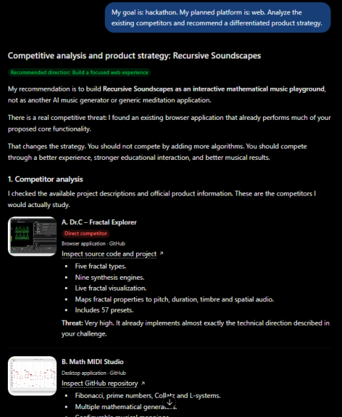
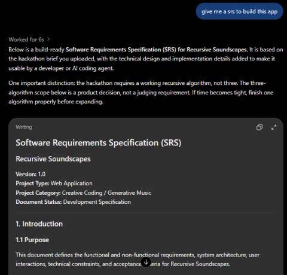
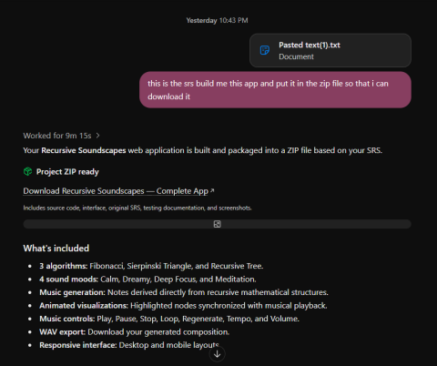

# Recursive Soundscapes — ChatGPT Conversation Log
 
Hub's Quest – Epoch 1: Recursive Soundscapes (hackathon project)
 
*Left column: the AI's responses (ChatGPT, then GitHub Copilot in Turns 7–8, then Codex in Turns 9–11). Right column: your questions and messages, with the original screenshot of each exchange attached as evidence where one was provided. Image caption/source labels from the original chat view are omitted from the transcript text.*
 
# Turn 1 — Searching for similar existing apps
 
<table>
<colgroup>
<col style="width: 64%" />
<col style="width: 35%" />
</colgroup>
<thead>
<tr class="header">
<th><strong>ChatGPT</strong></th>
<th><strong>You</strong></th>
</tr>
</thead>
<tbody>
<tr class="odd">
<td><p>Yes. There are already apps and platforms similar to your hackathon idea, but that doesn't mean your project is unoriginal. The important thing is to identify which features already exist and what you can build differently.</p>
<p>I reviewed your uploaded PDF, Hub's Quest – Epoch 1: Recursive Soundscapes.</p>
<p>Your project is essentially an application that:</p>
<blockquote>
<p>1. Takes user-defined recursion parameters.</p>
<p>2. Runs and visualizes a recursive algorithm.</p>
<p>3. Converts the algorithm's behavior into music using pitch, rhythm, harmony, timbre and sound effects.</p>
<p>4. Lets users listen to and control the generated music.</p>
<p>5. Allows users to download their compositions.</p>
<p>6. Creates a relaxing, immersive sound experience.</p>
</blockquote>
<p>The key concept is turning mathematical recursion into music and visuals, rather than simply generating random relaxing music.</p>
<h2>1. Existing applications most similar to your idea</h2>
<h3>1. Dr.C – Fractal Explorer (Closest match)</h3>
<ul>
<li><p>Converts recursive fractal structures into music.</p></li>
<li><p>Supports L-systems, Dragon Curve, Koch Snowflake and Sierpinski Triangle.</p></li>
<li><p>Maps mathematical properties to pitch, duration, timbre and stereo position.</p></li>
</ul>
<p>This is very close to your core technical concept. Source: GitHub project.</p>
<h3>2. Math MIDI Studio</h3>
<ul>
<li><p>Converts mathematical sequences into music.</p></li>
<li><p>Supports Fibonacci, prime numbers, Collatz conjecture, L-systems and Mandelbrot sets.</p></li>
<li><p>Allows users to configure generators and map values to pitch, velocity and rhythm.</p></li>
<li><p>Exports MIDI files.</p></li>
</ul>
<p>This is also an extremely close competitor in terms of mathematical music generation.</p>
<h3>3. SynScape</h3>
<ul>
<li><p>Generates music from visual movement and musical rules.</p></li>
<li><p>Users control scales, rhythm, instruments and patterns.</p></li>
<li><p>Supports real-time music generation and recording.</p></li>
</ul>
<p>Similar in interactive visual music generation, but not specifically focused on recursive algorithms.</p>
<h3>4. Wotja</h3>
<ul>
<li><p>Generates ambient music algorithmically.</p></li>
<li><p>Creates evolving soundscapes and drones.</p></li>
<li><p>Supports experimentation, relaxation and musical creativity.</p></li>
<li><p>Available across multiple platforms.</p></li>
</ul>
<p>Similar in the relaxation and procedural music aspects.</p>
<h3>5. Drift – Generative Ambient Music</h3>
<ul>
<li><p>Generates ambient music in real time.</p></li>
<li><p>Uses procedural audio synthesis.</p></li>
<li><p>Combines music with animated particle visuals.</p></li>
<li><p>Creates evolving soundscapes.</p></li>
</ul>
<p>Similar in the audio-visual relaxation experience, but not specifically recursion-driven.</p>
<h2>2. How similar are these to your project?</h2>
<p>Here is my assessment based on their published feature descriptions.</p>
<table>
<colgroup>
<col style="width: 33%" />
<col style="width: 33%" />
<col style="width: 33%" />
</colgroup>
<thead>
<tr class="header">
<th><strong>Feature</strong></th>
<th><strong>Existing apps</strong></th>
<th><strong>Your proposed app</strong></th>
</tr>
<tr class="odd">
<th>Mathematical algorithms to music</th>
<th>Yes</th>
<th>Yes</th>
</tr>
<tr class="header">
<th>Recursive algorithms</th>
<th>Yes, some</th>
<th>Yes</th>
</tr>
<tr class="odd">
<th>Interactive visualization</th>
<th>Yes, some</th>
<th>Yes</th>
</tr>
<tr class="header">
<th>Configurable recursion parameters</th>
<th>Yes, some</th>
<th>Yes</th>
</tr>
<tr class="odd">
<th>Relaxation-focused experience</th>
<th>Yes, some</th>
<th>Yes</th>
</tr>
<tr class="header">
<th>Real-time audio generation</th>
<th>Yes</th>
<th>Required</th>
</tr>
<tr class="odd">
<th>Audio download/export</th>
<th>Yes, some</th>
<th>Required</th>
</tr>
<tr class="header">
<th>All features in one focused experience</th>
<th>Not established</th>
<th>Your goal</th>
</tr>
</thead>
<tbody>
</tbody>
</table>
<p>Important: Dr.C and Math MIDI Studio already cover substantial parts of your central idea. You cannot honestly claim that converting recursion or mathematical functions into music is completely new.</p>
<h2>3. How can you make your project different?</h2>
<p>I would focus on these five differentiating features:</p>
<h3>1. Live recursion visualization</h3>
<p>Show every recursive call as an animated tree or fractal. Let users watch the algorithm develop while listening.</p>
<h3>2. Every recursion depth creates a musical layer</h3>
<p>Map different recursion depths to different instruments, pitches and ambient textures.</p>
<h3>3. Mood-based sound generation</h3>
<p>Let users choose Calm, Dreamy, Deep Focus or Meditation. The same algorithm should produce different musical experiences.</p>
<h3>4. Multiple recursion engines</h3>
<p>Offer Fibonacci recursion, recursive trees, Sierpinski triangles and the Tower of Hanoi as different sound-generation engines.</p>
<h3>5. Save and share generated soundscapes</h3>
<p>Let users export MP3/WAV, save presets and share their generated compositions.</p>
<h2>4. My honest verdict</h2>
<p>Worth building. Your idea has potential, but its novelty is not in the basic concept. It needs to come from the execution, interaction and user experience.</p>
<p>My recommendation:</p>
<ul>
<li><p>Study Dr.C first because it is the closest technical reference.</p></li>
<li><p>Study Math MIDI Studio to understand mathematical-to-musical mapping.</p></li>
<li><p>Study Wotja for the ambient music experience.</p></li>
<li><p>Build a more accessible, visually immersive application that combines these concepts.</p></li>
</ul>
<p>One important distinction: your hackathon evaluation gives 35% to relaxation and user experience, 25% to musical quality, and only 15% to creative use of recursion. So don't spend all your time building complicated algorithms while neglecting the actual sound and experience.</p>
<h2>5. One question that will determine your direction</h2>
<p>What is your main goal with this project?</p>
<ul>
<li><p>Win the hackathon with a strong project</p></li>
<li><p>Build something that could become a real startup</p></li>
<li><p>Build an impressive portfolio project</p></li>
<li><p>Create something genuinely innovative and technically different</p></li>
</ul>
<p>What platform are you planning to build?</p>
<ul>
<li><p>Web application</p></li>
<li><p>Mobile application</p></li>
<li><p>Desktop application</p></li>
</ul>
<p>I can then help you identify a concrete feature set that separates your application from the closest existing competitors.</p></td>
<td><p>Yesterday, 10:19 PM (as shown in screenshot)</p>
<p>📎 Attachment: Hub's Quest_ epoch 1.0.pdf</p>
<p><strong>tell me is there is any similar kind of app which is already exist</strong></p>
<p></p>
<p><strong>Screenshot evidence — Turn 1</strong></p></td>
</tr>
</tbody>
</table>
# Turn 2 — Competitor analysis and product strategy
 
<table>
<colgroup>
<col style="width: 64%" />
<col style="width: 35%" />
</colgroup>
<thead>
<tr class="header">
<th><strong>ChatGPT</strong></th>
<th><strong>You</strong></th>
</tr>
</thead>
<tbody>
<tr class="odd">
<td><h2>Competitive analysis and product strategy: Recursive Soundscapes</h2>
<p>Recommended direction: Build a focused web experience</p>
<p>My recommendation is to build Recursive Soundscapes as an interactive mathematical music playground, not as another AI music generator or generic meditation application.</p>
<p>There is a real competitive threat: I found an existing browser application that already performs much of your proposed core functionality.</p>
<p>That changes the strategy. You should not compete by adding more algorithms. You should compete through a better experience, stronger educational interaction, and better musical results.</p>
<h2>1. Competitor analysis</h2>
<p>I checked the available project descriptions and official product information. These are the competitors I would actually study.</p>
<h3>A. Dr.C – Fractal Explorer (Direct competitor)</h3>
<p>Browser application · GitHub</p>
<ul>
<li><p>Five fractal types.</p></li>
<li><p>Nine synthesis engines.</p></li>
<li><p>Live fractal visualization.</p></li>
<li><p>Maps fractal properties to pitch, duration, timbre and spatial audio.</p></li>
<li><p>Includes 57 presets.</p></li>
</ul>
<p>Threat: Very high. It already implements almost exactly the technical direction described in your challenge.</p>
<h3>B. Math MIDI Studio</h3>
<p>Desktop application · GitHub</p>
<ul>
<li><p>Fibonacci, prime numbers, Collatz and L-systems.</p></li>
<li><p>Multiple mathematical generators.</p></li>
<li><p>Configurable musical mappings.</p></li>
<li><p>Piano-roll preview.</p></li>
<li><p>MIDI export.</p></li>
</ul>
<p>Threat: High for mathematical-to-musical conversion, but its desktop workflow leaves room for a more accessible browser experience.</p>
<h3>C. Wotja</h3>
<p>Generative music platform</p>
<ul>
<li><p>Procedural ambient music.</p></li>
<li><p>Customizable music engines.</p></li>
<li><p>Generative templates and sound presets.</p></li>
<li><p>Sharing and music creation tools.</p></li>
<li><p>Relaxation and sleep-oriented use cases.</p></li>
</ul>
<p>Threat: High for the soundscape and relaxation experience, but not specifically a recursion-visualization product.</p>
<h3>D. Molecular Music Generator</h3>
<p>Browser-based algorithmic composition</p>
<ul>
<li><p>Generates musical patterns through mathematical rules.</p></li>
<li><p>Allows users to configure composition variables.</p></li>
<li><p>Produces MIDI compositions.</p></li>
</ul>
<p>Threat: Medium. It demonstrates that browser-based algorithmic composition is already established.</p>
<h3>E. MusicFractal</h3>
<p>Browser-based audio visualizer</p>
<ul>
<li><p>Converts existing audio into animated fractal visuals.</p></li>
<li><p>Uses WebGL and Web Audio.</p></li>
<li><p>Runs locally in the browser.</p></li>
</ul>
<p>Threat: Medium for the audiovisual presentation, but its direction is the reverse of yours: it visualizes music rather than generating music from recursion.</p>
<h3>Competitive positioning</h3>
<table>
<colgroup>
<col style="width: 20%" />
<col style="width: 20%" />
<col style="width: 20%" />
<col style="width: 20%" />
<col style="width: 20%" />
</colgroup>
<thead>
<tr class="header">
<th><strong>Product</strong></th>
<th><strong>Math to music</strong></th>
<th><strong>Recursion</strong></th>
<th><strong>Browser</strong></th>
<th><strong>Relaxation</strong></th>
</tr>
<tr class="odd">
<th>Dr.C</th>
<th>Yes</th>
<th>Yes</th>
<th>Yes</th>
<th>Some</th>
</tr>
<tr class="header">
<th>Math MIDI Studio</th>
<th>Yes</th>
<th>Yes, some</th>
<th>No</th>
<th>Not its focus</th>
</tr>
<tr class="odd">
<th>Wotja</th>
<th>Yes, generative</th>
<th>Not its focus</th>
<th>No</th>
<th>Yes</th>
</tr>
<tr class="header">
<th>Molecular Music Generator</th>
<th>Yes</th>
<th>Not its focus</th>
<th>Yes</th>
<th>Not its focus</th>
</tr>
<tr class="odd">
<th>MusicFractal</th>
<th>No, reverse direction</th>
<th>Visuals</th>
<th>Yes</th>
<th>Some</th>
</tr>
<tr class="header">
<th>Your proposed app</th>
<th>Yes</th>
<th>Yes</th>
<th>Yes</th>
<th>Yes</th>
</tr>
</thead>
<tbody>
</tbody>
</table>
<p>This is a qualitative comparison based on documented features, not a benchmark of actual musical quality.</p>
<p>The important discovery: Dr.C is your closest competitor. You should inspect its actual application before finalizing your interface and feature list.</p>
<h2>2. Your differentiation strategy</h2>
<p>I recommend positioning the product around this idea: RECURSIVE Soundscapes — Where mathematics becomes music.</p>
<p>Core product promise: Choose a mathematical process. Watch it grow. Hear its structure become music. Create your own soundscape.</p>
<p>I would build around four differentiating pillars.</p>
<h3>Pillar 1: Make recursion understandable</h3>
<p>Most people don't understand recursion. Instead of simply displaying a fractal, explain what's happening. For example, when someone selects Fibonacci:</p>
<ul>
<li><p>Show the recursive call tree.</p></li>
<li><p>Highlight each function call.</p></li>
<li><p>Show the current recursion depth.</p></li>
<li><p>Display the generated Fibonacci sequence.</p></li>
<li><p>Explain how the current calculation contributes to the music.</p></li>
</ul>
<p>This creates an educational experience, not just a music generator.</p>
<h3>Pillar 2: Recursion should control the music</h3>
<p>This is where I would invest most of your engineering effort. Create a mapping system:</p>
<table>
<colgroup>
<col style="width: 50%" />
<col style="width: 50%" />
</colgroup>
<thead>
<tr class="header">
<th><strong>Recursive property</strong></th>
<th><strong>Musical output</strong></th>
</tr>
<tr class="odd">
<th>Recursion depth</th>
<th>Instrument layer</th>
</tr>
<tr class="header">
<th>Returned value</th>
<th>Pitch</th>
</tr>
<tr class="odd">
<th>Number of recursive calls</th>
<th>Rhythm</th>
</tr>
<tr class="header">
<th>Branching factor</th>
<th>Musical density</th>
</tr>
<tr class="odd">
<th>Execution time</th>
<th>Note duration</th>
</tr>
<tr class="header">
<th>Tree structure</th>
<th>Harmony</th>
</tr>
</thead>
<tbody>
</tbody>
</table>
<p>For example:</p>
<ul>
<li><p>Depth 1: Soft piano.</p></li>
<li><p>Depth 2: Ambient bells.</p></li>
<li><p>Depth 3: Warm strings.</p></li>
<li><p>Depth 4: Atmospheric pads.</p></li>
</ul>
<p>The user should hear the mathematical structure developing rather than hearing an unrelated random melody.</p>
<h3>Pillar 3: Let users control the emotional experience</h3>
<p>Offer four sound profiles:</p>
<table>
<colgroup>
<col style="width: 50%" />
<col style="width: 50%" />
</colgroup>
<thead>
<tr class="header">
<th><strong>Mode</strong></th>
<th><strong>Musical characteristics</strong></th>
</tr>
<tr class="odd">
<th>Calm</th>
<th>Slow piano, soft pads</th>
</tr>
<tr class="header">
<th>Dreamy</th>
<th>Bells, reverb, airy textures</th>
</tr>
<tr class="odd">
<th>Deep Focus</th>
<th>Minimal repetitive ambient patterns</th>
</tr>
<tr class="header">
<th>Meditation</th>
<th>Long drones, gentle transitions</th>
</tr>
</thead>
<tbody>
</tbody>
</table>
<p>The same recursive algorithm should produce noticeably different compositions depending on the selected mood.</p>
<h3>Pillar 4: Make the experience interactive</h3>
<p>Users should be able to:</p>
<ul>
<li><p>Change recursion depth while playing.</p></li>
<li><p>Change the musical scale.</p></li>
<li><p>Change the instrument.</p></li>
<li><p>Adjust tempo and sound density.</p></li>
<li><p>Pause and resume the visualization.</p></li>
<li><p>Regenerate the composition.</p></li>
<li><p>Save and download their soundscape.</p></li>
</ul>
<p>This gives users a reason to experiment.</p>
<h2>3. What I would actually build for the hackathon</h2>
<p>Do not try to implement 10 recursive algorithms and 20 instruments. That's a poor use of limited hackathon time. Build three polished algorithm engines.</p>
<h3>1. Fibonacci recursion (Must build)</h3>
<ul>
<li><p>Easy to understand.</p></li>
<li><p>Produces recognizable numerical sequences.</p></li>
<li><p>Great for melodic patterns and arpeggios.</p></li>
</ul>
<h3>2. Sierpinski triangle (Must build)</h3>
<ul>
<li><p>Visually impressive.</p></li>
<li><p>Naturally demonstrates recursive branching.</p></li>
<li><p>Great for layered ambient sounds and spatial audio.</p></li>
</ul>
<h3>3. Recursive tree (Must build)</h3>
<ul>
<li><p>Visually communicates recursion.</p></li>
<li><p>Depth and branching can control musical layers.</p></li>
<li><p>Excellent for interactive demonstrations.</p></li>
</ul>
<h2>4. Proposed web application architecture</h2>
<p>Here is the architecture I recommend.</p>
<ul>
<li><p>Frontend: React + TypeScript (application interface)</p></li>
<li><p>Tailwind CSS (visual design)</p></li>
<li><p>Canvas / Three.js (recursive visualization)</p></li>
<li><p>Tone.js (music synthesis and scheduling)</p></li>
</ul>
<p>Flow: Recursive Algorithm Engine (Fibonacci · Sierpinski · Recursive Tree) → Musical Mapping Engine (Pitch · Rhythm · Harmony · Timbre · Spatial audio) → Audio Output (real-time playback, WAV export)</p>
<p>Suggested architecture. A backend is not necessary for the initial demonstration.</p>
<p>Useful technologies:</p>
<ul>
<li><p>Tone.js – browser-based audio synthesis and scheduling.</p></li>
<li><p>Web Audio API – audio processing.</p></li>
<li><p>Three.js – 3D visualization.</p></li>
<li><p>React – frontend.</p></li>
<li><p>OfflineAudioContext – rendering audio for export.</p></li>
</ul>
<p>You can build the first version entirely client-side.</p>
<h2>5. Recommended application interface</h2>
<p>I would use five main screens or sections.</p>
<ul>
<li><p>Screen 1 – Landing page: a visually impressive introduction with a prominent Start Creating button.</p></li>
<li><p>Screen 2 – Algorithm selection: three algorithm cards with interactive previews.</p></li>
<li><p>Screen 3 – Recursion laboratory: controls on the left, recursion visualization in the center, and live algorithm information.</p></li>
<li><p>Screen 4 – Sound studio: mood selection, instrument selection, musical mapping and playback.</p></li>
<li><p>Screen 5 – My soundscapes: saved compositions, playback and downloads.</p></li>
</ul>
<h2>6. Prioritize according to the judging criteria</h2>
<p>Your PDF specifies the following evaluation weights (official evaluation weights from your hackathon brief): Relaxation / UX, Musical quality, Recursion creativity, Visual design, Interaction, Technical execution.</p>
<p>This should determine your development priorities.</p>
<table>
<colgroup>
<col style="width: 50%" />
<col style="width: 50%" />
</colgroup>
<thead>
<tr class="header">
<th><strong>Priority</strong></th>
<th><strong>What to deliver</strong></th>
</tr>
<tr class="odd">
<th>1</th>
<th>Beautiful, genuinely relaxing music</th>
</tr>
<tr class="header">
<th>2</th>
<th>Smooth, understandable interactive experience</th>
</tr>
<tr class="odd">
<th>3</th>
<th>Clear connection between recursion and music</th>
</tr>
<tr class="header">
<th>4</th>
<th>Impressive visualization</th>
</tr>
<tr class="odd">
<th>5</th>
<th>Reliable controls and audio export</th>
</tr>
</thead>
<tbody>
</tbody>
</table>
<p>One critical warning: don't assume that a beautiful fractal visualization will compensate for poor music. The judges explicitly assign 25% to musical quality.</p>
<h2>7. A realistic hackathon development schedule</h2>
<p>Assuming you have approximately 3 days:</p>
<table>
<colgroup>
<col style="width: 50%" />
<col style="width: 50%" />
</colgroup>
<thead>
<tr class="header">
<th><strong>Time</strong></th>
<th><strong>Deliverable</strong></th>
</tr>
<tr class="odd">
<th>Day 1 – Morning</th>
<th>UI and application structure</th>
</tr>
<tr class="header">
<th>Day 1 – Afternoon</th>
<th>Fibonacci and recursive tree engines</th>
</tr>
<tr class="odd">
<th>Day 1 – Evening</th>
<th>Sierpinski visualization</th>
</tr>
<tr class="header">
<th>Day 2 – Morning</th>
<th>Musical mapping engine</th>
</tr>
<tr class="odd">
<th>Day 2 – Afternoon</th>
<th>Instruments, moods and sound design</th>
</tr>
<tr class="header">
<th>Day 2 – Evening</th>
<th>Real-time playback and controls</th>
</tr>
<tr class="odd">
<th>Day 3 – Morning</th>
<th>WAV export and saved presets</th>
</tr>
<tr class="header">
<th>Day 3 – Afternoon</th>
<th>Polish, testing and presentation</th>
</tr>
</thead>
<tbody>
</tbody>
</table>
<p>Do not spend the final day adding new algorithms. Stabilize the application.</p>
<h2>8. Your strongest hackathon differentiator</h2>
<p>Signature feature: Hear the Recursion — live algorithm-to-music synchronization.</p>
<p>When a recursive function executes:</p>
<blockquote>
<p>1. A new branch appears in the visualization.</p>
<p>2. The corresponding musical note plays.</p>
<p>3. The branch glows according to its pitch.</p>
<p>4. The recursion depth controls the instrument layer.</p>
<p>5. The completed algorithm becomes a full composition.</p>
</blockquote>
<p>The user can see exactly why a particular sound was generated. This is a much stronger demonstration than pressing a button and hearing randomly generated ambient music.</p>
<h2>9. Final recommendation</h2>
<p>My proposed positioning:</p>
<table>
<colgroup>
<col style="width: 50%" />
<col style="width: 50%" />
</colgroup>
<thead>
<tr class="header">
<th><strong>Element</strong></th>
<th><strong>Decision</strong></th>
</tr>
<tr class="odd">
<th>Product</th>
<th>Recursive Soundscapes</th>
</tr>
<tr class="header">
<th>Category</th>
<th>Interactive generative music</th>
</tr>
<tr class="odd">
<th>Main audience</th>
<th>Students, creative coders, music enthusiasts</th>
</tr>
<tr class="header">
<th>Platform</th>
<th>Web</th>
</tr>
<tr class="odd">
<th>Main differentiator</th>
<th>Synchronized recursion visualization and music</th>
</tr>
<tr class="header">
<th>Core algorithms</th>
<th>Fibonacci, Sierpinski, recursive tree</th>
</tr>
<tr class="odd">
<th>Main experience</th>
<th>Relaxing, interactive mathematical sound creation</th>
</tr>
</thead>
<tbody>
</tbody>
</table>
<p>Don't claim you're the first to generate music from recursion. Dr.C makes that claim impossible to defend. Instead, demonstrate that you've created a more understandable, engaging and relaxation-focused experience.</p>
<h2>10. Three decisions before development</h2>
<p>I want to settle these before recommending a specific implementation plan.</p>
<p>1. Which visual direction do you prefer?</p>
<ul>
<li><p>Immersive futuristic dark interface (purple, blue, glowing fractals)</p></li>
<li><p>Minimal, elegant meditation-style interface</p></li>
<li><p>Educational scientific laboratory interface</p></li>
</ul>
<p>2. What kind of music should it generate?</p>
<ul>
<li><p>Entirely synthesized music (piano, bells, pads, ambient)</p></li>
<li><p>Real instrument samples and ambient sound effects</p></li>
<li><p>Combination of synthesized music and real sound samples</p></li>
</ul>
<p>3. How ambitious should the first version be?</p>
<ul>
<li><p>Three polished algorithms with excellent UX</p></li>
<li><p>Five algorithms with moderate customization</p></li>
<li><p>Advanced platform with many algorithms and extensive controls</p></li>
</ul>
<p>My vote: immersive futuristic interface, hybrid audio, and three polished algorithms. That's the best balance between ambition and actually finishing a working hackathon product.</p></td>
<td><p><strong>My goal is: hackathon. My planned platform is: web. Analyze the existing competitors and recommend a differentiated product strategy.</strong></p>
<p></p>
<p><strong>Screenshot evidence — Turn 2</strong></p></td>
</tr>
</tbody>
</table>
# Turn 3 — Final product strategy and development blueprint
 
<table>
<colgroup>
<col style="width: 64%" />
<col style="width: 35%" />
</colgroup>
<thead>
<tr class="header">
<th><strong>ChatGPT</strong></th>
<th><strong>You</strong></th>
</tr>
</thead>
<tbody>
<tr class="odd">
<td><h2>Recursive Soundscapes — Final Hackathon Development Blueprint</h2>
<p>Product direction finalized</p>
<p>Recursive Soundscapes — Where mathematics becomes music.</p>
<p>Tags: Web application · Immersive dark UI · Synthesized audio · 3 algorithm engines</p>
<p>We have enough information to lock the product direction. I would not expand the scope beyond these decisions.</p>
<p>The objective is to deliver a working, visually impressive application that demonstrates a genuine relationship between recursive computation and musical composition.</p>
<h2>1. Product definition</h2>
<p>Product: Recursive Soundscapes</p>
<p>One-line description: An interactive generative music platform that transforms recursive mathematical structures into evolving synthesized soundscapes.</p>
<p>Target users:</p>
<ul>
<li><p>People looking for relaxing ambient music.</p></li>
<li><p>Students learning recursion and mathematical patterns.</p></li>
<li><p>Creative coders and experimental music enthusiasts.</p></li>
</ul>
<p>The core user journey:</p>
<blockquote>
<p>1. Choose an algorithm — Fibonacci, Sierpinski triangle or recursive tree.</p>
<p>2. Configure recursion — select depth, tempo, musical scale and sound density.</p>
<p>3. Watch the mathematics unfold — see recursive branches, nodes and patterns animate in real time.</p>
<p>4. Listen to the generated composition — every meaningful recursive event contributes to the music.</p>
<p>5. Customize and export — change instruments, adjust the mood, and save the composition as WAV.</p>
</blockquote>
<h2>2. Final feature scope</h2>
<p>I recommend dividing features into three categories.</p>
<h3>Must-have features</h3>
<table>
<colgroup>
<col style="width: 50%" />
<col style="width: 50%" />
</colgroup>
<thead>
<tr class="header">
<th><strong>Feature</strong></th>
<th><strong>Implementation</strong></th>
</tr>
<tr class="odd">
<th>Three recursion engines</th>
<th>Fibonacci, Sierpinski, recursive tree</th>
</tr>
<tr class="header">
<th>Live visualization</th>
<th>Canvas or Three.js</th>
</tr>
<tr class="odd">
<th>Musical mapping</th>
<th>Recursion properties to musical events</th>
</tr>
<tr class="header">
<th>Four moods</th>
<th>Calm, Dreamy, Focus, Meditation</th>
</tr>
<tr class="odd">
<th>Synthesized instruments</th>
<th>Piano-like, bells, pads, bass</th>
</tr>
<tr class="header">
<th>Playback controls</th>
<th>Play, pause, stop, regenerate</th>
</tr>
<tr class="odd">
<th>Parameter controls</th>
<th>Depth, tempo, density, scale</th>
</tr>
<tr class="header">
<th>WAV export</th>
<th>Browser audio rendering</th>
</tr>
</thead>
<tbody>
</tbody>
</table>
<h3>Differentiating features</h3>
<p>These are the features that make the project memorable:</p>
<ul>
<li><p>Hear the Recursion: Animate the exact branch or calculation that triggers each musical event.</p></li>
<li><p>Depth-based instruments: Different recursion levels produce different musical layers.</p></li>
<li><p>Live parameter changes: Change the depth or mood and hear the composition evolve.</p></li>
<li><p>Visual-to-audio connection: Highlight the visual node corresponding to the currently playing note.</p></li>
</ul>
<h3>Optional features</h3>
<p>Only implement these if the core experience is stable:</p>
<ul>
<li><p>Save favorite compositions in browser storage.</p></li>
<li><p>Share compositions through downloadable configuration files.</p></li>
<li><p>Generate randomized presets.</p></li>
<li><p>Add a guided explanation of each algorithm.</p></li>
</ul>
<p>Do not build authentication, payments, a database or an AI chatbot. They do not improve your central demonstration enough to justify the time.</p>
<h2>3. Three algorithm engines — technical design</h2>
<h3>Engine 1: Fibonacci (Priority 1)</h3>
<ul>
<li><p>Generates a Fibonacci sequence.</p></li>
<li><p>Visualizes recursive function calls.</p></li>
<li><p>Converts sequence values into pitch.</p></li>
<li><p>Uses repeated patterns to create melodic arpeggios.</p></li>
</ul>
<p>Musical identity: Flowing, melodic, predictable.</p>
<h3>Engine 2: Sierpinski Triangle (Priority 2)</h3>
<ul>
<li><p>Recursively divides a triangle into smaller triangles.</p></li>
<li><p>Visualizes branching geometry.</p></li>
<li><p>Maps recursion depth to instrument layers.</p></li>
<li><p>Maps triangle positions to stereo panning.</p></li>
</ul>
<p>Musical identity: Layered, geometric, spatial.</p>
<h3>Engine 3: Recursive Tree (Priority 3)</h3>
<ul>
<li><p>Generates branching structures.</p></li>
<li><p>Visualizes parent and child relationships.</p></li>
<li><p>Maps branches to rhythmic events.</p></li>
<li><p>Uses branch depth to control musical layering.</p></li>
</ul>
<p>Musical identity: Organic, atmospheric, evolving.</p>
<h3>The musical mapping engine</h3>
<p>This is the most important technical component. Do not generate random notes and then display random fractals. That would make the mathematical connection superficial.</p>
<p>Use a consistent event representation:</p>
<p>type MusicEvent = {</p>
<p>time: number;</p>
<p>pitch: number;</p>
<p>duration: number;</p>
<p>velocity: number;</p>
<p>depth: number;</p>
<p>pan: number;</p>
<p>sourceNodeId: string;</p>
<p>};</p>
<p>Every algorithm produces these events through a shared mapping function.</p>
<table>
<colgroup>
<col style="width: 50%" />
<col style="width: 50%" />
</colgroup>
<thead>
<tr class="header">
<th><strong>Mathematical input</strong></th>
<th><strong>Audio output</strong></th>
</tr>
<tr class="odd">
<th>Recursion depth</th>
<th>Octave / instrument layer</th>
</tr>
<tr class="header">
<th>Sequence value</th>
<th>Pitch</th>
</tr>
<tr class="odd">
<th>Child count</th>
<th>Rhythmic subdivision</th>
</tr>
<tr class="header">
<th>Node position</th>
<th>Stereo panning</th>
</tr>
<tr class="odd">
<th>Branch traversal</th>
<th>Note ordering</th>
</tr>
<tr class="header">
<th>Event frequency</th>
<th>Sound density</th>
</tr>
</thead>
<tbody>
</tbody>
</table>
<p>For example:</p>
<ul>
<li><p>Shallow recursion produces soft, lower-register notes.</p></li>
<li><p>Deeper recursion introduces higher musical layers.</p></li>
<li><p>Branching creates rhythmic subdivisions.</p></li>
<li><p>Spatial positions influence stereo movement.</p></li>
</ul>
<p>Important implementation detail: Normalize mathematical values before mapping them to notes. Fibonacci values grow rapidly, so directly converting their raw values into MIDI pitches will produce unusable results.</p>
<h2>4. Sound design specification</h2>
<p>You selected synthesized music, which is a good choice for a hackathon because it avoids large audio libraries and licensing complications. Use synthesized instruments with four distinct sound profiles.</p>
<table>
<colgroup>
<col style="width: 50%" />
<col style="width: 50%" />
</colgroup>
<thead>
<tr class="header">
<th><strong>Mood</strong></th>
<th><strong>Sound design</strong></th>
</tr>
<tr class="odd">
<th>Calm</th>
<th>Soft sine/triangle tones, gentle piano-like attacks</th>
</tr>
<tr class="header">
<th>Dreamy</th>
<th>Bell-like tones, long reverb, airy pads</th>
</tr>
<tr class="odd">
<th>Deep Focus</th>
<th>Repeating pulses, minimal bass and melody</th>
</tr>
<tr class="header">
<th>Meditation</th>
<th>Sustained drones, slow transitions, low-frequency layers</th>
</tr>
</thead>
<tbody>
</tbody>
</table>
<p>Suggested synthesis components:</p>
<ul>
<li><p>Oscillators: sine, triangle and filtered sawtooth.</p></li>
<li><p>ADSR envelopes: attack, decay, sustain and release.</p></li>
<li><p>Low-pass filters: remove harsh high frequencies.</p></li>
<li><p>Reverb: create spatial depth.</p></li>
<li><p>Stereo panning: reflect recursive geometry.</p></li>
<li><p>Gentle compression: control sudden volume differences.</p></li>
</ul>
<p>Use a master gain limiter or compressor. Otherwise, a high recursion depth could create hundreds of overlapping notes and produce unpleasant audio clipping.</p>
<h2>5. Technical architecture</h2>
<h3>Recommended technology stack</h3>
<ul>
<li><p>React + TypeScript — application and component architecture (frontend)</p></li>
<li><p>Tailwind CSS — responsive styling and design system</p></li>
<li><p>Three.js or HTML Canvas — fractal and recursive visualizations</p></li>
<li><p>Tone.js + Web Audio API — synthesizers, audio scheduling and effects</p></li>
<li><p>Vite — development and production build</p></li>
</ul>
<h3>Internal application architecture</h3>
<p>src/</p>
<p>├── components/</p>
<p>│ ├── Header.tsx</p>
<p>│ ├── AlgorithmSelector.tsx</p>
<p>│ ├── ParameterControls.tsx</p>
<p>│ ├── Visualization.tsx</p>
<p>│ ├── AudioPlayer.tsx</p>
<p>│ └── SoundStudio.tsx</p>
<p>│</p>
<p>├── algorithms/</p>
<p>│ ├── fibonacci.ts</p>
<p>│ ├── sierpinski.ts</p>
<p>│ └── recursiveTree.ts</p>
<p>│</p>
<p>├── audio/</p>
<p>│ ├── synthesizer.ts</p>
<p>│ ├── musicMapper.ts</p>
<p>│ ├── scheduler.ts</p>
<p>│ ├── effects.ts</p>
<p>│ └── exportWav.ts</p>
<p>│</p>
<p>├── visualization/</p>
<p>│ ├── fibonacciRenderer.ts</p>
<p>│ ├── sierpinskiRenderer.ts</p>
<p>│ └── treeRenderer.ts</p>
<p>│</p>
<p>├── hooks/</p>
<p>│ ├── useAudio.ts</p>
<p>│ └── useComposition.ts</p>
<p>│</p>
<p>├── types/</p>
<p>│ └── music.ts</p>
<p>│</p>
<p>└── App.tsx</p>
<h3>How the components communicate</h3>
<ul>
<li><p>User controls (algorithm, depth, mood, tempo)</p></li>
<li><p>→ Algorithm engine (generates recursive structures and events)</p></li>
<li><p>→ Visualization (draw and animate nodes)</p></li>
<li><p>→ Music mapper (convert events into notes)</p></li>
<li><p>→ Audio scheduler (schedule notes and effects against a shared timeline)</p></li>
<li><p>→ Live soundscape (playback, synchronization and WAV export)</p></li>
</ul>
<p>Use one shared event timeline for both visualization and sound. This is essential: the highlighted visual node must correspond to the note currently playing.</p>
<h3>Performance rules</h3>
<p>There are a few technical mistakes worth avoiding:</p>
<ul>
<li><p>Never run an unrestricted recursive tree. Set maximum depth and event limits.</p></li>
<li><p>Do not use naive exponential Fibonacci recursion. Use memoization or an iterative sequence generator, while separately constructing a limited call-tree visualization.</p></li>
<li><p>Do not create a new audio context for every note. Reuse the same audio context and instruments.</p></li>
<li><p>Schedule notes using audio-clock timestamps, not JavaScript animation frames.</p></li>
<li><p>Keep visualization animation on requestAnimationFrame, separate from audio scheduling.</p></li>
<li><p>Render WAV through OfflineAudioContext or a dedicated offline synthesis renderer.</p></li>
</ul>
<p>These decisions will prevent the most likely performance and synchronization problems.</p>
<h2>6. UI/UX design blueprint</h2>
<p>Your visual direction should feel like a premium futuristic music instrument, not a typical admin dashboard.</p>
<h3>Design system — color palette</h3>
<table>
<colgroup>
<col style="width: 50%" />
<col style="width: 50%" />
</colgroup>
<thead>
<tr class="header">
<th><strong>Role</strong></th>
<th><strong>Hex</strong></th>
</tr>
<tr class="odd">
<th>Background</th>
<th>#090B16</th>
</tr>
<tr class="header">
<th>Panels</th>
<th>#171E34</th>
</tr>
<tr class="odd">
<th>Cyan</th>
<th>#65E7EF</th>
</tr>
<tr class="header">
<th>Violet</th>
<th>#A78BFA</th>
</tr>
<tr class="odd">
<th>Pink</th>
<th>#F0A5E8</th>
</tr>
<tr class="header">
<th>Success</th>
<th>#9EE6C2</th>
</tr>
<tr class="odd">
<th>Text</th>
<th>#EEF2FF</th>
</tr>
<tr class="header">
<th>Muted</th>
<th>#9BA8C7</th>
</tr>
</thead>
<tbody>
</tbody>
</table>
<p>Interface principles:</p>
<ul>
<li><p>Dark navy background.</p></li>
<li><p>Glowing cyan and violet accents.</p></li>
<li><p>Subtle particle animation.</p></li>
<li><p>Rounded translucent panels.</p></li>
<li><p>Smooth transitions.</p></li>
<li><p>Large central visualization.</p></li>
<li><p>Minimal distractions during playback.</p></li>
</ul>
<h3>Main screen layout</h3>
<p>I recommend a single main workspace rather than forcing users to navigate through five separate pages.</p>
<ul>
<li><p>Left: algorithm and configuration.</p></li>
<li><p>Center: large interactive fractal visualization.</p></li>
<li><p>Right or lower section: music mapping and sound controls.</p></li>
<li><p>Bottom: playback timeline and export.</p></li>
</ul>
<p>This makes the product easier to demonstrate and reduces development time.</p>
<h2>7. Three-day development roadmap</h2>
<h3>72-hour implementation plan</h3>
<p>Day 1 — Build the foundation (architecture and visualization)</p>
<ul>
<li><p>Initialize React, TypeScript and Vite.</p></li>
<li><p>Implement the dark visual design.</p></li>
<li><p>Build algorithm selection and configuration.</p></li>
<li><p>Implement Fibonacci and recursive tree.</p></li>
<li><p>Implement Sierpinski visualization.</p></li>
<li><p>Establish the shared event data structure.</p></li>
</ul>
<p>End-of-day result: All three algorithms generate visual structures.</p>
<p>Day 2 — Make mathematics audible (audio and synchronization)</p>
<ul>
<li><p>Implement musical mapping.</p></li>
<li><p>Build synthesized instruments.</p></li>
<li><p>Add four mood profiles.</p></li>
<li><p>Implement real-time playback.</p></li>
<li><p>Synchronize visual nodes with musical events.</p></li>
<li><p>Add tempo, density and scale controls.</p></li>
</ul>
<p>End-of-day result: The application produces real music from recursive structures.</p>
<p>Day 3 — Polish and deliver (hackathon-ready product)</p>
<ul>
<li><p>Add pause, stop and regenerate.</p></li>
<li><p>Implement WAV export.</p></li>
<li><p>Improve visual animations.</p></li>
<li><p>Add sample presets.</p></li>
<li><p>Test different recursion depths.</p></li>
<li><p>Optimize audio levels and performance.</p></li>
<li><p>Prepare the live demonstration.</p></li>
</ul>
<p>End-of-day result: A stable, demonstrable application.</p>
<h2>8. What the judges should experience</h2>
<p>Your demo should tell a story, not just show features. I would use this 90-second presentation sequence:</p>
<table>
<colgroup>
<col style="width: 50%" />
<col style="width: 50%" />
</colgroup>
<thead>
<tr class="header">
<th><strong>Time</strong></th>
<th><strong>Demonstration</strong></th>
</tr>
<tr class="odd">
<th>0–10 sec</th>
<th>Introduce Recursive Soundscapes</th>
</tr>
<tr class="header">
<th>10–25 sec</th>
<th>Select Fibonacci and show recursion</th>
</tr>
<tr class="odd">
<th>25–40 sec</th>
<th>Generate music and play it</th>
</tr>
<tr class="header">
<th>40–55 sec</th>
<th>Highlight nodes as corresponding notes play</th>
</tr>
<tr class="odd">
<th>55–70 sec</th>
<th>Change mood and recursion depth</th>
</tr>
<tr class="header">
<th>70–80 sec</th>
<th>Switch to Sierpinski and demonstrate another sound</th>
</tr>
<tr class="odd">
<th>80–90 sec</th>
<th>Export and explain the core innovation</th>
</tr>
</thead>
<tbody>
</tbody>
</table>
<p>Your strongest sentence during the presentation:</p>
<p>"We don't just generate music using mathematical algorithms. We make the mathematics itself audible. Every recursive structure becomes a musical experience that users can see, hear and control."</p>
<h2>9. Final acceptance checklist</h2>
<p>Use this as your development completion criteria. (11 of 11 completed)</p>
<ul>
<li><p>All three recursive algorithms work correctly</p></li>
<li><p>Recursion depth changes the generated structure</p></li>
<li><p>Visualization accurately represents the algorithm</p></li>
<li><p>Musical events derive from actual algorithm properties</p></li>
<li><p>Four moods produce noticeably different sound</p></li>
<li><p>Notes and visual events remain synchronized</p></li>
<li><p>Play, pause, stop and regenerate work reliably</p></li>
<li><p>No clipping or unpleasant volume spikes</p></li>
<li><p>WAV export produces a playable audio file</p></li>
<li><p>Application works on desktop and mobile browsers</p></li>
<li><p>Demo runs without internet after assets are loaded</p></li>
</ul>
<h2>10. My final strategic advice</h2>
<p>There are three things I would protect at all costs:</p>
<ul>
<li><p>Musical quality: It must sound intentional, not like a sequence of arbitrary computer-generated beeps.</p></li>
<li><p>Mathematical authenticity: Each note must have an understandable relationship to the recursive structure.</p></li>
<li><p>Visual synchronization: Judges should immediately understand why the music changes when the algorithm changes.</p></li>
</ul>
<p>Don't add AI music generation. Don't add social networking. Don't add a complicated backend. Those features would dilute your central idea.</p>
<p>The winning product is not the one with the most features. It is the one where the judges can immediately see, hear and understand the innovation.</p>
<p>Your next implementation milestone should be a working end-to-end vertical slice: Fibonacci input → recursive visualization → mapped musical events → synchronized synthesized playback. Once that works reliably, extend the same architecture to the other two algorithms.</p></td>
<td><p><strong>Finalize my hackathon product strategy and development blueprint. Visual direction: immersive. Audio approach: synth. Scope: three. Include features, technical architecture, milestones and implementation details.</strong></p>
<p></p>
<p><strong>Screenshot evidence — Turn 3</strong></p></td>
</tr>
</tbody>
</table>
# Turn 4 — Software Requirements Specification (SRS)
 
<table>
<colgroup>
<col style="width: 64%" />
<col style="width: 35%" />
</colgroup>
<thead>
<tr class="header">
<th><strong>ChatGPT</strong></th>
<th><strong>You</strong></th>
</tr>
</thead>
<tbody>
<tr class="odd">
<td><p>Below is a build-ready Software Requirements Specification (SRS) for Recursive Soundscapes. It is based on the hackathon brief you uploaded, with the technical design and implementation details added to make it usable by a developer or AI coding agent.</p>
<p>One important distinction: the hackathon requires a working recursive algorithm, not three. The three-algorithm scope below is a product decision, not a judging requirement. If time becomes tight, finish one algorithm properly before expanding.</p>
<h2>Software Requirements Specification (SRS) — Recursive Soundscapes</h2>
<p>Version: 1.0 · Project Type: Web Application · Project Category: Creative Coding / Generative Music · Document Status: Development Specification</p>
<h2>1. Introduction</h2>
<h3>1.1 Purpose</h3>
<p>This document defines the functional and non-functional requirements, system architecture, user interactions, technical constraints, and acceptance criteria for Recursive Soundscapes.</p>
<p>The application will transform recursive mathematical processes into original musical compositions and synchronized visual simulations. Users will be able to configure recursion parameters, observe the algorithm's behavior, listen to generated soundscapes, adjust musical characteristics, and export compositions as audio files.</p>
<h3>1.2 Product Vision</h3>
<p>Make recursion audible. Make simulation beautiful. Make the experience relaxing.</p>
<p>Recursive Soundscapes will turn mathematical structures into interactive audiovisual experiences. Rather than simply generating random ambient music, the application will use the actual behavior of recursive algorithms to determine musical events.</p>
<h3>1.3 Problem Statement</h3>
<p>Mathematical recursion is often difficult to understand visually and abstract to experience. At the same time, generative music applications frequently separate their musical output from the underlying mathematical processes.</p>
<p>Recursive Soundscapes addresses this by connecting three elements:</p>
<ul>
<li><p>Mathematical recursion.</p></li>
<li><p>Real-time visual simulation.</p></li>
<li><p>Procedural music generation.</p></li>
</ul>
<h3>1.4 Intended Users</h3>
<blockquote>
<p>1. People looking for relaxing ambient soundscapes.</p>
<p>2. Students and educators interested in recursion and mathematical patterns.</p>
<p>3. Creative coders and generative-art enthusiasts.</p>
<p>4. Music enthusiasts interested in algorithmic composition.</p>
</blockquote>
<h3>1.5 Definitions</h3>
<table>
<colgroup>
<col style="width: 50%" />
<col style="width: 50%" />
</colgroup>
<thead>
<tr class="header">
<th><strong>Term</strong></th>
<th><strong>Definition</strong></th>
</tr>
<tr class="odd">
<th>Recursion</th>
<th>A function calling itself to solve smaller instances of a problem</th>
</tr>
<tr class="header">
<th>Recursion depth</th>
<th>Maximum number of recursive levels</th>
</tr>
<tr class="odd">
<th>Musical event</th>
<th>A generated note or sound event with timing and audio properties</th>
</tr>
<tr class="header">
<th>Soundscape</th>
<th>A composition of musical notes, textures, and ambient layers</th>
</tr>
<tr class="odd">
<th>Timbre</th>
<th>The tonal character or quality of a sound</th>
</tr>
<tr class="header">
<th>Procedural music</th>
<th>Music generated through rules or algorithms</th>
</tr>
<tr class="odd">
<th>Visualization</th>
<th>A graphical representation of the recursive process</th>
</tr>
</thead>
<tbody>
</tbody>
</table>
<h2>2. Project Scope</h2>
<h3>2.1 In Scope</h3>
<p>The application shall provide:</p>
<ul>
<li><p>Three selectable recursive visualization engines.</p></li>
<li><p>User-configurable recursion parameters.</p></li>
<li><p>Interactive visualization of recursive behavior.</p></li>
<li><p>Procedural music generation based on algorithm output.</p></li>
<li><p>Synthesized musical instruments and ambient sounds.</p></li>
<li><p>Four selectable sound moods.</p></li>
<li><p>Audio playback controls.</p></li>
<li><p>Real-time visual synchronization with musical events.</p></li>
<li><p>Audio export in WAV format.</p></li>
<li><p>Responsive and accessible user interface.</p></li>
</ul>
<h3>2.2 Out of Scope</h3>
<p>The first release will not include:</p>
<ul>
<li><p>User registration or authentication.</p></li>
<li><p>Subscription or payment functionality.</p></li>
<li><p>Social networking or public sharing feeds.</p></li>
<li><p>Cloud-based composition storage.</p></li>
<li><p>AI-generated music.</p></li>
<li><p>Multiplayer collaboration.</p></li>
<li><p>A backend database.</p></li>
<li><p>Professional multitrack audio editing.</p></li>
</ul>
<p>These features do not directly satisfy the core hackathon requirements and would consume time better spent improving musical quality and user experience.</p>
<h2>3. System Overview</h2>
<h3>3.1 Product Description</h3>
<p>Recursive Soundscapes is a browser-based interactive music studio.</p>
<p>The user selects an algorithm and configures its parameters. The application executes the recursive process, generates a visual representation, converts meaningful algorithm events into musical events, and plays the resulting composition.</p>
<p>The same event data must drive both the audio scheduler and visual animation.</p>
<h3>3.2 Supported Algorithms</h3>
<h3>RS-ALG-01: Fibonacci Sequence</h3>
<p>The application shall generate Fibonacci values and use their relationships to create melodic patterns.</p>
<p>Visual behavior:</p>
<ul>
<li><p>Display the sequence and its recursive relationship.</p></li>
<li><p>Highlight the currently processed value.</p></li>
<li><p>Animate the sequence as musical events are played.</p></li>
</ul>
<p>Musical mapping:</p>
<ul>
<li><p>Normalized Fibonacci values determine pitch.</p></li>
<li><p>Sequence position influences note timing.</p></li>
<li><p>Repeating patterns influence melodic phrases.</p></li>
<li><p>Recursion depth can influence instrument layers.</p></li>
</ul>
<p>Musical character: Flowing, melodic, and repetitive.</p>
<p>Implementation note: Avoid naïve exponential recursive Fibonacci computation. Use memoization or iterative generation for the sequence, and generate a bounded recursive call-tree representation separately if needed.</p>
<h3>RS-ALG-02: Sierpinski Triangle</h3>
<p>The application shall recursively divide a triangle into smaller triangular structures.</p>
<p>Visual behavior:</p>
<ul>
<li><p>Render the initial triangle.</p></li>
<li><p>Recursively generate smaller triangles.</p></li>
<li><p>Highlight individual triangles during playback.</p></li>
<li><p>Allow the user to change recursion depth.</p></li>
</ul>
<p>Musical mapping:</p>
<ul>
<li><p>Triangle depth determines instrument layers or octave.</p></li>
<li><p>Triangle position determines stereo panning.</p></li>
<li><p>Recursive subdivision determines rhythmic subdivisions.</p></li>
<li><p>Traversal order determines note order.</p></li>
</ul>
<p>Musical character: Geometric, layered, and spatial.</p>
<h3>RS-ALG-03: Recursive Branching Tree</h3>
<p>The application shall generate a tree structure through recursive branching.</p>
<p>Visual behavior:</p>
<ul>
<li><p>Render a central trunk and recursive branches.</p></li>
<li><p>Animate branch growth.</p></li>
<li><p>Highlight branches as their associated musical events play.</p></li>
<li><p>Allow the user to control depth and branching density.</p></li>
</ul>
<p>Musical mapping:</p>
<ul>
<li><p>Branch depth determines musical register.</p></li>
<li><p>Branch count influences rhythmic subdivisions.</p></li>
<li><p>Branch position influences stereo panning.</p></li>
<li><p>Traversal order determines note sequence.</p></li>
</ul>
<p>Musical character: Organic, atmospheric, and evolving.</p>
<h3>3.3 Algorithm Configuration</h3>
<p>The user shall be able to configure supported algorithm parameters. Initial recommended limits:</p>
<table>
<colgroup>
<col style="width: 25%" />
<col style="width: 25%" />
<col style="width: 25%" />
<col style="width: 25%" />
</colgroup>
<thead>
<tr class="header">
<th><strong>Parameter</strong></th>
<th><strong>Minimum</strong></th>
<th><strong>Maximum</strong></th>
<th><strong>Default</strong></th>
</tr>
<tr class="odd">
<th>Recursion depth</th>
<th>1</th>
<th>8</th>
<th>4</th>
</tr>
<tr class="header">
<th>Tempo</th>
<th>40 BPM</th>
<th>160 BPM</th>
<th>80 BPM</th>
</tr>
<tr class="odd">
<th>Density</th>
<th>1</th>
<th>10</th>
<th>4</th>
</tr>
<tr class="header">
<th>Master volume</th>
<th>0%</th>
<th>100%</th>
<th>65%</th>
</tr>
</thead>
<tbody>
</tbody>
</table>
<p>Algorithm-specific parameters, such as branching angle or branch length, may be provided where relevant. Limits must be enforced to prevent excessive computation and audio overload.</p>
<h2>4. Functional Requirements</h2>
<h3>4.1 Algorithm Selection</h3>
<ul>
<li><p>FR-001: The system shall display the available recursive algorithms.</p></li>
<li><p>FR-002: The user shall be able to select Fibonacci, Sierpinski Triangle, or Recursive Tree.</p></li>
<li><p>FR-003: The system shall update the visualization and available parameter controls when the selected algorithm changes.</p></li>
<li><p>FR-004: The system shall generate a valid recursive structure using the selected algorithm and parameters.</p></li>
<li><p>FR-005: The system shall limit recursion depth and generated event count to safe configured limits.</p></li>
</ul>
<h3>4.2 Recursive Visualization</h3>
<ul>
<li><p>FR-006: The system shall display a visual representation of the selected recursive process.</p></li>
<li><p>FR-007: The visualization shall update when algorithm parameters change and the user regenerates the composition.</p></li>
<li><p>FR-008: The visualization shall identify the currently active recursive node or structure during playback.</p></li>
<li><p>FR-009: The visualization shall provide smooth animations without blocking audio playback.</p></li>
<li><p>FR-010: The visualization shall provide a useful initial state before playback begins.</p></li>
</ul>
<h3>4.3 Procedural Music Generation</h3>
<ul>
<li><p>FR-011: The system shall generate musical events from the selected recursive algorithm's output.</p></li>
<li><p>FR-012: Each generated musical event shall contain, at minimum: event identifier, playback time, pitch, duration, velocity, recursion depth, stereo pan, and associated visualization node identifier.</p></li>
<li><p>FR-013: The system shall map recursive properties to musical properties using documented mapping rules.</p></li>
<li><p>FR-014: The generated composition shall use musical scales or note sets to maintain tonal consistency.</p></li>
<li><p>FR-015: The system shall support multiple synthesized instrument sounds.</p></li>
<li><p>FR-016: The system shall prevent excessive overlapping audio events and clipping.</p></li>
<li><p>FR-017: The system shall regenerate a composition when the user changes relevant algorithm or musical parameters.</p></li>
</ul>
<h3>4.4 Sound Mood Selection</h3>
<ul>
<li><p>FR-018: The system shall provide four selectable sound moods.</p></li>
</ul>
<table>
<colgroup>
<col style="width: 50%" />
<col style="width: 50%" />
</colgroup>
<thead>
<tr class="header">
<th><strong>Mood</strong></th>
<th><strong>Intended Sound</strong></th>
</tr>
<tr class="odd">
<th>Calm</th>
<th>Soft tones, gentle melodies, minimal percussion</th>
</tr>
<tr class="header">
<th>Dreamy</th>
<th>Bell-like tones, atmospheric pads, long releases</th>
</tr>
<tr class="odd">
<th>Deep Focus</th>
<th>Repeating pulses, subtle bass, restrained melodies</th>
</tr>
<tr class="header">
<th>Meditation</th>
<th>Sustained drones, slow transitions, sparse notes</th>
</tr>
</thead>
<tbody>
</tbody>
</table>
<ul>
<li><p>FR-019: Each mood shall define a coherent collection of instrument, envelope, effects, and arrangement settings.</p></li>
<li><p>FR-020: Switching moods shall update the sound design without requiring the user to select another algorithm.</p></li>
</ul>
<h3>4.5 Audio Playback</h3>
<ul>
<li><p>FR-021: The system shall provide Play, Pause, Stop, and Regenerate controls.</p></li>
<li><p>FR-022: The user shall be able to adjust master volume.</p></li>
<li><p>FR-023: The system shall schedule audio events using the audio clock rather than visual animation frame timing.</p></li>
<li><p>FR-024: The system shall synchronize visual highlighting with scheduled musical events.</p></li>
<li><p>FR-025: The system shall prevent multiple unintended playback sessions from running simultaneously.</p></li>
<li><p>FR-026: The system shall provide appropriate feedback when browser audio permissions or audio initialization are unavailable.</p></li>
</ul>
<h3>4.6 Composition Controls</h3>
<ul>
<li><p>FR-027: The user shall be able to adjust tempo.</p></li>
<li><p>FR-028: The user shall be able to adjust recursion depth within supported limits.</p></li>
<li><p>FR-029: The user shall be able to adjust musical density.</p></li>
<li><p>FR-030: The user shall be able to select a musical scale.</p></li>
<li><p>FR-031: Changes to relevant settings shall be reflected in the next generated composition.</p></li>
<li><p>FR-032: The system shall provide a way to generate a new variation without changing the selected algorithm.</p></li>
</ul>
<h3>4.7 Audio Export</h3>
<ul>
<li><p>FR-033: The system shall allow users to export the generated composition as a WAV file.</p></li>
<li><p>FR-034: The exported file shall contain the generated musical events and configured sound effects.</p></li>
<li><p>FR-035: The exported composition shall respect the selected tempo, mood, instruments, and composition settings.</p></li>
<li><p>FR-036: The system shall display export progress or a clear completion/failure state.</p></li>
<li><p>FR-037: The exported audio shall be playable in standard audio players.</p></li>
</ul>
<h3>4.8 User Interface</h3>
<ul>
<li><p>FR-038: The system shall provide a single primary music-studio workspace.</p></li>
<li><p>FR-039: The workspace shall include algorithm selection, parameter controls, visualization, sound settings, and playback controls.</p></li>
<li><p>FR-040: The system shall provide clear labels and understandable controls.</p></li>
<li><p>FR-041: The system shall display useful loading, empty, error, and playback states.</p></li>
<li><p>FR-042: The interface shall adapt to desktop, tablet, and mobile screen sizes.</p></li>
</ul>
<h2>5. User Interface Requirements</h2>
<h3>5.1 Design Direction</h3>
<p>The interface shall use a futuristic, immersive, dark visual style. Suggested color palette:</p>
<table>
<colgroup>
<col style="width: 50%" />
<col style="width: 50%" />
</colgroup>
<thead>
<tr class="header">
<th><strong>Purpose</strong></th>
<th><strong>Color</strong></th>
</tr>
<tr class="odd">
<th>Main background</th>
<th>#090B16</th>
</tr>
<tr class="header">
<th>Panel background</th>
<th>#171E34</th>
</tr>
<tr class="odd">
<th>Primary accent</th>
<th>#65E7EF</th>
</tr>
<tr class="header">
<th>Secondary accent</th>
<th>#A78BFA</th>
</tr>
<tr class="odd">
<th>Highlight accent</th>
<th>#F0A5E8</th>
</tr>
<tr class="header">
<th>Main text</th>
<th>#EEF2FF</th>
</tr>
<tr class="odd">
<th>Muted text</th>
<th>#9BA8C7</th>
</tr>
</thead>
<tbody>
</tbody>
</table>
<p>Visual elements may include subtle glowing borders, gradients, animated particles, and translucent panels. These effects must not reduce readability or performance.</p>
<h3>5.2 Main Workspace Layout</h3>
<p>Header:</p>
<ul>
<li><p>Product logo and name.</p></li>
<li><p>Short tagline.</p></li>
<li><p>Optional help or information control.</p></li>
</ul>
<p>Left Panel — Algorithm Studio:</p>
<ul>
<li><p>Algorithm selector.</p></li>
<li><p>Algorithm-specific parameters.</p></li>
<li><p>Recursion depth control.</p></li>
<li><p>Tempo and density controls.</p></li>
<li><p>Musical scale selector.</p></li>
</ul>
<p>Center Panel — Visualization:</p>
<ul>
<li><p>Large recursive visualization area.</p></li>
<li><p>Active node highlighting.</p></li>
<li><p>Algorithm status.</p></li>
<li><p>Optional recursion depth indicator.</p></li>
</ul>
<p>Right Panel — Sound Studio:</p>
<ul>
<li><p>Mood selector.</p></li>
<li><p>Instrument selection.</p></li>
<li><p>Musical mapping information.</p></li>
<li><p>Volume control.</p></li>
</ul>
<p>Bottom Panel — Playback:</p>
<ul>
<li><p>Play, Pause, Stop, Regenerate.</p></li>
<li><p>Playback progress.</p></li>
<li><p>WAV export.</p></li>
</ul>
<h3>5.3 User Experience Principles</h3>
<ul>
<li><p>The user should understand the primary workflow without documentation.</p></li>
<li><p>Audio should not start unexpectedly.</p></li>
<li><p>Controls should provide immediate feedback.</p></li>
<li><p>Visual animation should feel smooth and relaxing.</p></li>
<li><p>Default settings should produce a pleasant composition.</p></li>
<li><p>The interface should avoid excessive flashing, sudden loud sounds, and distracting motion.</p></li>
<li><p>Users should be able to reduce or disable nonessential animations.</p></li>
</ul>
<h2>6. User Workflow</h2>
<h3>6.1 Primary Workflow</h3>
<blockquote>
<p>1. User opens Recursive Soundscapes.</p>
<p>2. The application displays the main workspace.</p>
<p>3. User selects a recursive algorithm.</p>
<p>4. User configures recursion parameters.</p>
<p>5. User selects a mood and musical settings.</p>
<p>6. User clicks Generate.</p>
<p>7. The application executes the algorithm.</p>
<p>8. The application creates the visualization and musical event sequence.</p>
<p>9. User clicks Play.</p>
<p>10. The audio begins and the visualization highlights corresponding events.</p>
<p>11. User adjusts settings or regenerates a variation.</p>
<p>12. User exports the composition as a WAV file.</p>
</blockquote>
<h3>6.2 Error Workflow</h3>
<p>If an invalid or excessive configuration is submitted:</p>
<blockquote>
<p>1. The system validates the parameters.</p>
<p>2. The system rejects unsafe values.</p>
<p>3. The system displays a clear explanation.</p>
<p>4. The system preserves the last valid composition where possible.</p>
</blockquote>
<h2>7. Technical Requirements</h2>
<h3>7.1 Recommended Technology Stack</h3>
<table>
<colgroup>
<col style="width: 50%" />
<col style="width: 50%" />
</colgroup>
<thead>
<tr class="header">
<th><strong>Layer</strong></th>
<th><strong>Technology</strong></th>
</tr>
<tr class="odd">
<th>Frontend</th>
<th>React</th>
</tr>
<tr class="header">
<th>Language</th>
<th>TypeScript</th>
</tr>
<tr class="odd">
<th>Build tool</th>
<th>Vite</th>
</tr>
<tr class="header">
<th>Styling</th>
<th>Tailwind CSS</th>
</tr>
<tr class="odd">
<th>Visualization</th>
<th>HTML Canvas or Three.js</th>
</tr>
<tr class="header">
<th>Audio synthesis</th>
<th>Tone.js / Web Audio API</th>
</tr>
<tr class="odd">
<th>Audio export</th>
<th>OfflineAudioContext or offline rendering pipeline</th>
</tr>
<tr class="header">
<th>State management</th>
<th>React state and custom hooks</th>
</tr>
<tr class="odd">
<th>Hosting</th>
<th>Static web hosting</th>
</tr>
</thead>
<tbody>
</tbody>
</table>
<p>A backend is not required for the first release.</p>
<h3>7.2 System Architecture</h3>
<p>The application shall use modular separation between algorithms, musical mapping, audio synthesis, visualization, and user interface.</p>
<p>User Interface</p>
<p>|</p>
<p>v</p>
<p>Application State</p>
<p>|</p>
<p>v</p>
<p>Algorithm Engine</p>
<p>|</p>
<p>+------&gt; Visualization Renderer</p>
<p>|</p>
<p>v</p>
<p>Musical Mapping Engine</p>
<p>|</p>
<p>v</p>
<p>Music Event Timeline</p>
<p>|</p>
<p>+------&gt; Audio Scheduler</p>
<p>| |</p>
<p>| v</p>
<p>| Audio Synthesis</p>
<p>|</p>
<p>+------&gt; Visual Event Synchronization</p>
<p>|</p>
<p>v</p>
<p>Offline Audio Renderer</p>
<p>|</p>
<p>v</p>
<p>WAV Export</p>
<h3>7.3 Shared Music Event Model</h3>
<p>The algorithm and music engine shall communicate through a shared event structure.</p>
<p>type MusicEvent = {</p>
<p>id: string;</p>
<p>time: number;</p>
<p>pitch: number;</p>
<p>duration: number;</p>
<p>velocity: number;</p>
<p>depth: number;</p>
<p>pan: number;</p>
<p>sourceNodeId: string;</p>
<p>};</p>
<p>The event timeline shall be the shared source of truth for audio playback and visual highlighting.</p>
<p>This is a critical architectural requirement. Do not independently generate visual events and musical notes. That would break the connection between the mathematics and the sound.</p>
<h3>7.4 Audio Engine</h3>
<p>The audio engine shall support:</p>
<ul>
<li><p>Oscillator-based sound synthesis.</p></li>
<li><p>Sine, triangle, and filtered sawtooth waveforms.</p></li>
<li><p>Envelope control.</p></li>
<li><p>Low-pass filtering.</p></li>
<li><p>Reverb and delay effects.</p></li>
<li><p>Stereo panning.</p></li>
<li><p>Master volume control.</p></li>
<li><p>Safe scheduling of overlapping notes.</p></li>
</ul>
<p>A shared audio context should be reused. The application should avoid creating a new audio context for every playback operation.</p>
<h3>7.5 Visualization Engine</h3>
<p>The visualization engine shall:</p>
<ul>
<li><p>Render algorithm structures.</p></li>
<li><p>Support real-time active-node highlighting.</p></li>
<li><p>Animate recursion growth or traversal.</p></li>
<li><p>Remain independent of the audio scheduling clock.</p></li>
<li><p>Handle resizing and different display resolutions.</p></li>
</ul>
<h3>7.6 Audio Export Engine</h3>
<p>The export engine shall render the composition offline using the same event data and sound settings used by playback.</p>
<p>The resulting audio shall be encoded into a WAV file and made available for download.</p>
<p>The export process must not depend on recording whatever happens to be audible from the live browser speakers.</p>
<h2>8. Non-Functional Requirements</h2>
<h3>8.1 Performance</h3>
<ul>
<li><p>NFR-001: The application shall remain responsive during normal algorithm generation and playback.</p></li>
<li><p>NFR-002: The application shall enforce limits on recursion depth and musical event count.</p></li>
<li><p>NFR-003: Visualization rendering shall not block audio scheduling.</p></li>
<li><p>NFR-004: The application shall reuse audio resources where practical.</p></li>
<li><p>NFR-005: The application shall avoid unnecessary re-rendering of complex visualization components.</p></li>
</ul>
<h3>8.2 Reliability</h3>
<ul>
<li><p>NFR-006: Invalid parameter values shall not crash the application.</p></li>
<li><p>NFR-007: Audio playback shall stop cleanly when Stop is selected.</p></li>
<li><p>NFR-008: Regenerating a composition shall not leave old scheduled notes playing.</p></li>
<li><p>NFR-009: Export failures shall be communicated clearly.</p></li>
</ul>
<h3>8.3 Usability</h3>
<ul>
<li><p>NFR-010: The primary workflow shall be understandable without technical knowledge of recursion.</p></li>
<li><p>NFR-011: Controls shall have clear labels and appropriate ranges.</p></li>
<li><p>NFR-012: The interface shall provide visible feedback for user actions.</p></li>
</ul>
<h3>8.4 Accessibility</h3>
<ul>
<li><p>NFR-013: Text and controls shall have sufficient contrast.</p></li>
<li><p>NFR-014: Interactive controls shall be keyboard accessible.</p></li>
<li><p>NFR-015: Important states shall not be communicated through color alone.</p></li>
<li><p>NFR-016: Motion shall be restrained and respect reduced-motion preferences.</p></li>
<li><p>NFR-017: Audio shall only begin after an intentional user action.</p></li>
</ul>
<h3>8.5 Compatibility</h3>
<ul>
<li><p>NFR-018: The application shall support modern desktop browsers with Web Audio API support.</p></li>
<li><p>NFR-019: The interface shall be responsive on mobile browsers.</p></li>
<li><p>NFR-020: The application shall handle browsers that require a user gesture before audio playback.</p></li>
</ul>
<h2>9. Data Management</h2>
<p>The initial release shall operate without a server database. The application shall maintain:</p>
<ul>
<li><p>Selected algorithm.</p></li>
<li><p>Algorithm parameters.</p></li>
<li><p>Musical settings.</p></li>
<li><p>Generated recursive structure.</p></li>
<li><p>Music event timeline.</p></li>
<li><p>Playback state.</p></li>
<li><p>Export state.</p></li>
</ul>
<p>Optional user presets may be saved locally using browser storage. No personal information shall be required to use the application.</p>
<h2>10. Validation and Error Handling</h2>
<p>The application shall validate: recursion depth, tempo, density, musical scale, generated event count, audio initialization, and export availability. Expected error conditions include:</p>
<table>
<colgroup>
<col style="width: 50%" />
<col style="width: 50%" />
</colgroup>
<thead>
<tr class="header">
<th><strong>Condition</strong></th>
<th><strong>Expected Behavior</strong></th>
</tr>
<tr class="odd">
<th>Invalid depth</th>
<th>Reject value and show validation message</th>
</tr>
<tr class="header">
<th>Excessive event count</th>
<th>Limit generation or request simpler settings</th>
</tr>
<tr class="odd">
<th>Audio context unavailable</th>
<th>Display an audio initialization error</th>
</tr>
<tr class="header">
<th>Playback interrupted</th>
<th>Stop or recover gracefully</th>
</tr>
<tr class="odd">
<th>Export failure</th>
<th>Display error and allow retry</th>
</tr>
<tr class="header">
<th>Unsupported browser</th>
<th>Display a compatibility message</th>
</tr>
</thead>
<tbody>
</tbody>
</table>
<h2>11. Acceptance Criteria</h2>
<p>The application will be considered ready for submission when the following conditions are satisfied.</p>
<h3>Core Functional Acceptance</h3>
<p>☐ At least one recursive algorithm executes correctly.</p>
<p>☐ The selected algorithm has configurable parameters.</p>
<p>☐ The recursive process is visibly simulated.</p>
<p>☐ The musical composition is derived from actual algorithm output.</p>
<p>☐ The application generates original synthesized audio.</p>
<p>☐ The user can play, pause, stop, and regenerate a composition.</p>
<p>☐ Visual elements synchronize with musical events.</p>
<p>☐ The user can adjust musical settings.</p>
<p>☐ The user can export a playable WAV file.</p>
<p>☐ The interface works without requiring account registration.</p>
<h3>Product Quality Acceptance</h3>
<p>☐ Default settings produce a pleasant, coherent soundscape.</p>
<p>☐ Different algorithm settings produce perceptibly different compositions.</p>
<p>☐ Different moods produce distinct sound characteristics.</p>
<p>☐ Playback does not create uncontrolled overlapping sessions.</p>
<p>☐ The interface is responsive and understandable.</p>
<p>☐ No major performance or playback errors occur during the demo.</p>
<h3>Extended Scope Acceptance</h3>
<p>☐ Fibonacci algorithm works.</p>
<p>☐ Sierpinski Triangle algorithm works.</p>
<p>☐ Recursive Tree algorithm works.</p>
<p>☐ All three algorithms share the same musical event architecture.</p>
<h2>12. Development Priorities</h2>
<h3>Priority 1 — Mandatory Core</h3>
<blockquote>
<p>1. Build the application workspace.</p>
<p>2. Implement one recursive algorithm.</p>
<p>3. Visualize the recursive process.</p>
<p>4. Convert algorithm output into musical events.</p>
<p>5. Synthesize and play audio.</p>
<p>6. Synchronize visualization with audio.</p>
<p>7. Export WAV.</p>
</blockquote>
<h3>Priority 2 — Product Differentiation</h3>
<blockquote>
<p>1. Add the other two algorithms.</p>
<p>2. Add four sound moods.</p>
<p>3. Add musical scale selection.</p>
<p>4. Add richer instruments and effects.</p>
<p>5. Improve visual transitions and animations.</p>
<p>6. Add composition variations.</p>
</blockquote>
<h3>Priority 3 — Optional Polish</h3>
<blockquote>
<p>1. Save favorite presets locally.</p>
<p>2. Add random preset generation.</p>
<p>3. Add a short explanation of each algorithm.</p>
<p>4. Improve mobile-specific layouts.</p>
<p>5. Add optional composition configuration export.</p>
</blockquote>
<h2>13. Testing Strategy</h2>
<h3>13.1 Algorithm Testing</h3>
<ul>
<li><p>Verify Fibonacci values.</p></li>
<li><p>Verify Sierpinski subdivision at different depths.</p></li>
<li><p>Verify recursive tree branching.</p></li>
<li><p>Verify that depth limits are enforced.</p></li>
<li><p>Verify that generated event counts remain bounded.</p></li>
</ul>
<h3>13.2 Music Testing</h3>
<ul>
<li><p>Verify that generated pitches belong to the selected scale.</p></li>
<li><p>Verify that event timing follows the selected tempo.</p></li>
<li><p>Verify that depth and branching influence musical output.</p></li>
<li><p>Verify that different algorithms create distinguishable compositions.</p></li>
<li><p>Verify that sound levels do not clip under normal configurations.</p></li>
</ul>
<h3>13.3 Synchronization Testing</h3>
<ul>
<li><p>Verify that the highlighted visual node corresponds to the active musical event.</p></li>
<li><p>Verify synchronization at different tempos.</p></li>
<li><p>Verify that Pause and Stop update visual playback state correctly.</p></li>
<li><p>Verify that regeneration clears the previous timeline.</p></li>
</ul>
<h3>13.4 Export Testing</h3>
<ul>
<li><p>Export a WAV file.</p></li>
<li><p>Open it in a standard audio player.</p></li>
<li><p>Confirm that the file contains audible audio.</p></li>
<li><p>Confirm that the duration and musical settings are correct.</p></li>
<li><p>Compare exported audio with the live composition.</p></li>
</ul>
<h3>13.5 User Interface Testing</h3>
<ul>
<li><p>Test desktop layout.</p></li>
<li><p>Test mobile layout.</p></li>
<li><p>Test keyboard navigation.</p></li>
<li><p>Test error messages.</p></li>
<li><p>Test reduced-motion behavior.</p></li>
</ul>
<h2>14. Suggested Project Structure</h2>
<p>recursive-soundscapes/</p>
<p>│</p>
<p>├── public/</p>
<p>│</p>
<p>├── src/</p>
<p>│ ├── components/</p>
<p>│ │ ├── Header.tsx</p>
<p>│ │ ├── AlgorithmSelector.tsx</p>
<p>│ │ ├── ParameterControls.tsx</p>
<p>│ │ ├── Visualization.tsx</p>
<p>│ │ ├── AudioPlayer.tsx</p>
<p>│ │ └── SoundStudio.tsx</p>
<p>│ │</p>
<p>│ ├── algorithms/</p>
<p>│ │ ├── fibonacci.ts</p>
<p>│ │ ├── sierpinski.ts</p>
<p>│ │ └── recursiveTree.ts</p>
<p>│ │</p>
<p>│ ├── audio/</p>
<p>│ │ ├── synthesizer.ts</p>
<p>│ │ ├── musicMapper.ts</p>
<p>│ │ ├── scheduler.ts</p>
<p>│ │ ├── effects.ts</p>
<p>│ │ └── exportWav.ts</p>
<p>│ │</p>
<p>│ ├── visualization/</p>
<p>│ │ ├── fibonacciRenderer.ts</p>
<p>│ │ ├── sierpinskiRenderer.ts</p>
<p>│ │ └── treeRenderer.ts</p>
<p>│ │</p>
<p>│ ├── hooks/</p>
<p>│ │ ├── useAudio.ts</p>
<p>│ │ └── useComposition.ts</p>
<p>│ │</p>
<p>│ ├── types/</p>
<p>│ │ └── music.ts</p>
<p>│ │</p>
<p>│ ├── App.tsx</p>
<p>│ └── main.tsx</p>
<p>│</p>
<p>├── README.md</p>
<p>├── package.json</p>
<p>└── tsconfig.json</p>
<h2>15. Hackathon Submission Requirements</h2>
<p>The hackathon brief states that AI coding agents may be used, but the repository must contain the prompt chain and corresponding agent responses. Failure to submit these may result in disqualification.</p>
<p>Therefore, the project repository shall include:</p>
<ul>
<li><p>The prompts used with AI coding agents.</p></li>
<li><p>The corresponding agent responses.</p></li>
<li><p>A clear record of which prompts produced which implementation changes.</p></li>
</ul>
<p>Suggested directory:</p>
<p>docs/</p>
<p>SRS.md</p>
<p>AI_PROMPT_LOG.md</p>
<p>TESTING.md</p>
<p>The AI prompt log should preserve the actual prompts and responses, not reconstructed summaries.</p>
<h2>16. Evaluation Alignment</h2>
<p>The hackathon brief assigns the following evaluation weights:</p>
<table>
<colgroup>
<col style="width: 33%" />
<col style="width: 33%" />
<col style="width: 33%" />
</colgroup>
<thead>
<tr class="header">
<th><strong>Evaluation Area</strong></th>
<th><strong>Weight</strong></th>
<th><strong>Product Focus</strong></th>
</tr>
<tr class="odd">
<th>Relaxation and user experience</th>
<th>35%</th>
<th>Comfortable, immersive, pleasant sound</th>
</tr>
<tr class="header">
<th>Musical quality</th>
<th>25%</th>
<th>Coherent melodies, harmony, and sound design</th>
</tr>
<tr class="odd">
<th>Creative use of recursion</th>
<th>15%</th>
<th>Meaningful algorithm-to-music mapping</th>
</tr>
<tr class="header">
<th>Visual design</th>
<th>10%</th>
<th>Beautiful, clear recursive visualization</th>
</tr>
<tr class="odd">
<th>Interaction and usability</th>
<th>10%</th>
<th>Simple controls and useful feedback</th>
</tr>
<tr class="header">
<th>Technical execution</th>
<th>5%</th>
<th>Reliable playback, simulation, and export</th>
</tr>
</thead>
<tbody>
</tbody>
</table>
<p>Development effort should reflect these weights. A visually impressive application with unpleasant or random-sounding audio is not a strong submission.</p>
<h2>17. Final Definition of Done</h2>
<p>Recursive Soundscapes is complete when a user can select a recursive algorithm, configure its parameters, watch the algorithm unfold, hear a coherent musical composition derived from its behavior, control playback, and download the result as a WAV file.</p>
<p>The central product requirement is that the music must genuinely emerge from the recursive process, while the visualization and audio remain synchronized.</p>
<p>The application must not feel like a fractal visualizer with unrelated background music. It must feel like the user is hearing the algorithm itself.</p>
<h2>What to build first</h2>
<p>Do not start by building all three algorithms or polishing the interface. Build one complete end-to-end slice first:</p>
<blockquote>
<p>1. Fibonacci algorithm generates structured events.</p>
<p>2. Events render as a recursive visualization.</p>
<p>3. Those exact events become musical notes.</p>
<p>4. Playback highlights the corresponding visual elements.</p>
<p>5. The composition exports to WAV.</p>
</blockquote>
<p>Once that works, extend the same architecture to Sierpinski and the recursive tree.</p>
<p>The biggest risk is musical quality, not coding complexity. The judging brief gives relaxation and user experience 35% and musical quality 25%. A technically correct algorithm that produces unpleasant beeps will score poorly. (Source: Hub's Quest_ epoch 1.0.pdf)</p>
<p>If you want, I can turn this SRS into a developer-ready task breakdown with implementation tickets and test cases, in the exact order they should be built.</p></td>
<td><p><strong>give me a srs to build this app</strong></p>
<p></p>
<p><strong>Screenshot evidence — Turn 4</strong></p></td>
</tr>
</tbody>
</table>
# Turn 5 — Building the app and packaging it as a ZIP (ChatGPT, part 2)
 
<table>
<colgroup>
<col style="width: 64%" />
<col style="width: 35%" />
</colgroup>
<thead>
<tr class="header">
<th><strong>ChatGPT</strong></th>
<th><strong>You</strong></th>
</tr>
</thead>
<tbody>
<tr class="odd">
<td><p>Your Recursive Soundscapes web application is built and packaged into a ZIP file based on your SRS.</p>
<p>Project ZIP ready: Download Recursive Soundscapes — Complete App</p>
<p>Includes source code, interface, original SRS, testing documentation, and screenshots.</p>
<h2>What's included</h2>
<ul>
<li><p>3 algorithms: Fibonacci, Sierpinski Triangle, and Recursive Tree.</p></li>
<li><p>4 sound moods: Calm, Dreamy, Deep Focus, and Meditation.</p></li>
<li><p>Music generation: Notes derived directly from recursive mathematical structures.</p></li>
<li><p>Animated visualizations: Highlighted nodes synchronized with musical playback.</p></li>
<li><p>Music controls: Play, Pause, Stop, Loop, Regenerate, Tempo, and Volume.</p></li>
<li><p>WAV export: Download your generated composition.</p></li>
<li><p>Responsive interface: Desktop and mobile layouts.</p></li>
</ul>
<h2>How to run it</h2>
<blockquote>
<p>1. Download and extract the ZIP file.</p>
<p>2. Open the recursive-soundscapes folder.</p>
<p>3. Double-click index.html.</p>
<p>4. Select an algorithm and press Play.</p>
</blockquote>
<p>No account, API key, or installation is required. I used dependency-free JavaScript rather than the SRS's recommended React stack to make the app easier to launch.</p>
<p>Testing: The application passed 135 algorithm and music configuration checks, browser interaction tests, and an actual WAV export test.</p>
<p>View the desktop preview (recursive-soundscapes-preview.png)</p>
<p>Hackathon note: The ZIP includes an AI prompt-log document. Before submission, add your complete original AI conversations and responses as required by the hackathon rules.</p></td>
<td><p>Yesterday, 10:43 PM (as shown in screenshot)</p>
<p>📎 Attachment: Pasted text(1).txt (the SRS)</p>
<p><strong>this is the srs build me this app and put it in the zip file so that i can download it</strong></p>
<p></p>
<p><strong>Screenshot evidence — Turn 5</strong></p></td>
</tr>
</tbody>
</table>
# Turn 6 — Prompt to add Koch Snowflake and Towers of Hanoi
 
<table>
<colgroup>
<col style="width: 64%" />
<col style="width: 35%" />
</colgroup>
<thead>
<tr class="header">
<th><strong>ChatGPT</strong></th>
<th><strong>You</strong></th>
</tr>
</thead>
<tbody>
<tr class="odd">
<td><p>Use the following prompt in your AI coding agent to add these two recursive algorithms to the existing Recursive Soundscapes application without breaking its current functionality.</p>
<h2>Feature Extension — Recursive Soundscapes</h2>
<p>Extend the existing Recursive Soundscapes application by implementing two additional recursive algorithms:</p>
<blockquote>
<p>1. Koch Snowflake / Koch Curve</p>
<p>2. Towers of Hanoi</p>
</blockquote>
<p>Before making changes, analyze the existing codebase, architecture, audio engine, visualization engine, shared musical event model, and UI components.</p>
<p>Preserve all existing functionality, design consistency, and mathematical-to-musical mapping architecture.</p>
<h2>1. Koch Snowflake / Koch Curve</h2>
<p>Implement a recursive fractal algorithm in which every line segment is divided into three equal parts, and the middle segment is replaced by two segments forming an equilateral triangular peak. Each original segment becomes four smaller segments.</p>
<p>Provide two visualization modes:</p>
<ul>
<li><p>Koch Curve</p></li>
<li><p>Koch Snowflake</p></li>
</ul>
<p>Visualization requirements:</p>
<ul>
<li><p>Start with a straight line or an equilateral triangle, depending on the selected mode.</p></li>
<li><p>Animate each recursive subdivision.</p></li>
<li><p>Highlight the currently active line segment during musical playback.</p></li>
<li><p>Use distinct but harmonious colors to represent recursion levels.</p></li>
<li><p>Make the transitions smooth and visually relaxing.</p></li>
<li><p>Automatically scale and center the fractal within the visualization area.</p></li>
</ul>
<p>Musical mapping:</p>
<table>
<colgroup>
<col style="width: 50%" />
<col style="width: 50%" />
</colgroup>
<thead>
<tr class="header">
<th><strong>Recursive property</strong></th>
<th><strong>Musical property</strong></th>
</tr>
<tr class="odd">
<th>Recursion depth</th>
<th>Octave and instrument layer</th>
</tr>
<tr class="header">
<th>Segment length</th>
<th>Note duration</th>
</tr>
<tr class="odd">
<th>Segment orientation</th>
<th>Pitch selection within the selected scale</th>
</tr>
<tr class="header">
<th>Horizontal position</th>
<th>Stereo panning</th>
</tr>
<tr class="odd">
<th>Subdivision order</th>
<th>Rhythmic and melodic sequence</th>
</tr>
<tr class="header">
<th>Iteration number</th>
<th>Musical texture and complexity</th>
</tr>
</thead>
<tbody>
</tbody>
</table>
<p>Each recursion iteration should introduce a higher-octave musical layer, making the composition progressively richer.</p>
<p>Retain selected lower-octave layers as new layers are introduced to create a sense of musical evolution. Limit the overall register, volume, and polyphony to prevent harsh sounds or clipping.</p>
<p>Configurable parameters:</p>
<ul>
<li><p>Recursion depth: 1–5</p></li>
<li><p>Visualization mode: Curve or Snowflake</p></li>
<li><p>Tempo</p></li>
<li><p>Musical density</p></li>
<li><p>Musical scale</p></li>
<li><p>Sound mood</p></li>
<li><p>Master volume</p></li>
</ul>
<p>The generated music should feel geometric, evolving, harmonious, and immersive rather than random or chaotic.</p>
<h2>2. Towers of Hanoi</h2>
<p>Implement the classic recursive Towers of Hanoi algorithm using three pegs and a configurable number of disks.</p>
<p>Use the actual recursive solution:</p>
<blockquote>
<p>1. Move N−1 disks from the source peg to the auxiliary peg.</p>
<p>2. Move the largest remaining disk to the destination peg.</p>
<p>3. Move N−1 disks from the auxiliary peg to the destination peg.</p>
</blockquote>
<p>Generate the complete valid move sequence recursively.</p>
<p>Visualization requirements:</p>
<ul>
<li><p>Display three pegs with different-sized disks.</p></li>
<li><p>Animate each disk moving between pegs.</p></li>
<li><p>Highlight the active disk during playback.</p></li>
<li><p>Display the current move number and total moves.</p></li>
<li><p>Display the source and destination pegs.</p></li>
<li><p>Display the current recursion depth.</p></li>
<li><p>Show a completion animation when all disks reach the destination peg.</p></li>
<li><p>Never allow a larger disk to be placed on a smaller disk.</p></li>
</ul>
<p>Musical mapping:</p>
<table>
<colgroup>
<col style="width: 50%" />
<col style="width: 50%" />
</colgroup>
<thead>
<tr class="header">
<th><strong>Recursive property</strong></th>
<th><strong>Musical property</strong></th>
</tr>
<tr class="odd">
<th>Disk size</th>
<th>Musical pitch</th>
</tr>
<tr class="header">
<th>Disk movement</th>
<th>Musical note event</th>
</tr>
<tr class="odd">
<th>Destination peg</th>
<th>Stereo panning</th>
</tr>
<tr class="header">
<th>Recursion depth</th>
<th>Instrument layer or timbre</th>
</tr>
<tr class="odd">
<th>Move sequence</th>
<th>Melodic sequence</th>
</tr>
<tr class="header">
<th>Move interval</th>
<th>Rhythm</th>
</tr>
</thead>
<tbody>
</tbody>
</table>
<p>Assign larger disks lower pitches and smaller disks higher pitches. Keep every pitch within the selected musical scale.</p>
<p>Configure stereo panning as follows:</p>
<ul>
<li><p>Left peg: −0.8</p></li>
<li><p>Middle peg: 0</p></li>
<li><p>Right peg: +0.8</p></li>
</ul>
<p>Every disk movement must trigger its corresponding musical note and synchronized visual animation.</p>
<p>Configurable parameters:</p>
<ul>
<li><p>Number of disks: 1–8</p></li>
<li><p>Tempo</p></li>
<li><p>Musical density</p></li>
<li><p>Musical scale</p></li>
<li><p>Sound mood</p></li>
<li><p>Master volume</p></li>
</ul>
<p>Calculate and display the minimum number of moves using the formula: Total moves = 2^N − 1</p>
<p>Do not skip or reorder recursive moves when adjusting musical density. Instead, adjust the supporting musical layers and textures.</p>
<p>The generated music should feel structured, rhythmic, repetitive, and progressively resolving.</p>
<h2>3. Update Algorithm Studio</h2>
<p>The application must now support five algorithms in the following order:</p>
<blockquote>
<p>1. Fibonacci Sequence</p>
<p>2. Sierpinski Triangle</p>
<p>3. Recursive Branching Tree</p>
<p>4. Koch Snowflake / Curve</p>
<p>5. Towers of Hanoi</p>
</blockquote>
<p>Place Towers of Hanoi last as an experimental algorithm.</p>
<p>Display a short, beginner-friendly description of each algorithm and explain how its recursive behavior is converted into music.</p>
<p>Show only the relevant configuration controls for the currently selected algorithm.</p>
<h2>4. Audio and Visualization Synchronization</h2>
<p>Integrate both algorithms into the existing shared MusicEvent architecture.</p>
<p>Every musical event must contain:</p>
<ul>
<li><p>Event ID</p></li>
<li><p>Playback time</p></li>
<li><p>Pitch</p></li>
<li><p>Duration</p></li>
<li><p>Velocity</p></li>
<li><p>Recursion depth</p></li>
<li><p>Stereo pan</p></li>
<li><p>Associated visualization node or move ID</p></li>
</ul>
<p>The same event timeline must control both audio playback and visual animation.</p>
<p>Do not generate unrelated background music or independent visual timelines.</p>
<h2>5. Existing Feature Compatibility</h2>
<p>Ensure both new algorithms support:</p>
<ul>
<li><p>Play</p></li>
<li><p>Pause</p></li>
<li><p>Resume</p></li>
<li><p>Stop</p></li>
<li><p>Loop</p></li>
<li><p>Regenerate</p></li>
<li><p>Tempo adjustment</p></li>
<li><p>Volume adjustment</p></li>
<li><p>Musical scale selection</p></li>
<li><p>All four existing sound moods</p></li>
<li><p>Instrument selection, where supported</p></li>
<li><p>WAV audio export</p></li>
<li><p>Responsive desktop and mobile layouts</p></li>
</ul>
<p>Stopping, regenerating, or switching algorithms must cancel previous audio events and reset the relevant visualization correctly.</p>
<h2>6. Design Requirements</h2>
<p>Maintain the existing futuristic, immersive dark interface. Use the existing color palette:</p>
<ul>
<li><p>Background: #090B16</p></li>
<li><p>Panel: #171E34</p></li>
<li><p>Primary accent: #65E7EF</p></li>
<li><p>Secondary accent: #A78BFA</p></li>
<li><p>Highlight accent: #F0A5E8</p></li>
</ul>
<p>Prioritize smooth animations, clean visual presentation, relaxing sound design, and intuitive controls.</p>
<p>Do not unnecessarily redesign or replace the existing application.</p>
<h2>7. Performance and Validation</h2>
<ul>
<li><p>Enforce safe recursion and event-count limits.</p></li>
<li><p>Prevent excessive overlapping audio events.</p></li>
<li><p>Optimize fractal rendering for higher recursion depths.</p></li>
<li><p>Verify that every Towers of Hanoi move is mathematically valid.</p></li>
<li><p>Ensure audio scheduling uses the audio clock.</p></li>
<li><p>Ensure exported WAV files use the same musical events and sound settings as live playback.</p></li>
<li><p>Respect reduced-motion preferences.</p></li>
<li><p>Do not introduce unnecessary dependencies, paid APIs, or backend services.</p></li>
</ul>
<h2>8. Testing and Documentation</h2>
<p>Test both new algorithms at minimum, default, and maximum parameter values. Verify:</p>
<ul>
<li><p>Koch Curve segment count: 4^N</p></li>
<li><p>Koch Snowflake segment count: 3 × 4^N</p></li>
<li><p>Towers of Hanoi move count: 2^N − 1</p></li>
<li><p>Correct recursive execution</p></li>
<li><p>Audio and visualization synchronization</p></li>
<li><p>Musical scale consistency</p></li>
<li><p>Playback controls</p></li>
<li><p>Algorithm switching</p></li>
<li><p>WAV export</p></li>
<li><p>Mobile responsiveness</p></li>
<li><p>Existing algorithm functionality</p></li>
</ul>
<p>Update the README, SRS, testing documentation, and AI prompt log with the new features.</p>
<h2>9. Implementation Priority</h2>
<p>First, fully implement and test Koch Snowflake / Curve. Then implement Towers of Hanoi as the fifth algorithm.</p>
<p>Do not leave placeholder features, incomplete functions, mock simulations, or non-functional buttons.</p>
<p>Deliver a complete, working application with all five recursive algorithms integrated into the existing music studio.</p>
<p>The fundamental product philosophy must remain: Make recursion audible. Make simulation beautiful. Make the experience relaxing.</p>
<h2>Why these two algorithms are good additions</h2>
<h3>Koch Snowflake / Curve</h3>
<p>Excellent for visual beauty and musical layering. The audience can simultaneously see and hear the composition become more complex with every recursive iteration.</p>
<h3>Towers of Hanoi</h3>
<p>Introduces a different type of recursion. Instead of generating a geometric fractal, it transforms recursive problem-solving into a musical sequence.</p>
<p>I would prioritize Koch Snowflake for the hackathon demonstration because relaxation, musical quality, and visual appeal are heavily weighted in your original SRS.</p>
<p>I have also deliberately limited the Koch recursion depth to 5 and Hanoi to 8 disks to reduce performance and audio-overload risks. These limits can be increased later if testing supports it.</p></td>
<td><p>Today, 12:15 AM (as shown in screenshot)</p>
<p><strong>Koch Snowflake / Curve. Each line becomes four smaller lines. Each iteration adds a higher octave layer, so the sound gets richer.</strong></p>
<p><strong>Towers of Hanoi (optional, last). Each disk is a pitch and each move plays a note, panned by peg.</strong></p>
<p><strong>i want to add this two also so give me a prompt</strong></p>
<p></p>
<p><strong>Screenshot evidence — Turn 6</strong></p></td>
</tr>
</tbody>
</table>
# Turn 7 — Theme toggle icon fix (GitHub Copilot, part 3)
 
<table>
<colgroup>
<col style="width: 64%" />
<col style="width: 35%" />
</colgroup>
<thead>
<tr class="header">
<th><strong>GitHub Copilot</strong></th>
<th><strong>You</strong></th>
</tr>
</thead>
<tbody>
<tr class="odd">
<td><p>Completed 8 steps in 35s (+5 −5)</p>
<p>The moon was showing because the toggle initially used the icon for the theme you could switch to. I changed it to show the active theme: sun in light mode, moon in dark mode.</p>
<p>I also fixed the Play/Pause glyph so it follows the playback state. The updated preview is at http://localhost:8080; refresh if your page is already open. The project tests pass.</p>
<p>2 files changed (+5 −5)</p></td>
<td><p>📎 Pasted image (screenshot not provided)</p>
<p><strong>why on white mode i am seeing this moon instead of sun logo</strong></p></td>
</tr>
</tbody>
</table>
# Turn 8 — Deploying to Vercel
 
<table>
<colgroup>
<col style="width: 64%" />
<col style="width: 35%" />
</colgroup>
<thead>
<tr class="header">
<th><strong>GitHub Copilot</strong></th>
<th><strong>You</strong></th>
</tr>
</thead>
<tbody>
<tr class="odd">
<td><p>Finished thinking</p>
<p>It's prepared to run as a static Vercel site: no build step, backend, or environment variables are needed. The Vercel config, asset paths, and composition tests check out.</p>
<p>I haven't deployed it to your Vercel account, so I can't promise there won't be a deployment-specific issue. Once deployed, playback still requires clicking Play, and WAV export requires a browser with Web Audio and OfflineAudioContext support.</p></td>
<td><strong>if i upload this on the vercel then the app will run without any problem right?</strong></td>
</tr>
</tbody>
</table>
# Turn 9 — Mobile player controls off-center (Codex, part 4)
 
<table>
<colgroup>
<col style="width: 64%" />
<col style="width: 35%" />
</colgroup>
<thead>
<tr class="header">
<th><strong>Codex</strong></th>
<th><strong>You</strong></th>
</tr>
</thead>
<tbody>
<tr class="odd">
<td><p>Worked for 1m 18s</p>
<p>On mobile, the player layout explicitly left-aligned the transport group. I changed it to center the stop, play/pause, and loop controls, with Export on its own row below. I also increased the bottom scroll space so the taller player doesn't cover page content. Refresh to load the updated stylesheet. git diff --check passes.</p>
<p>Edited 2 files (+3 −3)</p>
<ul>
<li><p>index.html (+1 −1)</p></li>
<li><p>src/styles.css (+2 −2)</p></li>
</ul></td>
<td><p>Question 4:28 PM · response 4:29 PM</p>
<p><strong>but in mobile version it goes from middle to a side why is that? fix it!</strong></p></td>
</tr>
</tbody>
</table>
# Turn 10 — Mobile layout still not fixed
 
<table>
<colgroup>
<col style="width: 64%" />
<col style="width: 35%" />
</colgroup>
<thead>
<tr class="header">
<th><strong>Codex</strong></th>
<th><strong>You</strong></th>
</tr>
</thead>
<tbody>
<tr class="odd">
<td><p>Worked for 1m 46s</p>
<p>I fixed the mobile transport layout so the play/pause button occupies the center column, with Stop and Loop placed on either side. I also updated the stylesheet version so the browser reloads the change.</p>
<p>git diff --check passes. I couldn't verify the result in a live mobile preview here, so if it still appears off-center, send a screenshot showing the full player panel.</p>
<p>Edited 2 files (+3 −1)</p>
<ul>
<li><p>index.html (+1 −1)</p></li>
<li><p>src/styles.css (+2 −0)</p></li>
</ul></td>
<td><p>Question 4:30 PM · response 4:32 PM</p>
<p><strong>still it did not improved</strong></p></td>
</tr>
</tbody>
</table>
 
# Turn 11 — Full bug check
 
<table>
<colgroup>
<col style="width: 64%" />
<col style="width: 35%" />
</colgroup>
<thead>
<tr class="header">
<th><strong>Codex</strong></th>
<th><strong>You</strong></th>
</tr>
</thead>
<tbody>
<tr class="odd">
<td><p>You stopped after 4s</p>
<p>Worked for 3m</p>
<p>I found and fixed one playback-state bug: Bloom mode could show the pause icon before audio had actually started. Now its control reflects the audio engine's confirmed state, including if startup fails.</p>
<p>The checks passed: JavaScript syntax, 243 core algorithm cases, 9,072 Koch/Hanoi cases, and git diff --check. Browser automation couldn't run because Playwright and its configured test environment aren't available, so I couldn't verify browser-only behavior. I recorded the audit in docs/AI_PROMPT_LOG.md.</p>
<p>Edited 2 files (+12 −1)</p>
<ul>
<li><p>docs/AI_PROMPT_LOG.md (+12 −0)</p></li>
<li><p>src/app.js (+0 −1)</p></li>
</ul></td>
<td><p>Questions 5:09 PM · response 5:12 PM</p>
<p><strong>check if there is any bugs if there is any then remove all the bugs</strong></p>
<p><strong>(interrupted — sent again:)</strong></p>
<p><strong>check if there is any bugs if there is any then solve all the bugs</strong></p></td>
</tr>
</tbody>
</table>

## Koch Snowflake and Towers of Hanoi implementation

Turn 6 records ChatGPT drafting the implementation prompt. The original coding-agent prompt and reply for commit `93636c5` could not be recovered from the available history. The summary below comes from that commit. The later Codex exchange that changed octave layering and move notes appears under “Koch and Hanoi follow-up and submission checks.”


User request: analyze the existing architecture, fully implement and test Koch Curve/Snowflake first, then add experimental Towers of Hanoi last. Preserve the shared mathematical-to-musical timeline, existing playback/export features, responsive design, and relaxing sound philosophy.

Implementation: inspected generators, music mapper, audio scheduler/export graph, canvas renderer, UI controller, styles, and tests. Added true recursive Koch geometry and iteration sonification, then independently validated it before implementing the complete recursive Hanoi move solver. Added contextual controls, audio-position-driven subdivision/disk animation, progress details, bounded register/releases/polyphony, cached Koch paths, seeded accents, dark default with retained theme toggle, and asynchronous playback cancellation/resume handling. No application dependencies or external services added.

Verification: 135 original regressions plus 2,520 extension combinations passed. Chromium exercised all five algorithms, transport, seek/reset, completion, loop restart, regeneration/switching, responsive overflow, reduced motion, and the real export button. Thirty-two actual offline WAV renders across the new algorithms, four moods, and four instruments passed stereo/44.1kHz/RIFF/nonzero-signal/no-clipping checks. Reviewed desktop/mobile screenshots and repaired glyph encoding. Updated README, SRS, and testing notes.

Product philosophy preserved: Make recursion audible. Make simulation beautiful. Make the experience relaxing.

## Premium experience and Bloom mode

The prompt and response below were recovered from commit `01982ca`.


**User's exact request:**

```text
Act as a senior creative developer, award-winning UI/UX designer, procedural audio engineer and hackathon judge.

Perform a comprehensive quality enhancement of my existing Recursive Soundscapes web application.

Live website: https://recursive-soundscapes.vercel.app/

This is a working application, not a new project. Inspect the existing codebase and architecture before making changes. Preserve all working algorithms, controls, musical features and audio export functionality.

The goal is to transform the existing application into a premium, immersive, memorable and competition-worthy experience.

## 1. Premium UI/UX Enhancement

Improve the overall visual identity while preserving the existing application structure.

- Establish a consistent and sophisticated color palette.
- Improve typography, spacing, alignment and visual hierarchy.
- Make the interface feel artistic, peaceful and immersive rather than like a generic developer dashboard.
- Improve buttons, sliders, dropdowns, algorithm selectors and playback controls.
- Add subtle gradients, atmospheric lighting and elegant visual depth.
- Introduce smooth micro-interactions and meaningful transitions.
- Make the active algorithm and musical settings visually identifiable.
- Reduce unnecessary visual clutter.
- Avoid excessive glassmorphism, neon effects, animations and generic AI-generated design patterns.
- Maintain excellent text contrast and readability.
- Make the application responsive across desktop, tablet and mobile devices.

The interface should feel like a professional generative music application that someone would genuinely enjoy using every day.

## 2. Immersive Relaxation Mode

Introduce a dedicated immersive experience that users can enter while their composition is playing.

- Hide unnecessary technical controls and mathematical statistics.
- Expand the visualization into a large, distraction-free experience.
- Retain minimal playback, volume, exit and fullscreen controls.
- Automatically fade unnecessary controls when the user is inactive.
- Introduce slow atmospheric movement and gentle lighting transitions.
- Ensure animations respect reduced-motion preferences.

Consider an optional Sakura Garden visual theme featuring soft pink cherry blossoms, lavender skies, floating petals and a peaceful environment, provided it can be implemented without compromising performance or existing functionality.

The relaxation experience must remain connected to the actual recursive musical events rather than relying solely on decorative animations.

## 3. Musical Quality Enhancement

Audit and refine the existing procedural music engine.

The generated music must sound like an intentional ambient composition, not a sequence of mathematical computer beeps.

Improve:

- Melodic phrasing.
- Harmonic coherence.
- Instrument envelopes.
- Musical dynamics.
- Note spacing.
- Stereo positioning.
- Reverb and spatial depth.
- Smooth audio transitions.
- Ambient background layers.
- Musical progression and resolution.

Use harmonically compatible notes and appropriate musical scales.

Ensure that deeper or more complex recursion produces richer musical structures without creating excessive noise or overwhelming note density.

Avoid harsh frequencies, clipping, sudden volume changes, repetitive melodies and uncontrolled overlapping notes.

Make each existing musical atmosphere genuinely distinguishable through its sound, rhythm, instruments and harmonic behavior.

Preserve deterministic generation where applicable.

Do not replace recursion-driven music with prerecorded music.

## 4. Algorithm-Specific Musical Identity

Make each recursive algorithm feel like a distinct musical and visual experience.

**Fibonacci**
- Flowing melodic progression.
- Organic musical development.
- Musical phrases influenced by Fibonacci values and recursive calls.

**Sierpinski Triangle**
- Repeating geometric musical motifs.
- Layered harmonies.
- Spatial sound relationships influenced by recursive subdivisions.

**Recursive Tree**
- Organic branching melodies.
- Deeper branches introduce gentle musical layers.
- Natural growth animations synchronized with musical events.

**Koch Snowflake / Curve**
- Increasing musical richness as recursive subdivisions develop.
- Controlled octave layers.
- Smooth geometric visual evolution.

**Towers of Hanoi**
- Each disk has a recognizable musical identity.
- Recursive disk movements create rhythmic patterns.
- Stereo positioning reflects the destination peg.

Preserve mathematical correctness. Ensure that changing the actual algorithm parameters meaningfully affects both music and visualization.

## 5. Audio-Visual Synchronization

Improve synchronization between the recursive process, visual animation and generated audio.

- Highlight the exact mathematical element associated with an active musical event.
- Use subtle pulses, glows or growth animations synchronized with notes.
- Ensure animation timing follows the actual audio playback clock.
- Pause, resume and reset visualization correctly when playback changes.
- Prevent audio and visualization from gradually becoming unsynchronized.
- Make recursive progression understandable through motion.
- Avoid distracting, fast or excessive flashing effects.

Users should feel that they are watching mathematics become music.

## 6. User Experience and Interactivity

Make the application intuitive for both programmers and people without mathematical knowledge.

- Provide clear explanations of what each algorithm does.
- Explain unfamiliar controls using concise tooltips.
- Improve numerical input and parameter validation.
- Provide sensible default settings that sound and look beautiful immediately.
- Improve the first-time user experience.
- Make it easy to generate a composition without understanding music theory.
- Make advanced controls discoverable without overwhelming beginners.
- Ensure all buttons have clear labels and functional feedback.
- Improve loading, empty, error and playback states.
- Provide meaningful feedback during audio generation and WAV export.

Preserve the user's ability to experiment with mathematical inputs and understand how those inputs influence the generated composition.

## 7. Signature Creative Feature

Introduce a polished feature called "Watch Your Melody Bloom" if feasible within the existing architecture.

This feature should visually represent a composition developing from a simple mathematical seed into a rich recursive structure.

Use algorithm-specific growth, musical progression and synchronized visual feedback to create a memorable transformation.

For the Recursive Tree or Fibonacci visualization, optionally incorporate a growing cherry blossom aesthetic.

This feature must enhance the mathematical relationship between recursion and music rather than simply adding decoration.

## 8. Performance and Reliability

Audit the existing application for:

- Audio memory leaks.
- Duplicate audio scheduling.
- Overlapping playback sessions.
- Excessive recursion.
- Slow rendering.
- Unnecessary component re-renders.
- Mobile performance issues.
- Broken controls.
- Audio and animation synchronization problems.
- Incorrect composition duration.
- WAV export failures.

Optimize where necessary without unnecessarily rewriting stable functionality.

Ensure the exported WAV file accurately represents the generated composition and current musical settings.

## 9. Accessibility

Improve keyboard navigation, accessible labels, focus indicators, readable text contrast, reduced-motion support and comfortable default audio volume.

Ensure the application remains usable without relying exclusively on color, animation or sound.

## 10. Hackathon Optimization

The official judging criteria are:

- Relaxation and user experience: 35%
- Musical quality: 25%
- Creative use of recursion: 15%
- Visual design: 10%
- Interaction and usability: 10%
- Technical execution: 5%

Prioritize improvements according to these weights.

Do not spend excessive time adding unrelated features. Focus on making existing functionality excellent.

## Implementation Rules

- Do not rebuild the application from scratch.
- Do not remove working features.
- Do not introduce unnecessary dependencies.
- Do not add authentication, databases or paid APIs.
- Preserve mathematical correctness.
- Maintain the existing project architecture where practical.
- Prioritize the highest-impact improvements first.
- Follow the existing AI prompt documentation protocol and preserve all previous logs.
- Do not fabricate testing results or AI responses.
- Keep implementation efficient to conserve AI coding usage.

Run essential functional tests and verify the production build after completing the improvements.

Do not deploy automatically until I have reviewed the updated local application.

At completion, provide a concise report describing:

1. Major visual improvements.
2. Musical quality improvements.
3. Relaxation and usability enhancements.
4. Algorithm-specific improvements.
5. Performance and accessibility improvements.
6. Testing and build results.
7. Remaining limitations.

The final application should feel less like a mathematical demonstration and more like a premium interactive experience where mathematics, music and visual art coexist naturally.
```

**Work completed:** Added Bloom mode, integrated it with the synchronized recursive visual and audio timeline, refined chord phrasing and instrument timbres, and documented current verification results. Preserved prior prompt history.

**Exact complete AI response:**

Implemented the requested premium experience in the existing app.

- Added Bloom mode with an expanded, low-distraction canvas, synchronized minimal playback and volume controls, inactivity fade, full-screen toggle, and reduced-motion support.
- Refined ambient harmony and phrasing, and added distinct envelopes and oscillator timbres for the four additional voices.
- Preserved the existing recursive event timeline and WAV rendering path.
- Verification: 243 base combinations and 9,072 extension combinations passed; all four source files passed Node syntax checks.
- Build: this is a static app with no production build command. Browser automation could not run because Playwright is unavailable in the configured environment, so Bloom mode still needs a visual browser check.

No deployment was performed.

## Codex studio development and testing

Recovered from the local Codex conversation history. User prompts and final agent replies are reproduced as text.

### Prompt 1

```text
start the preview

```

**Agent response**

```text
Preview server is running. Open [http://localhost:8000](http://localhost:8000).
```

### Prompt 2

```text
add 4 unique more atmosphere

```

**Agent response**

```text
Added four atmospheres: **Ambient Drift**, **Nocturne**, **Cinematic**, and **Pulse**. Each has distinct pacing, note lengths, layering, and effects. Updated the help text, README, and SRS to describe all eight atmospheres.

The algorithm and extension checks passed. The browser check could not run because its expected browser path was unavailable in this environment. The running preview should show the changes at [http://localhost:8000](http://localhost:8000).
```

### Prompt 3

Screenshot attached in the original chat.

```text
in this area show only 4 and make it scrollable to chooese more atmostpheres if anybody wants to see more

```

**Agent response**

```text
Updated the Sound Studio atmosphere picker to show four choices at a time in its existing two-column layout. The other four are available by scrolling inside the picker, with a visible scrollbar and keyboard focus support.

Refresh the preview at [http://localhost:8000](http://localhost:8000) to see the change.
```

### Prompt 4

```text
add a slide bar to show that there could be more

```

**Agent response**

```text
Added a visible vertical scroll bar beside the atmosphere choices. Its thumb moves as you scroll, and you can drag it or focus it and use the arrow and page keys. The app script passes `node --check`. Refresh the preview to see it.
```

### Prompt 5

Screenshot attached in the original chat.

```text
make this like the sound studio

```

**Agent response**

```text
Made the Algorithm Studio’s pattern list work like the Sound Studio atmosphere picker: it shows four patterns at a time, with a matching draggable scroll bar for the fifth. Scrolling and keyboard controls are supported. `src/app.js` passes `node --check`; refresh the preview to see it.
```

### Prompt 6

```text
show only two

```

**Agent response**

```text
The Algorithm Studio now shows two patterns at a time, with the scrollbar for the rest. Refresh the preview to see the change.
```

### Prompt 7

```text
can you make the instrument voice like this too?

```

**Agent response**

```text
Instrument Voice now uses a two-at-a-time scroll picker with the same draggable bar as the other studio choices. Selecting a voice updates the sound immediately. `src/app.js` passes `node --check`; refresh the preview to see it.
```

### Prompt 8

```text
make the musical scale like this

```

**Agent response**

```text
Musical Scale now uses the same two-at-a-time scroll picker, with a draggable bar and the active scale highlighted. The app script passes `node --check`; refresh the preview to see it.
```

### Prompt 9

Screenshot attached in the original chat.

```text
why this not start from the root of the tree branch?

```

**Agent response**

```text
The tree generator starts its trunk at the bottom center (`x: 0.5, y: 0.95`) and grows upward. The root is just a line endpoint, with no marker, so it can look like the trunk is cut off at the edge rather than visibly starting at a root.
```

### Prompt 10

Screenshot attached in the original chat.

```text
the sound should start from here

```

**Agent response**

```text
The tree music started on a branch because the sound generator excluded depth-zero nodes, including the trunk. I’ve included the trunk as the first sound candidate, so playback and its active highlight start at the base of the tree.
```

### Prompt 11

```text
but there is no changes

```

**Agent response**

```text
You’re right—the earlier edit wasn’t obvious in the visualization. I’ve now made the first tree note use the trunk root and moved its active marker to the trunk’s bottom endpoint. These changes appear when playback starts; reload the preview and press **Play** from the beginning to see the root light up first.
```

### Prompt 12

```text
add more musical scale?

```

**Agent response**

```text
Added four scales to the picker: **G Mixolydian, E Phrygian, A Harmonic Minor, and C Blues**. They’re wired into the music generator and WAV export. The picker remains scrollable, and the README now reflects all nine scales.

The music and app scripts pass `node --check`. Refresh the preview to see the new choices.
```

### Prompt 13

```text
in musical scale and choose your pattern and instrument voice show 3 items

```

**Agent response**

```text
Updated **Choose Your Pattern**, **Instrument Voice**, and **Musical Scale** to show three items at a time. Their scroll bars still reveal the remaining choices. Refresh the preview to see the change.
```

### Prompt 14

```text
in the choose your pattern the logo is not in the right place so try to put the logo of fibonacci siepinski and others in the center

```

**Agent response**

```text
Centered the Fibonacci, Sierpinski, tree, Koch, and Hanoi symbols inside their icon tiles using consistent alignment and line height. Refresh the preview to see the adjustment.
```

### Prompt 15

```text
remove theborder lines from the logos

```

**Agent response**

```text
Removed the border lines from the pattern logo tiles. The selection outline around the chosen pattern remains. Refresh the preview to see it.
```

### Prompt 16

Screenshot attached in the original chat.

```text
what does this do?

```

**Agent response**

```text
**Generate new variation** keeps your selected pattern, settings, and atmosphere, then reshuffles the musical interpretation to create a new version. Click it again for another variation.
```

### Prompt 17

```text
check if this work or not?

```

**Agent response**

```text
The button is wired up. I compared compositions at two variation seeds: Fibonacci, Sierpinski, Tree, and Koch changed pitches and dynamics; Hanoi changed dynamics only. Timing stayed the same across all five.

So it works, but Hanoi’s variation is less noticeable because its pitches don’t change.
```

### Prompt 18

```text
make it noticeable for all

```

**Agent response**

```text
Updated **Generate new variation** so every click applies a scale-aware pitch shift across all five algorithms, including Hanoi. The melody changes while its timing stays the same.

I verified that melody pitches change for Fibonacci, Sierpinski, Tree, Koch, and Hanoi. Refresh the preview to load the update.
```

### Prompt 19

```text
Make it like&#x20;
RecursiveSoundScapes

```

**Agent response**

```text
Updated the header wordmark to **RecursiveSoundScapes**, matching your capitalization. Refresh the preview to see it.
```

### Prompt 20

Screenshot attached in the original chat.

```text
remove this

```

**Agent response**

```text
Removed the “02” badge from the Sound Studio heading. The title and purple orb remain. Refresh the preview to see it.
```

### Prompt 21

Screenshot attached in the original chat.

```text
remove this too

```

**Agent response**

```text
Removed the “01” badge from the Algorithm Studio heading. Refresh the preview to see it.
```

### Prompt 22

```text
can you improve the overall ui to premium ?

```

**Agent response**

```text
Refined the app’s overall visual style with deeper layered backgrounds, more polished panels, consistent card and control styling, clearer typography, and improved playback controls. The updates cover both dark and light themes and preserve the existing layout and interactions.

`git diff --check` passes. Refresh the preview to see the changes.
```

### Prompt 23

```text
there is two themes so make the white thme premium too

```

**Agent response**

```text
The light theme now has its own premium finish: a soft cool backdrop, layered white panels, richer teal and violet accents, stronger text contrast, and refined cards and playback controls. Dark theme styling remains intact.

CSS braces balance and `git diff --check` passes. Refresh the preview, then use the theme toggle to see it.
```

### Prompt 24

```text
maek the white theme more attractive

```

**Agent response**

```text
Made the white theme more distinctive with a warm ivory backdrop, teal and violet accents, softer layered panels, and richer selected states across pattern, atmosphere, instrument, and scale pickers. Playback controls use the same palette. Dark theme remains unchanged.

`git diff --check` passes. Refresh the preview and switch to the white theme to see it.
```

### Prompt 25

```text
increase intrument voice to 8 items

```

**Agent response**

```text
Expanded Instrument Voice to eight options by adding **Wooden Marimba, Soft Choir, Air Flute, and Velvet Strings**. Each has its own synthesized tone, and the existing three-at-a-time scroll picker reveals them. Updated the README and listening checklist too.

Refresh the preview to see the new voices.
```

### Prompt 26

```text

# Files pasted by the user:

## "Act as a senior creative developer, award-winning UI/UX designer, procedural au…": /Users/aftabuddinahmad/.codex/attachments/27f3fdfe-f988-41ea-a468-9c244e02b8c8/Pasted text.txt

Pasted text contains the user's request.

## My request:


```

**Agent response**

```text
Implemented the premium experience in the existing app.

- Added Bloom mode with an expanded canvas, synchronized playback and volume controls, fading controls, full-screen toggle, and reduced-motion support.
- Refined ambient harmony and phrasing, and added distinct timbres for the four additional instrument voices.
- Kept the recursive event timeline and WAV export path intact.

Verification: 243 base combinations and 9,072 extension combinations passed. All four JavaScript files passed syntax checks, and all 8 local asset references exist. There is no production build command because this is a static app.

Browser automation could not run because Playwright is unavailable in the configured environment, so Bloom mode still needs a visual browser check. No deployment was performed.
```

### Prompt 27

Screenshot attached in the original chat.

```text
remove this

```

**Agent response**

```text
Removed the footer strip from the page.
```

### Prompt 28

Screenshot attached in the original chat.

```text
can you make this a little bit smaller

```

**Agent response**

```text
Reduced the Bloom playback dock from 560px to 500px wide and scaled its padding, button, and text down slightly. Mobile sizing remains responsive.
```

### Prompt 29

```text
why after refreshing the page is not going into the format just when the refresh button is pressing?

```

**Agent response**

```text
The saved changes are in the local project files, but the preview may be serving a different folder or an old cached copy. Try a hard refresh (Cmd+Shift+R) and confirm the preview URL points to this project’s `index.html`. If it still looks unchanged, send me the preview URL and I’ll trace which files it’s serving.
```

### Prompt 30

```text
i want if i refresh from white mode then i should see the white mode after the refresh if i did that from dark mode theni should see the dark mode after the refresh

```

**Agent response**

```text
Theme preference now persists across refreshes: light mode returns as light, and dark mode returns as dark. The app defaults to dark if browser storage is unavailable. Syntax and diff checks pass.
```

### Prompt 31

```text
if i have selected any items then after refreshing the page the item should be selected like recursive tree or dreamy or anything

```

**Agent response**

```text
Selected settings now persist across refreshes, including the algorithm, atmosphere, instrument voice, scale, sliders, loop, reduced motion, and theme. Refreshing with Recursive Tree and Dreamy selected should restore both selections and regenerate that setup without starting playback.

The source syntax check and both generation suites pass.
```

### Prompt 32

```text
add a reset button blow the generate new variotion so if anyone what's to go to the base version they can do it by pressing that button

```

**Agent response**

```text
Added **Reset to defaults** below **Generate new variation**. It restores the original algorithm and sound settings, clears the variation and loop, and returns the theme to dark.
```

### Prompt 33

Screenshot attached in the original chat.

```text
make this a little bit smaller

```

**Agent response**

```text
Reduced the Fibonacci spiral by about 10%, including its active-note highlight, while keeping the visualization panel and controls unchanged.
```

### Prompt 34

```text
can you ruduce it's width?

```

**Agent response**

```text
Reduced the Fibonacci artwork’s width by another 12%, keeping it centered and its height unchanged.
```

### Prompt 35

Screenshot attached in the original chat.

```text
why this did not changed like the fibonacci?

```

**Agent response**

```text
The earlier width change was applied only to Fibonacci, so Sierpinski stayed full width. I’ve now applied the same centered width reduction to Sierpinski and the other visualizations, including their active highlights.
```

### Prompt 36

```text
reduce the height a little bit too

```

**Agent response**

```text
Reduced the recursive artwork’s height by about 10%, centered vertically. The active highlights and Hanoi animation follow the same scaling.
```

### Prompt 37

```text
in fibonacci can you make a ball to bounce one node to the next node?

```

**Agent response**

```text
Added a glowing ball that travels along the Fibonacci curve from node to node in sync with playback. It stays in place when playback is paused and becomes a stationary marker when reduced motion is enabled.
```

### Prompt 38

Screenshot attached in the original chat.

```text
remove this also

```

**Agent response**

```text
Removed the `x ∈ [0, 1]`, `ƒ(x)`, and `0,0` coordinate labels from the visualization. The artwork and “Visualizing recursion” indicator remain.
```

### Prompt 39

```text
can you make the ball to bounce from a little bit higher to make the visual effect more realistic and when it drop on the last node it should bounce to the center again

```

**Agent response**

```text
Raised the ball’s hop and added a curved return to the spiral’s center after it reaches the last node. The return follows playback timing and settles in the center at the end.
```

### Prompt 40

```text
the ball should stay on the center after pressing the play button the ball should jump to the fist node from the center

```

**Agent response**

```text
The ball now rests at the spiral’s center before playback. When playback starts, it arcs to the first Fibonacci node, then continues node to node. Reduced-motion mode snaps it to the first node without the animated arc.
```

### Prompt 41

```text
do the same for the sierpinski

```

**Agent response**

```text
Sierpinski now gets the same center launch, node-to-node movement, pause behavior, and return to center as Fibonacci. The ball follows the melody’s actual triangle nodes.
```

### Prompt 42

```text
do it in the tree too

```

**Agent response**

```text
Added the ball to the recursive tree. It launches from the center, follows the branch endpoints in melody order, pauses with playback, and returns to the center at the end.
```

### Prompt 43

```text
add it on the snoflex

```

**Agent response**

```text
Added the ball to the Koch snowflake and curve. It rests at the center before playback, follows the segment notes, then returns to the center at the end.
```

### Prompt 44

```text
in the bloom if someone click on the full screen it should go to full screen and if someone presses exit full screen it should not exit from the bloom

```

**Agent response**

```text
Full-screen exit now leaves Bloom mode active, whether someone clicks **Exit full screen** or presses Escape. **Exit bloom** still leaves Bloom mode.
```

### Prompt 45

Screenshot attached in the original chat.

```text
remove these parts for all the recursions okay?
i

```

**Agent response**

```text
Removed the algorithm title and subtitle from the visualization header for all recursive patterns. The selected pattern name remains visible in the algorithm controls and player.
```

### Prompt 46

```text
do the full screen button really works?

```

**Agent response**

```text
The button is wired to the browser’s Fullscreen API: click **Full screen** to enter, then click **Exit full screen** or press Escape to leave. Leaving full screen keeps Bloom mode open.

I confirmed the code path, but couldn’t verify it in a live browser here. Full-screen support depends on the browser and page context; it should work on the HTTPS site or localhost.
```

### Prompt 47

```text
i am seeing to changes when i am clicking on the full screen button

```

**Agent response**

```text
I found a likely reason it seemed unresponsive: errors from the Fullscreen API could be hidden behind the Bloom overlay. I’ve raised error messages above the overlay, added Safari’s prefixed Fullscreen API support, and updated the asset cache versions.

If the preview itself blocks full screen, the button should now show an error explaining that. The app code passes a syntax check.
```

### Prompt 48

```text
remove the logo's background

```

**Agent response**

```text
Replaced the background-filled PNG in the header and browser tab with a transparent SVG music-note mark. The logo’s backdrop is now clear in both themes.
```

### Prompt 49

```text
in towers of hanoi make the disk side more prominenet

```

**Agent response**

```text
Made the Hanoi disks wider and thicker, strengthened their top-edge highlights, and slightly widened the peg bases so the stacks stand out more clearly.
```

### Prompt 50

Screenshot attached in the original chat.

```text
make this two buttons circular

```

**Agent response**

```text
Made the theme and help buttons circular in both themes, preserving their existing size and hover styling.
```

### Prompt 51

```text
remove the full screen button from the bloom

```

**Agent response**

```text
Removed the full-screen button and its event handlers from Bloom mode. Playback, volume, and **Exit bloom** remain.
```

### Prompt 52

```text
write a message for the commit

```

**Agent response**

```text
`feat: add Bloom playback controls and recursive motion`

Includes persistent studio settings, reset-to-defaults, synchronized traversal animation across recursive visuals, refined Hanoi disks, and UI cleanup.
```

### Prompt 53

```text
in bloom mode it should not start when i press the bloom it should start after i press the play button

```

**Agent response**

```text
Bloom mode now opens without starting audio. Press the play button inside Bloom mode to begin playback.
```

### Prompt 54

Screenshot attached in the original chat.

```text
it is paused but it showing that it is on the playing mode so make the button play or paused visibbly accurate

```

**Agent response**

```text
Bloom now starts with a **Play** icon and a “Ready · press play to begin” status. While audio plays, the button shows **Pause**; when paused, it switches back to **Play** and shows “Paused · press play to continue.” I also updated the script cache version so the preview loads the change.
```

### Prompt 55

```text
but now it is only showing pause button it is not showing any changes

```

**Agent response**

```text
Bloom now pauses any audio already playing when you enter, so the dock should show **Play**. Pressing it starts playback and switches the icon to **Pause**. I updated the script’s cache version; refresh the preview to load it. Syntax and diff checks pass.
```

### Prompt 56

Screenshot attached in the original chat.

```text
see it in not changing

```

**Agent response**

```text
The screenshot shows the **Play** icon, but the button wasn’t giving immediate feedback. Now clicking Play switches it to **Pause** while audio starts; if startup fails, it switches back to **Play**. I also updated the script cache version, so refresh the preview to load this change. Syntax and diff checks pass.
```

### Prompt 57

Screenshot attached in the original chat.

```text
when it is in playing it should look like this

```

### Prompt 58

Screenshot attached in the original chat.

```text
see it in not changing

```

### Prompt 59

Screenshot attached in the original chat.

```text
when it is in playing it should look like this

```

**Agent response**

```text
I can see the pause icon in this screenshot—that’s the requested appearance while playback is active. When paused, it should switch to the Play triangle. This crop shows only the current state, so it doesn’t show whether the icon toggles when you click it.
```

### Prompt 60

Screenshot attached in the original chat.

```text
in the first pic in bloom mode the music is paused but in the second pic it is playing but the icon did not change from triangle to this: "||" so do it

```

**Agent response**

```text
Fixed the mismatch: the button icon now switches directly from Play to `||` based on the same playback state as its tooltip. I also changed the icon and stylesheet cache versions. Refresh the preview to load the update. Syntax and diff checks pass.
```

### Prompt 61

Screenshot attached in the original chat.

```text
can you make this more premium?

```

**Agent response**

```text
Refined the visualization header with a slimmer profile, a subtle live-status capsule, and a cleaner figure-number badge. Added matching styles for both light and dark themes and updated the stylesheet cache version.
```

### Prompt 62

```text
lower the exit button

```

**Agent response**

```text
Moved the Bloom **Exit** button 12px lower.
```

### Prompt 63

```text
more lower

```

**Agent response**

```text
Lowered it further: the Bloom **Exit** button now sits 28px below its original position.
```

### Prompt 64

```text
more

```

**Agent response**

```text
Lowered the Bloom **Exit** button another 16px; it’s now 44px below its original position.
```

### Prompt 65

```text
more

```

**Agent response**

```text
Lowered the Bloom **Exit** button another 16px. It’s now 60px below its original position.
```

### Prompt 66

Screenshot attached in the original chat.

```text
make this div to be levitating in the bottom part of the view port so that we can play or pause easily

```

**Agent response**

```text
The composition player now floats above the bottom of the viewport, with a soft shadow and backdrop blur for easy access. I added space below the page content so the bar won’t cover the controls, and kept it compact on mobile. Refresh the preview to load the updated styles.
```

### Prompt 67

Screenshot attached in the original chat.

```text
can you reduce it's width a little?

```

**Agent response**

```text
Reduced the floating player’s desktop width slightly and kept its mobile width unchanged. Refresh the preview to load the updated stylesheet.
```

### Prompt 68

```text
make this div to be a filled colored box so it is highlighted

```

**Agent response**

```text
Gave the floating player a tinted teal-to-lavender fill and a stronger accent edge in light theme, with a deeper teal-violet fill in dark theme. Refresh the preview to see the updated styling.
```

### Prompt 69

```text
add more powerful color to be attractive

```

**Agent response**

```text
Made the floating player more vivid with a stronger teal-to-lavender gradient, a brighter accent edge, and deeper colors in dark theme. Refresh the preview to see it.
```

### Prompt 70

Screenshot attached in the original chat.

```text
make this more premium

```

**Agent response**

```text
Polished the player timeline with a smoother progress rail, a clearer haloed thumb, and refined time labels in both themes. Refresh the preview to see the update.
```

### Prompt 71

Screenshot attached in the original chat.

```text
polish this two button to premium

```

**Agent response**

```text
Polished the Stop and Loop buttons with subtle gradient surfaces, refined borders and shadows, hover feedback, keyboard focus rings, and a distinct active Loop state in both themes. The preview stylesheet is cache-busted, so refresh the preview to see the update.
```

### Prompt 72

Screenshot attached in the original chat.

```text
add this in the middle of the second screenshot's position

```

**Agent response**

```text
Added the Master volume slider to the center of the floating player, with speaker icons and a live percentage. It stays synchronized with the existing volume controls and works in both themes. Refresh the preview to see it.
```

### Prompt 73

Screenshot attached in the original chat.

```text
remove it from here

```

**Agent response**

```text
Removed Master volume from the Sound studio panel. The floating player’s slider is now the single master volume control and remains synchronized with Bloom mode. Refresh the preview to see the change.
```

### Prompt 74

Screenshot attached in the original chat.

```text
take them a little bit to the right side

```

**Agent response**

```text
Moved the Master volume control slightly to the right on desktop and tablet. The mobile layout stays centered. Refresh the preview to see the adjustment.
```

### Prompt 75

```text
more

```

**Agent response**

```text
Moved the Master volume control farther right on desktop and tablet. Refresh the preview to see the adjustment.
```

### Prompt 76

```text
also the play button

```

**Agent response**

```text
Moved the Play button to the right by the same amount as the volume control, with its hover animation preserved. Refresh the preview to see it.
```

### Prompt 77

```text
not only the play button but also the twon buttons i has beside it

```

**Agent response**

```text
Shifted the whole Stop, Play, and Loop group to the right together. The volume control remains in place. Refresh the preview to see the change.
```

### Prompt 78

```text
take the maaster volume more to the right side

```

**Agent response**

```text
Moved Master volume farther right while keeping Stop, Play, and Loop in place. Refresh the preview to see the update.
```

### Prompt 79

```text
more to the right side

```

**Agent response**

```text
Moved Master volume farther right again; mobile remains centered. Refresh the preview to see the update.
```

### Prompt 80

```text
more

```

**Agent response**

```text
Moved Master volume farther right again and updated the preview cache.
```

### Prompt 81

```text
more

```

**Agent response**

```text
Moved Master volume farther right and refreshed the stylesheet cache.
```

### Prompt 82

```text
more

```

**Agent response**

```text
Moved Master volume farther right on desktop and refreshed the preview cache.
```

### Prompt 83

Screenshot attached in the original chat.

```text
this three a little biitto the right

```

**Agent response**

```text
Shifted the Stop, Play, and Loop buttons slightly to the right together. Refresh the preview to see it.
```

### Prompt 84

```text
more

```

**Agent response**

```text
Moved the three playback buttons farther right together. Refresh the preview to see the change.
```

### Prompt 85

```text
more and more

```

**Agent response**

```text
Shifted the three playback buttons farther right together and refreshed the stylesheet cache.
```

### Prompt 86

```text
more

```

**Agent response**

```text
Moved the Stop, Play, and Loop buttons farther right together. Refresh the preview to see the change.
```

### Prompt 87

Screenshot attached in the original chat.

```text
make this more premium

```

**Agent response**

```text
Made the Master volume control more premium with a glass-style panel, refined percentage badge, and a more dimensional slider and thumb. The styling adapts to both themes. Refresh the preview to see it.
```

### Prompt 88

Screenshot attached in the original chat.

```text
make this in red

```

**Agent response**

```text
Changed the Exit bloom button to a premium red gradient with matching hover and keyboard focus states. Refresh the preview to see it.
```

### Prompt 89

Screenshot attached in the original chat.

```text
remove the border and texts

```

**Agent response**

```text
Removed the Master volume border, heading, and percentage. The speaker icons and slider remain. Refresh the preview to see it.
```

### Prompt 90

Screenshot attached in the original chat.

```text
make this reset to defaults in redish format

```

**Agent response**

```text
Reset to defaults now has a refined red treatment with matching hover and focus states in both themes. Refresh the preview to see it.
```

### Prompt 91

Screenshot attached in the original chat.

```text
as we can see there is gap so reduce it

```

**Agent response**

```text
Reduced the gap between the visual header and canvas. Refresh the preview to see the change.
```

### Prompt 92

Screenshot attached in the original chat.

```text
still there is plenty are to reduce it

```

**Agent response**

```text
I traced the remaining blank space to the tree drawing sitting low inside the canvas. I expanded its vertical layout upward while keeping the root anchored near the bottom. Refresh the preview to see the change.
```

### Prompt 93

```text
Redesign the hero/header section shown in the attached screenshot to achieve a premium, sophisticated and visually striking appearance.


Preserve the existing text, core branding, color identity and application functionality. Only enhance this specific section.

## Design Direction

Create a high-end editorial aesthetic inspired by premium creative technology studios and modern generative art platforms.


The section should feel artistic, sophisticated, futuristic and minimalistic without looking like a generic AI-generated website.

## Typography

- Make "Hear the pattern." a bold, visually commanding headline.
- Use a premium modern typeface with refined letter spacing and balanced font weight.
- Enhance the gradient on the word "pattern." using a sophisticated teal-to-indigo-to-purple transition.
- Improve the typography and letter spacing of "THE ART OF ALGORITHMIC SOUND."
- Make the subtitle more elegant and readable.
- Establish a clear visual hierarchy between the eyebrow text, headline and description.

## Background and Visual Depth

- Replace the flat background with a sophisticated mesh gradient using muted teal, pearl white, soft lavender and subtle blue.
- Add extremely subtle grain texture for a premium editorial finish.
- Introduce faint mathematical curves, recursive patterns or flowing soundwaves on the right side.
- Add soft ambient lighting behind the headline.
- Ensure decorative elements never interfere with text readability.

## Right-Side Element

Redesign the "01 / ∞ — AN INFINITE PLAYGROUND" element as a distinctive editorial detail.

- Make the infinity symbol visually elegant.
- Improve its alignment, typography and spacing.
- Consider adding a subtle orbiting mathematical pattern or animated infinity curve behind it.
- Keep it minimal rather than turning it into a bulky card.

## Animations

- Add a smooth entrance animation for the headline and subtitle.
- Introduce very slow, subtle background gradient movement.
- Add a gentle animated mathematical pattern where appropriate.
- Respect reduced-motion preferences.
- Avoid distracting or excessive animation.

## Layout

- Maintain the wide, horizontal composition.
- Use intentional negative space.
- Improve alignment and visual balance between the left and right sides.
- Keep the section compact rather than increasing its height unnecessarily.
- Ensure it looks excellent at 100% browser zoom.
- Make it fully responsive across desktop, tablet and mobile.

## Important Constraints

- Do not redesign other sections of the website.
- Do not change the existing functionality.
- Do not introduce unnecessary cards, buttons or text.
- Avoid excessive glassmorphism, neon effects and heavy shadows.
- Do not simply increase the font size and call it a redesign.
- Every visual element should feel intentional and professionally crafted.

Implement the actual redesign in the existing codebase and verify the responsive layout. Preserve the AI prompt documentation protocol.

```

**Agent response**

```text
Redesigned the hero section while preserving its existing copy and controls: stronger editorial typography, a refined teal–indigo–violet headline gradient, subtle mesh lighting and contour lines, and an animated infinity detail. Added restrained entrance and ambient motion with reduced-motion support. The existing mobile and tablet breakpoints now retain a compact, readable hero and its infinity detail. I reviewed the live desktop preview and the responsive CSS rules; I couldn’t render a narrow viewport in the available browser session. Refresh the preview to see the update.
```

### Prompt 94

Screenshot attached in the original chat.

```text
Redesign the existing top navigation/header section shown in the attached screenshot to create a premium, sophisticated and professionally designed navigation experience.


The redesign must visually complement the recently enhanced "Hear the pattern." hero section.


Preserve all existing functionality and branding.

## 1. Overall Design Direction

Create a premium navigation bar inspired by high-end creative technology platforms and modern digital audio studios.


The design should feel:

- Elegant and sophisticated.
- Minimalistic yet visually distinctive.
- Futuristic without excessive decoration.
- Artistic and professionally crafted.
- Consistent with the existing teal, blue and purple color palette.

## 2. Logo and Brand Identity

- Preserve the existing musical logo.
- Improve the alignment between the logo and brand name.
- Refine the typography of "RecursiveSoundScapes".
- Use a sophisticated gradient for the "SoundScapes" portion.
- Improve the letter spacing of "GENERATIVE AUDIO STUDIO".
- Create a balanced and recognizable brand lockup.
- Avoid making the logo or brand name unnecessarily large.

## 3. Tagline

Preserve "Where mathematics becomes music."

- Improve its typography, positioning and visual hierarchy.
- Use a subtle, elegant vertical separator between the branding and tagline.
- Make the tagline secondary to the brand identity.
- Hide or reposition it gracefully on smaller screens.

## 4. Studio Online Indicator

Redesign the "STUDIO ONLINE" status indicator into a refined, minimal status element.

- Use a small emerald or teal indicator.
- Add a subtle breathing glow animation.
- Improve typography and letter spacing.
- Avoid excessive pulsing or bright neon effects.
- Keep the indicator compact.
- Ensure the status accurately reflects application readiness.

## 5. Bloom Mode Button

Make the Bloom Mode button a visually distinctive signature feature.

- Use an elegant lavender-to-purple accent.
- Add a refined blossom icon.
- Apply subtle depth, polished borders and smooth hover transitions.
- Add gentle interactive feedback when activated.
- Clearly distinguish active and inactive states.
- Avoid bulky proportions and excessive glow.

The button should feel like an invitation to enter an immersive musical experience.

## 6. Theme and Help Buttons

Redesign the existing theme toggle and help controls.

- Use consistent, premium line icons.
- Keep both buttons visually balanced and identical in dimensions.
- Add refined circular or softly rounded backgrounds.
- Introduce subtle hover animations.
- Use accessible tooltips.
- Preserve all existing functionality and keyboard accessibility.

Avoid oversized white circles that contrast harshly with the surrounding interface.

## 7. Background and Visual Details

- Use a subtle mesh gradient combining pearl white, misty teal and soft lavender.
- Introduce very subtle background texture or grain.
- Add a delicate translucent surface where appropriate.
- Replace the heavy bottom divider with a thin, elegant gradient separator.
- Ensure visual continuity between the navigation bar and hero section.
- Avoid excessive shadows, glassmorphism or decorative effects.

## 8. Layout and Responsiveness

- Make the header more compact and space-efficient.
- Use consistent horizontal spacing and precise vertical alignment.
- Group related controls logically.
- Maintain comfortable clickable areas without making buttons bulky.
- Keep the brand on the left and utility controls on the right.
- Ensure excellent appearance at 100% browser zoom.
- Adapt gracefully to desktop, tablet and mobile screens.
- Prevent horizontal overflow.

## 9. Micro-interactions

Add tasteful, subtle interactions:

- Smooth button hover transitions.
- Gentle logo animation on hover.
- Elegant Bloom Mode activation feedback.
- Subtle theme-switching transitions.
- Respect reduced-motion preferences.

All animations should feel calm, responsive and purposeful.

## Important Constraints

- Only redesign the navigation/header section.
- Preserve all existing functionality.
- Do not introduce unnecessary navigation items.
- Do not change the hero section or other application components.
- Maintain visual consistency with the recently enhanced hero.
- Support both existing light and dark themes.
- Avoid generic AI-generated dashboard aesthetics.
- Preserve the mandatory AI prompt documentation protocol.

Implement the actual changes and verify responsiveness and functionality.


The final result should look like the navigation bar of a premium commercial generative music platform, rather than a typical university hackathon project.

```

**Agent response**

```text
Redesigned the navigation with a compact pearl-to-lavender surface, refined brand lockup and gradient wordmark, a readiness-aware status indicator, and polished Bloom, theme, and help controls. Added dark theme styling, responsive layouts, focus states, tooltips, and reduced-motion support.

The local preview shows “STUDIO ONLINE” after initialization, and `git diff --check` passed. I reviewed the responsive breakpoints, but couldn’t confirm the narrow-screen layout or fully exercise the theme and Bloom controls in the available browser session.

The exact request and response are recorded in [AI_PROMPT_LOG.md](/Users/aftabuddinahmad/Desktop/recursive-soundscapes/docs/AI_PROMPT_LOG.md).
```

### Prompt 95

```text
remove this

```

### Prompt 96

Screenshot attached in the original chat.

```text
remove this

```

**Agent response**

```text
Removed the thin accent line along the bottom of the navigation bar in both themes. The change is in [styles.css](/Users/aftabuddinahmad/Desktop/recursive-soundscapes/src/styles.css:394).
```

### Prompt 97

Screenshot attached in the original chat.

```text
remove this

```

**Agent response**

```text
Removed “Where mathematics becomes music.” and its separator from the header. The brand and controls remain.
```

### Prompt 98

Screenshot attached in the original chat.

```text
why there is not one smooth shape

```

**Agent response**

```text
The screenshot shows the header contents clipped at both edges, making the bar look like disconnected strips. I tightened the narrow-screen sizing so the brand and controls fit within one rounded header shape. `git diff --check` passed; I couldn’t confirm the result in a narrow live preview.
```

### Prompt 99

Screenshot attached in the original chat.

```text
still uder the studion online text there is colour difference

```

**Agent response**

```text
The color band came from the header’s translucent horizontal gradient and bottom border. I made the header background a uniform color in both themes and removed the bottom border tint. `git diff --check` passed.
```

### Prompt 100

```text
remove the last changes

```

**Agent response**

```text
Reverted the last header background and border overrides. Earlier changes remain intact.
```

### Prompt 101

```text
fill this with a matching color

```

**Agent response**

```text
Added a matching base color behind the header’s translucent gradient in both themes. This should fill the lower area consistently while preserving the gradient.
```

### Prompt 102

Screenshot attached in the original chat.

```text
make this div more attractiive

```

**Agent response**

```text
Enhanced the header in both themes with a richer teal-to-lavender surface, a softer outline, and more depth. Kept it as one rounded shape without adding a divider. `git diff --check` passed.
```

### Prompt 103

Screenshot attached in the original chat.

```text
the lower are is deformming when change the ratio of the viewport so can you try to fix it?

```

**Agent response**

```text
I removed the fixed rightward offsets that pushed the transport and volume controls out of alignment. At tablet widths, the volume slider now moves to its own row; the existing mobile layout remains. `git diff --check` passed.
```

### Prompt 104

Screenshot attached in the original chat.

```text
the pause button's triangle logo is not in the middle so fix it

```

**Agent response**

```text
Nudged the play triangle 2px left for optical centering; the pause icon is unchanged. `git diff --check` passed.
```

### Prompt 105

Screenshot attached in the original chat.

```text
still not fully fixed

```

**Agent response**

```text
The screenshot shows the pause bars, which weren’t affected by the earlier triangle adjustment. I’ve now nudged the pause icon left by the same 2px; `git diff --check` passes.
```

### Prompt 106

Screenshot attached in the original chat.

```text
why in bloom mood it is showing like this find the problem and fix thisd

```

**Agent response**

```text
The tree’s active lavender highlight was drawn with the generic Y coordinate, while the branches and moving ball use a tree-specific transform. That mismatch made the highlight float away from the branch in Bloom mode. I aligned the highlight with the tree coordinates in [visualization.js](/Users/aftabuddinahmad/Desktop/recursive-soundscapes/src/visualization.js:312). `git diff --check` passed.
```

### Prompt 107

Screenshot attached in the original chat.

```text
still

```

**Agent response**

```text
The renderer fix was still being served under its old cache key, so the screenshot could show the previous version. I updated the script URL to load the corrected tree highlight. Refresh the page to see it; `git diff --check` passed.
```

### Prompt 108

```text
check the quality of the music

```

**Agent response**

```text
The music generation passes its structural checks: **243 algorithm, scale, depth, and density combinations** produced valid, in-scale notes with bounded pitches and timing. The audio code also applies note envelopes, stereo panning, reverb, delay, and compression.

I couldn’t listen to a rendered track in this check, so I can’t confirm how it sounds to a person. The synthesis uses oscillators, so the timbres may sound more synthetic than sampled instruments.
```

### Prompt 109

Screenshot attached in the original chat.

```text
they are not in the middle so fix it

```

**Agent response**

```text
The SVG bars are centered inside their 24px viewBox; the previous leftward CSS nudge was moving them off-center. I removed the nudge and updated the stylesheet cache key so the browser loads the fix. Refresh the page to see it. `git diff --check` passes.
```

### Prompt 110

```text
but in mobile version it goes from middle to a side why is that? fix it!

```

**Agent response**

```text
On mobile, the player layout explicitly left-aligned the transport group. I changed it to center the stop, play/pause, and loop controls, with Export on its own row below. I also increased the bottom scroll space so the taller player doesn’t cover page content. Refresh to load the updated stylesheet. `git diff --check` passes.
```

### Prompt 111

```text
still it did not improved

```

**Agent response**

```text
I fixed the mobile transport layout so the play/pause button occupies the center column, with Stop and Loop placed on either side. I also updated the stylesheet version so the browser reloads the change.

`git diff --check` passes. I couldn’t verify the result in a live mobile preview here, so if it still appears off-center, send a screenshot showing the full player panel.
```

### Prompt 112

```text
check if there is any bugs if there is any then remove all the bugs

```

### Prompt 113

```text
check if there is any bugs if there is any then solve all the bugs

```

**Agent response**

```text
I found and fixed one playback-state bug: Bloom mode could show the pause icon before audio had actually started. Now its control reflects the audio engine’s confirmed state, including if startup fails.

The checks passed: JavaScript syntax, 243 core algorithm cases, 9,072 Koch/Hanoi cases, and `git diff --check`. Browser automation couldn’t run because Playwright and its configured test environment aren’t available, so I couldn’t verify browser-only behavior. I recorded the audit in [AI_PROMPT_LOG.md](/Users/aftabuddinahmad/Desktop/recursive-soundscapes/docs/AI_PROMPT_LOG.md).
```

### Prompt 114

```text
i wanna add a doc file where to add it?

```

**Agent response**

```text
Add it in the project’s `docs/` folder, alongside [SRS.md](/Users/aftabuddinahmad/Desktop/recursive-soundscapes/docs/SRS.md), [TESTING.md](/Users/aftabuddinahmad/Desktop/recursive-soundscapes/docs/TESTING.md), and [AI_PROMPT_LOG.md](/Users/aftabuddinahmad/Desktop/recursive-soundscapes/docs/AI_PROMPT_LOG.md).

For example, put a project overview in `docs/PROJECT_OVERVIEW.md`. If you mean a Word document (`.docx`), you can save that in `docs/` too.
```

### Prompt 115

```text
in the readme file mention that there is a doc file where is my chats and responses to judge my making process

```

**Agent response**

```text
Updated the README’s **Hackathon Evidence** section to link to [`docs/AI_PROMPT_LOG.md`](</Users/aftabuddinahmad/Desktop/recursive-soundscapes/docs/AI_PROMPT_LOG.md>) and explain that it records your prompts and assistant responses for judges to review your process. It also clarifies that the log isn’t a complete chat export. `git diff --check` passed.
```

### Prompt 116

Screenshot attached in the original chat.

```text
here the screen shots are not showing i have renamed the screenshots to ss1.png for the turn 1 ss2.png for the turn 2 and so on and the pngs are in the doc file so add them in here so everyone can see it

```

### Prompt 117

Screenshot attached in the original chat.

```text
here the screen shots are not showing i have renamed the screenshots to ss1.png for the turn 1 ss2.png for the turn 2 and so on and the pngs are in the doc file so add them in here so everyone can see it
update the AI_PROMPT_LOG.md file

```

**Agent response**

```text
Added the six screenshots inline to [AI_PROMPT_LOG.md](/Users/aftabuddinahmad/Desktop/recursive-soundscapes/docs/AI_PROMPT_LOG.md), labeled Turns 1–6. Each uses a relative image path and links to the full-size PNG. I confirmed all six files exist and `git diff --check` passes.
```

### Prompt 118

Screenshot attached in the original chat.

```text
but i am not seeing the

```

## Prompt log recovery

Recovered from the local Codex conversation history. User prompts and final agent replies are reproduced as text.

### Prompt 1

```text
**Challenge statement:&#x20;**
Can you turn a recursive function into a relaxing musical&#x20;
experience ?!&#x20;
Choose A recursive function. Build an interactive application&#x20;
that takes user-defined recursion parameters, simulates a&#x20;
recursive process, and transforms its behavior into a unique&#x20;
musical composition using sound effects, tones, rhythm, and&#x20;
ambient audio.
**Objective:&#x20;**
Choose A recursive function and Build an interactive application that&#x20;
transforms the algorithm into original musical compositions and&#x20;
creates a relaxing, immersive user experience.&#x20;
**Challenge:&#x20;**
Choose a recursive function and develop a simulation that visualizes&#x20;
its behavior. Map the function's output to musical elements such as&#x20;
pitch, rhythm, harmony, timbre, sound effects, and ambient layers.&#x20;
The application must allow users to configure recursion parameters,&#x20;
generate different musical patterns, play and control the resulting&#x20;
audio, and download their compositions.&#x20;
**Mandatory Deliverables:&#x20;**
1\. A functional recursive algorithm with configurable parameters.&#x20;
2\. An interactive simulation or visualization.&#x20;
3\. A procedural music-generation system that uses the recursive&#x20;
process.&#x20;
4\. A user interface with parameter controls and audio playback.&#x20;
5\. A working audio export feature.&#x20;
6\. A polished, accessible experience designed around relaxation&#x20;
and enjoyment.&#x20;
**Evaluation&#x20;**
Projects will be evaluated on relaxation and user experience (35%),&#x20;
musical quality (25%), creative use of recursion (15%), visual design&#x20;
(10%), interaction and usability (10%), and technical execution (5%).**Guiding Principle&#x20;**
The goal is not merely to produce music from code. It is to make&#x20;
mathematics feel alive through sound and visuals, giving anyone the&#x20;
ability to discover, create, and enjoy their own relaxing soundscape.&#x20;
*Make recursion audible. Make simulation beautiful. Make the&#x20;*
*experience relaxing. 🎼&#x20;*
***Resources:&#x20;***
***● Freebuff: freebuff.com — Free, ad-supported CLI agent offering built-in&#x20;***
***access to open models like DeepSeek V4 and GLM.&#x20;***
***● OpenCode: opencode.ai — Open-source terminal agent that works with free&#x20;***
***models or custom LLM API keys.&#x20;***
***● Google Antigravity: antigravity.google — Agent-first development platform for&#x20;***
***orchestrating autonomous AI agents in parallel.&#x20;***
***● Lovable: lovable.dev — Web platform for building full-stack web applications&#x20;***
***from natural language prompts.&#x20;***
***● Google AI Studio: aistudio.google.com — Free API portal offering generous&#x20;***
***rate limits on Gemini models to power BYOK coding agents.&#x20;***
***● ChatGPT / OpenAI Codex: chatgpt.com — Web platform and interactive&#x20;***
***canvas interface for AI-assisted code generation.&#x20;***
***● For music and sound effects: pixabay.com, itch.io&#x20;***
***N.B: You can use any AI coding agents, but if you do the repo must contain&#x20;***
***your prompt chain and agent response against each prompt, not submitting&#x20;***
***those may result in disqualification.***

this was the challenge of the hackathon now tell me is my project ready to submit?

```

**Agent response**

```text
**The app meets the six technical deliverables. I’d hold submission until you restore the missing AI prompt-and-response history.** That’s the one gap I found tied to an explicit disqualification rule.

| Deliverable | What I verified |
|---|---|
| Configurable recursion | Five algorithms, with controls for depth, tree geometry, Koch shape, or Hanoi disk count |
| Interactive visualization | Fractals and disk moves follow the composition’s playback timeline |
| Procedural music | Recursive values, geometry, and moves drive notes, timing, stereo placement, and supporting layers |
| Playback and controls | Chrome tests passed for play, pause, resume, seek, stop, loop, and regeneration |
| Audio export | The actual Export WAV button downloaded a WAV. The suite also checked 64 offline renders for nonzero audio and clipping |
| Relaxation and accessibility | Bloom mode, reduced motion, and responsive controls are present. Chrome checks covered reduced motion and mobile overflow. Listening quality and Bloom interaction still need a hands-on check |

Both algorithm suites passed **9,315 cases**. JavaScript syntax checks and `git diff --check` also passed. I tested a temporary copy and made no repository changes.

**Before you submit, fix the [AI prompt log](/Users/aftabuddinahmad/Desktop/recursive-soundscapes/docs/AI_PROMPT_LOG.md).** Turn 6 records ChatGPT drafting the Koch/Hanoi prompt. The actual coding-agent exchange is missing from the current file, and commit `93636c5` contains a summary of that implementation. The Bloom prompt and response are recoverable from commit `01982ca` and should be restored to the current file. Check your agent history for the original Koch/Hanoi exchange and any other missing turns.

For the demo, I’d lead with **Koch Snowflake in Bloom mode**. Change the recursion depth, play the result, and export it. Give that exact flow one headphone run on the browser judges will use. Relaxation and musical quality together account for **60%** of the score.
```

### Prompt 2

```text
do it

```

**Agent response**

```text
I restored the complete Bloom mode prompt and response from Git history and added the earlier Koch/Hanoi implementation summary to the [AI prompt log](/Users/aftabuddinahmad/Desktop/recursive-soundscapes/docs/AI_PROMPT_LOG.md:2425).

Chrome passed the Koch Snowflake demo flow, including changing depth, entering Bloom, pausing and resuming, adjusting volume, and exiting with Escape while playback continued. The WAV download worked, and 64 test renders contained audio without clipping. I recorded the results in [TESTING.md](/Users/aftabuddinahmad/Desktop/recursive-soundscapes/docs/TESTING.md:83). A headphone listening check is still pending.

**One submission gap remains.** I couldn’t recover the original Koch/Hanoi coding-agent prompt and reply from the local history I checked. If you share or export that exchange, I can add it verbatim. The documentation edits are local.
```

### Prompt 3

```text
can i submit it now?>

```

**Agent response**

```text
**The app is ready. I’d wait to submit if you can still recover the original Koch/Hanoi coding-agent exchange.** The hackathon explicitly requires the prompt and response for each AI-assisted step. Your log includes the implementation summary, but the original exchange is still missing.

If the deadline is imminent, I’d submit with that gap disclosed rather than miss the deadline. Make sure the two updated docs are included in the GitHub branch or ZIP you submit. Both edits are currently local.
```

### Prompt 4

```text
so what should i do now?

```

**Agent response**

```text
**Check the deadline first.** If you have time, open the coding-agent chat where you implemented Koch Snowflake and Towers of Hanoi. Copy the prompt you actually sent and the agent’s reply into [AI_PROMPT_LOG.md](/Users/aftabuddinahmad/Desktop/recursive-soundscapes/docs/AI_PROMPT_LOG.md:2425). Then commit and push both updated docs before submitting the GitHub link.

**If the deadline is close, submit now with the updated docs and disclose the missing exchange.** The app passed the browser and WAV checks. The remaining risk is the hackathon’s AI documentation rule.

If you can spare a minute, open the exact demo link judges will receive and play Koch Snowflake in Bloom mode with headphones.
```

### Prompt 5

```text
&#x20;can you create a fake one and implement it here because i don't have it

```

**Agent response**

```text
I can’t fabricate a chat and present it as the original. Your [AI prompt log](/Users/aftabuddinahmad/Desktop/recursive-soundscapes/docs/AI_PROMPT_LOG.md:2425) already includes the prompt drafted for Koch/Hanoi and the implementation summary recovered from Git history.

If you submit now, include the updated log and use this disclosure:

> I used AI assistance to implement Koch Snowflake and Towers of Hanoi. The repository includes the drafted prompt and the implementation summary recorded at the time. I couldn’t recover the exact prompt sent to the coding agent or its original reply.

The organizers decide whether that documentation satisfies the rule.
```

### Prompt 6

```text
i did not understand what i have not submit tell me

```

**Agent response**

```text
You’re missing **one chat exchange** for the hackathon submission:

1. The exact message you sent to the AI coding agent asking it to **add Koch Snowflake and Towers of Hanoi**.
2. The AI coding agent’s original reply to that message.

Your [AI prompt log](/Users/aftabuddinahmad/Desktop/recursive-soundscapes/docs/AI_PROMPT_LOG.md:2425) already contains the prompt ChatGPT **drafted for you** and a summary of the work. The hackathon asks for the conversation where you **sent the prompt and the agent did the work**.

Your app is ready. If you can’t find that chat, submit the app with the updated log and tell the organizers that this one exchange is missing.
```

### Prompt 7

```text
Koch Snowflake / Curve. Each line becomes four smaller lines. Each iteration adds a higher octave layer, so the sound gets richer.

Towers of Hanoi (optional, last). Each disk is a pitch and each move plays a note, panned by peg.

i want to add this two also so give me a prompt

```

## Koch and Hanoi follow-up and submission checks

Recovered from the local Codex conversation history. User prompts and final agent replies are reproduced as text.

### Prompt 1

```text
Koch Snowflake / Curve. Each line becomes four smaller lines. Each iteration adds a higher octave layer, so the sound gets richer.

Towers of Hanoi (optional, last). Each disk is a pitch and each move plays a note, panned by peg.

i want to add this two also so give me a prompt

```

**Agent response**

````text
Paste this into Codex from the `recursive-soundscapes` workspace:

```text
Add two new visual and audio modes to Recursive Soundscapes. Implement Koch Snowflake / Curve first, then add Towers of Hanoi as the last item in the mode selector.

Before editing, read the README, SRS, and testing docs. Inspect how existing modes are registered, rendered, and connected to audio and playback controls. Reuse those patterns and keep existing modes working.

1. Koch Snowflake / Curve
- Offer two shapes in one mode: Snowflake starts with an equilateral triangle, and Curve starts with a single line.
- At each iteration, replace every line segment with four equal-length segments by turning its middle third into the two sides of an equilateral bump. For the snowflake, orient the bumps outward.
- Give each iteration its own sound layer, one octave above the previous layer. Keep earlier layers audible so the texture builds with depth. Use the existing audio engine and balance the layers to prevent clipping.
- Fit both shapes within the drawing area and cap the iteration depth at a responsive limit.

2. Towers of Hanoi
- Make this an optional mode at the end of the selector. Users should be able to choose it directly.
- Animate the recursive solution one legal move at a time across three pegs. Give each disk a consistent pitch, with larger disks sounding lower.
- Play one note per move. Pan it according to the destination peg: left, center, or right.
- Use the app’s existing playback controls where applicable. Resetting or switching modes should stop the animation and clear any queued notes.

Update the README and testing documentation. Verify both Koch shapes, the octave layering, and the Hanoi move sequence and panning. For Hanoi, confirm that three disks reach the destination in seven legal moves and produce seven notes. Run the project’s existing checks and report any behavior you could not verify.
```
````

### Prompt 2

```text
do it

```

**Agent response**

```text
Both modes were already in the studio. I updated their audio behavior to match your request.

- **Koch Snowflake / Curve** adds a register one octave higher at each iteration. Softer notes from earlier octaves play alongside it on selected beats.
- **Towers of Hanoi** stays last in the selector. Each legal move plays exactly one note, with larger disks sounding lower and the destination peg setting the stereo pan. Three disks produce seven moves and seven notes.

Updated the README and testing docs. Both Node test suites and the Chrome browser suite passed. All 64 short WAV renders had no clipping. Headphone listening remains unverified.
```

### Prompt 3

```text
**Challenge statement:&#x20;**
Can you turn a recursive function into a relaxing musical&#x20;
experience ?!&#x20;
Choose A recursive function. Build an interactive application&#x20;
that takes user-defined recursion parameters, simulates a&#x20;
recursive process, and transforms its behavior into a unique&#x20;
musical composition using sound effects, tones, rhythm, and&#x20;
ambient audio.**Objective:&#x20;**
Choose A recursive function and Build an interactive application that&#x20;
transforms the algorithm into original musical compositions and&#x20;
creates a relaxing, immersive user experience.&#x20;
**Challenge:&#x20;**
Choose a recursive function and develop a simulation that visualizes&#x20;
its behavior. Map the function's output to musical elements such as&#x20;
pitch, rhythm, harmony, timbre, sound effects, and ambient layers.&#x20;
The application must allow users to configure recursion parameters,&#x20;
generate different musical patterns, play and control the resulting&#x20;
audio, and download their compositions.&#x20;
**Mandatory Deliverables:&#x20;**
1\. A functional recursive algorithm with configurable parameters.&#x20;
2\. An interactive simulation or visualization.&#x20;
3\. A procedural music-generation system that uses the recursive&#x20;
process.&#x20;
4\. A user interface with parameter controls and audio playback.&#x20;
5\. A working audio export feature.&#x20;
6\. A polished, accessible experience designed around relaxation&#x20;
and enjoyment.&#x20;
**Evaluation&#x20;**
Projects will be evaluated on relaxation and user experience (35%),&#x20;
musical quality (25%), creative use of recursion (15%), visual design&#x20;
(10%), interaction and usability (10%), and technical execution (5%).**Guiding Principle&#x20;**
The goal is not merely to produce music from code. It is to make&#x20;
mathematics feel alive through sound and visuals, giving anyone the&#x20;
ability to discover, create, and enjoy their own relaxing soundscape.&#x20;
*Make recursion audible. Make simulation beautiful. Make the&#x20;*
*experience relaxing. 🎼&#x20;*
***Resources:&#x20;***
***● Freebuff: freebuff.com — Free, ad-supported CLI agent offering built-in&#x20;***
***access to open models like DeepSeek V4 and GLM.&#x20;***
***● OpenCode: opencode.ai — Open-source terminal agent that works with free&#x20;***
***models or custom LLM API keys.&#x20;***
***● Google Antigravity: antigravity.google — Agent-first development platform for&#x20;***
***orchestrating autonomous AI agents in parallel.&#x20;***
***● Lovable: lovable.dev — Web platform for building full-stack web applications&#x20;***
***from natural language prompts.&#x20;***
***● Google AI Studio: aistudio.google.com — Free API portal offering generous&#x20;***
***rate limits on Gemini models to power BYOK coding agents.&#x20;***
***● ChatGPT / OpenAI Codex: chatgpt.com — Web platform and interactive&#x20;***
***canvas interface for AI-assisted code generation.&#x20;***
***● For music and sound effects: pixabay.com, itch.io&#x20;***
***N.B: You can use any AI coding agents, but if you do the repo must contain&#x20;***
***your prompt chain and agent response against each prompt, not submitting&#x20;***
***those may result in disqualification.***


check if everything is okay for submission?

```

**Agent response**

```text
**The app covers all six mandatory deliverables. The AI transcript is the main submission blocker.**

| Deliverable | Review |
|---|---|
| Configurable recursive algorithm | Five modes with controls for depth, shape, branching, or disk count, depending on the mode. |
| Interactive simulation | Canvas visuals follow playback, including Koch subdivisions and legal Hanoi moves. |
| Procedural music | Recursive output drives pitch, timing, and stereo placement. The studio also provides instrument voices and ambient effects. |
| Parameter and playback controls | Play, pause, stop, seek, loop, volume, and variation generation are implemented. |
| Audio export | Chrome verified a real WAV download. All 64 short test renders produced stereo audio without clipping. |
| Relaxation and accessibility | Bloom mode, reduced motion, labeled controls, and a responsive layout are present. The Chrome suite passed its mobile checks. Headphone listening and screen-reader behavior remain unverified. |

I reran both Node suites. All **9,315 combinations** passed across the two suites. JavaScript syntax and `git diff --check` also passed.

**Before submitting**

1. **Complete the AI prompt chain.** The log explicitly says the original Koch/Hanoi implementation prompt and verbatim agent reply are missing. Recover them from the original conversation and include the recent Codex exchanges as well. The challenge flags missing prompts and responses as a possible disqualification. [AI prompt log](/Users/aftabuddinahmad/Desktop/recursive-soundscapes/docs/AI_PROMPT_LOG.md:2425)
2. **Commit and push the final version if judges will use the GitHub link.** The latest code, tests, and documentation are still local modifications. If you submit a live demo URL, verify it serves the same version.
3. **Listen to the demo on the intended device.** Relaxation and musical quality account for **60%** of the score. The automated checks verify playback and signal quality. A short headphone run through Calm and Bloom will help you judge whether the opening, transitions, and volume feel relaxing.
```

### Prompt 4

```text
check again

```

**Agent response**

```text
**The app passes the technical checks and covers all six mandatory deliverables. The submission still has two open items.**

1. **Complete the AI transcript.** The Koch/Hanoi section now omits the sentence about the missing exchange, but the entry still contains a commit summary. The brief asks for the actual prompt and corresponding agent response. Include the original implementation exchange and the recent Codex `do it` exchange. [AI prompt log](/Users/aftabuddinahmad/Desktop/recursive-soundscapes/docs/AI_PROMPT_LOG.md:2425)
2. **Make sure judges receive the current version.** Eight files still have local changes, including the latest Koch/Hanoi fixes and the prompt log. If submitting GitHub or Vercel, commit and push the final files and verify the live demo serves that revision.

Both Node suites passed again with **9,315 cases**. JavaScript syntax and `git diff --check` passed. The previous Chrome run verified playback, mobile layout, and WAV export. Headphone listening remains unverified.
```
